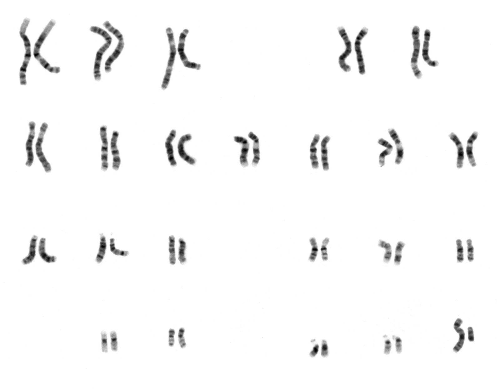
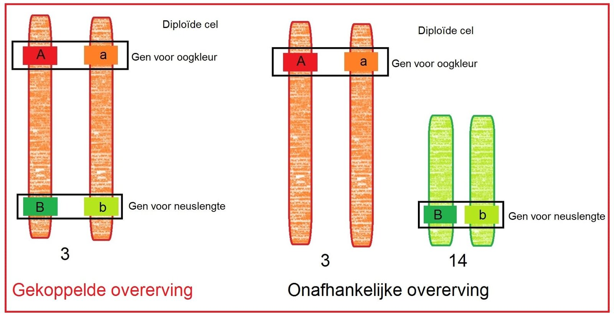

## Genetische eigenschappen

Alle eigenschappen van een mens samen, vormen het **fenotype**. Het fenotype bestaat uit invloeden uit de omgeving (milieu) en het **genotype** (alle erfelijke informatie). Al het DNA van een organisme vormt het **genoom**. Een groot deel van het genoom komt overeen tussen alle mensen.
**Mutaties** door chemische stoffen, straling of andere factoren leiden tot veranderingen in het DNA.  
**Genen** zijn stukjes DNA met de code voor een eiwit. Een variant van een gen noem je een **allel**. Voor het gen van haarkleur heb je dus een allel voor bruin, blond, zwart enz.  
De combinatie van alle allelen op 1 chromosoom is het **haplotype** van dat chromosoom. Dit zijn dus (vrijwel altijd) allelen van verschillende genen, en dus van verschillende eigenschappen.

## Chromosomen

De eerste 22 paren chromosomen zijn de **autosomen**. Binnen deze paren zijn de chromosomen van gelijke vorm en grootte. Het 23e paar bevat de **geslachtschromosomen**. Bij mannen zijn dit een groot X-chromosoom en een klein Y-chromosoom. Bij vrouwen zijn het 2 grote X-chromosomen.
Het Y-chromosoom bevat onder andere het **SRY-gen**: het gen dat verantwoordelijk is voor het vormen van mannelijke geslachtsorganen.

Op een **karyogram** kun je alle chromosomen zien (→ Binas 70B). Zo'n "chromosomenportret" wordt vaak gemaakt tijdens een celdeling. Het **karyotype** beschrijft wat er in het karyogram te zien, dus bijvoorbeeld 46,XY voor het karyogram hieronder.

Genen liggen onregelmatig verspreid over de chromosomen: een aantal grote chromosomen bevat relatief weinig genen in vergelijking met kleine chromosomen.

## Mutaties

In een karyogram is een wijziging in het aantal chromosomen (**genoommutatie**) te constateren, zoals **monosomie** (een chromosoom ontbreekt) of **trisomie** (een chromosoom te veel). Een genoommutatie ontstaat vaak tijdens de meiose.

Een **chromosoommutatie** is een verandering in het erfelijk materiaal, waarbij delen van chromosomen in verschillende paren zijn verwisseld of waarbij een chromosoomdeel naar een ander chromosoom is verplaatst (**translocatie**).

Een **puntmutatie** is een verandering van 1 enkel basenpaar.

## Eigenschappen doorgeven

De twee allelen over dezelfde informatie, maar in een ander chromosoom vormen samen een allelenpaar. De allelen in een allelenpaar kunnen hetzelfde zijn. Een persoon is dan **homozygoot** voor die eigenschap. Als de allelen verschillen zijn, ben je **heterozygoot** voor die eigenschap. Het allel dat altijd tot uiting komt, is **dominant**. Het allel dat alleen tot uiting komt als dat allel 2 keer voorkomt (homozygoot) is **recessief**.  
Een **onvolledig dominant** allel komt deels tot uiting bij een heterozygoot, meestal in een mengvorm. Het fenotype is dan **intermediair** (tussen homozygoot dominant en homozygoot recessief  
Voor het noteren van allelenparen gebruik je hoofdletters voor dominante allelen en kleine letters voor recessieve allelen.[^1]

Om de overerving van een bepaalde eigenschap makkelijk te visualiseren, kun je een **stamboom** gebruiken. Hier worden mannen aangeduid met een vierkant en vrouwen met een cirkel.  
Een **monohybride kruising** is een kruising waarbij je de overerving van 1 gen in kaart brengt. In een **kruisingsschema** kun je bepalen hoe groot de kans is op een bepaald genotype.  
Bij een kruising tussen twee heterozygote ouders (Aa × Aa) is de kans op een homozygoot dominant kind 25%. Voor een heterozygoot dominant kind is dat 50% en voor een homozygoot recessief kind 25%.

Als je kijkt naar overerving van allelen op het X-chromosoom, zijn mannen kwetsbaarder voor recessieve genetische aandoeningen, omdat ze slechts 1 X-chromosoom hebben (als een man een recessief allel heeft dan komt deze altijd tot uiting, omdat hij slechts 1 allel kan hebben, omdat hij slechts 1 X-chromosoom heeft).  
Je noteert een allel op het X-chromosoom als Xa. Als de moeder draagster is (XAXa) en de vader gezond is (XAY), krijgt de helft van hun zonen de ziekte.

Van sommige genen zijn er meerdere allelen: **multipele allelen**. Een voorbeeld hiervan zijn de allelen voor de bloedgroepen: IA, IB en i. IA is dominant over i: mensen met het genotype IAi hebben bloedgroep A. Op dezelfde manier is IB dominant over i: mensen met het genotype IBi hebben bloedgroep B. Mensen met genotype ii hebben bloedgroep O.  
Iemand met zowel IA als IB (genotype IAIB) heeft bloedgroep AB. Beide allelen komen (onafhankelijk van elkaar) tot uiting: ze zijn **codominant**.

**Letale allelen** zijn voor een homozygoot organisme dodelijk.

## Meerdere eigenschappen

Als je bij een kruising kijkt naar meerdere eigenschappen die worden overgeërfd, spreek je van een **dihybride kruising**. Het kan hierbij zowel gaan om 2 eigenschappen die niets met elkaar te maken hebben als 2 eigenschappen die wel met elkaar te maken hebben of die zelfs een rol spelen bij dezelfde eigenschap.

Als de genen op verschillende chromosomen liggen, spreek je van **onafhankelijke overerving**: welk allel van het eerste allelenpaar wordt overgeërfd heeft geen invloed op welk allel van het tweede par wordt overgeërfd.  
Als de genen op hetzelfde chromosoom liggen (dus tot hetzelfde haplotype horen) heeft dit wel invloed.

Veel menselijke eigenschappen komen **polygeen** (onder invloed van veel genen) tot stand, zoals oogkleur, huidskleur of lichaamslengte.

Veel veehouders **fokken** vaak op gunstige eigenschappen, zoals een hoge melkproductie van koeien. Plantenveredelaars gebruiken **klassieke veredeling** om gunstige eigenschappen te combineren. Deze 2 processen zijn erg langzaam.  
Het inbrengen van DNA in een ander organisme heet **genetische modificatie**. Dit is een veel sneller proces, maar wel een stuk moeilijker.  
Als je genetische modificatie uitvoert tussen soorten ontstaan **transgene organismen**.  
Een vorm van genetische modificatie die in de geneeskunde wordt toegepast is **gentherapie**: het inbrengen van een gezond gen om een cel normaal te laten functioneren.

## *Nature* en *nurture*

De precieze invloeden van _**nature**_ (genoom) en _**nurture**_ (milieu) op alle eigenschappen is niet bekend. Tweelingen zijn interessant voor onderzoek binnen de *nature*-*nurture*discussie, omdat hun genoom identiek is (bij eeneiige tweelingen)  en omdat hun milieu (zo goed als) gelijk is.

Vroeger werden kinderen er bij adoptietweelingen van elkaar gescheiden voor onderzoek. Zo'n experiment mag tegenwoordig niet meer. In de **ethiek** zoeken mensen naar criteria voor correct handelen. Deze criteria zijn voor iedereen verschillend.

Onderzoek naar het beïnvloeden van de genactiviteit en het aansturen van allelen noem je **epigenetica**.  
Methylgroepen kunnen zich aan het aan het DNA koppelen waardoor een gen kan worden gedeactiveerd: **methylering**.  
Epigenetische aanpassingen kunnen erfelijk zijn. Ouders geven niet alleen hun DNA door, maar ook een **epigenetische code** die bepaalt hoe dat DNA wordt afgelezen. Hierdoor kunnen omgevingsfactoren en leefstijl invloed hebben op de eigenschappen van volgende generaties.

[^1]:  Gebruik letters waarvan de hoofdletter en de kleine letter een verschillende vorm hebben, dus *a*, *b*, *d*, *e*, *f*, *g*, *h*, *i*, *l*, *n*, *q*, *r* en *t*.
