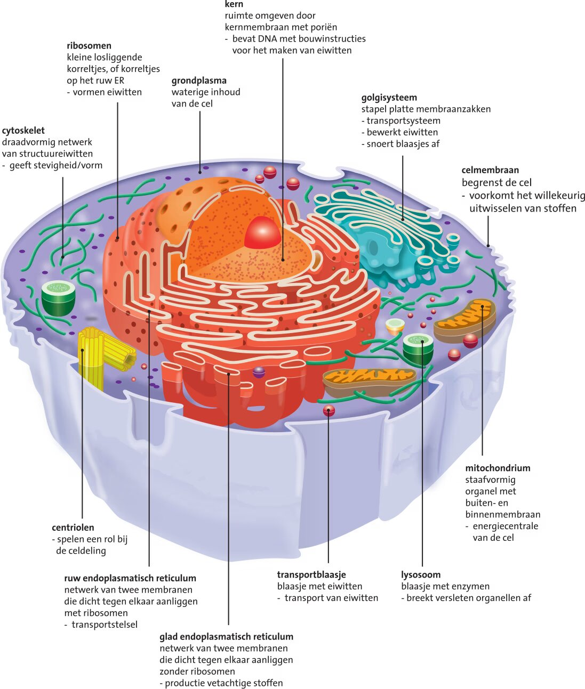
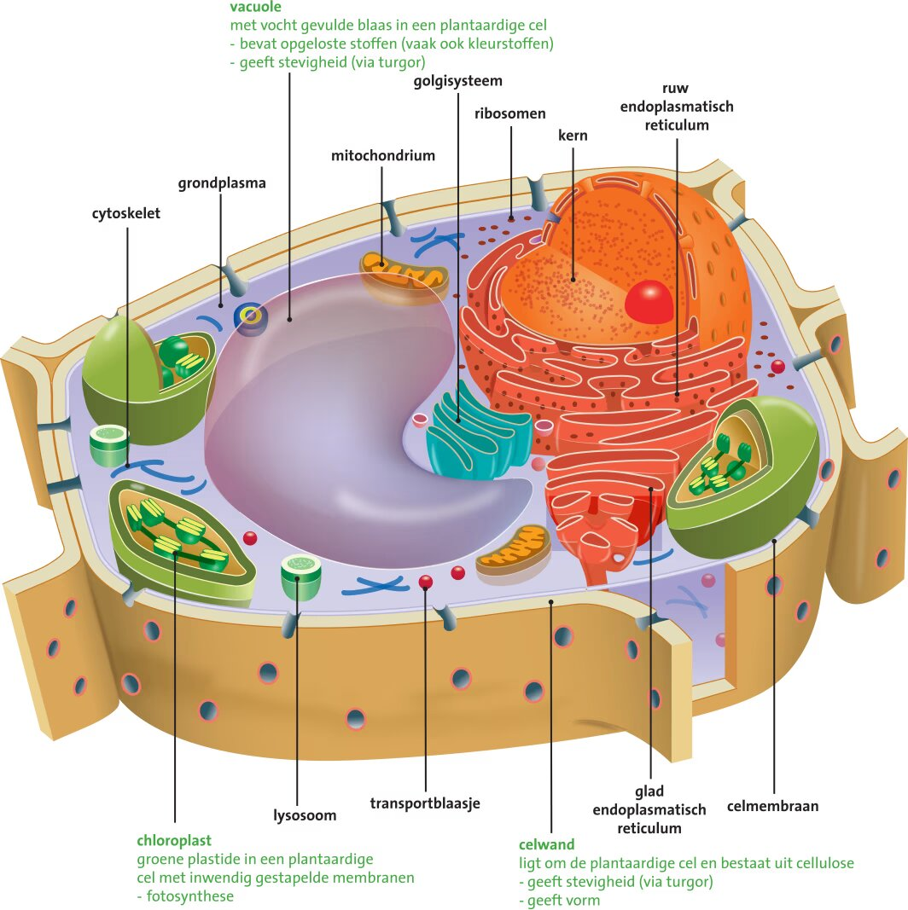
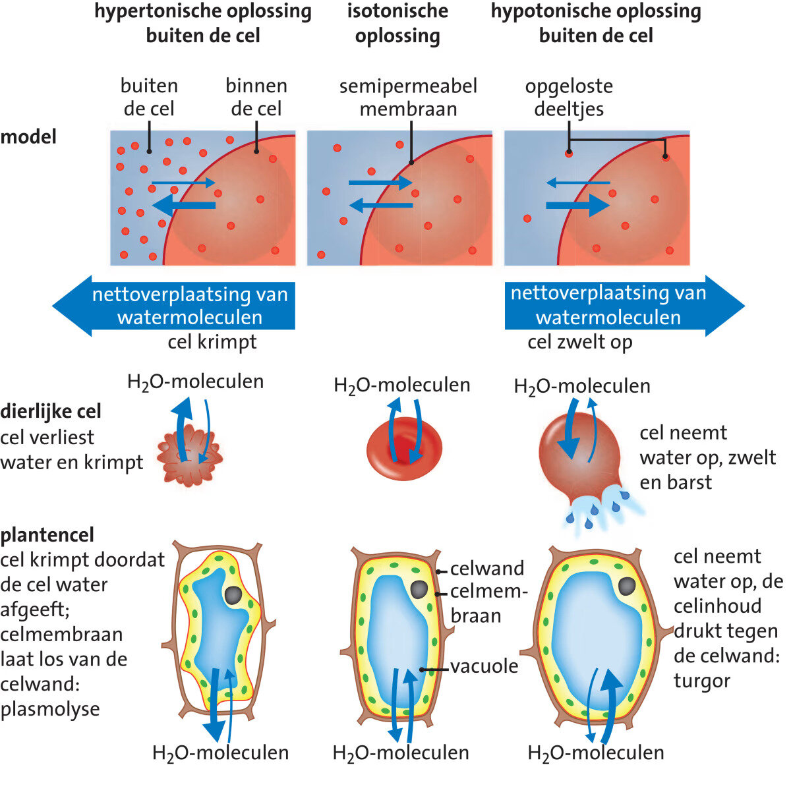

## Leven

### Organisatieniveaus

**Moleculen** zijn de kleinste deeltjes van een stof met nog alle eigenschappen van die stof. Glucose is bijvoorbeeld de brandstof voor je cellen. Om glucose op te nemen hebben veel van je cellen het hormoon **insuline** nodig.

Een **organisatieniveau** is een biologische groep met samenhangende onderdelen. Van klein naar groot zijn de organisatieniveaus:

- **Molecuul**
- **Organel**: onderdeel van een cel
- **Cel**
- **Weefsel**
- **Orgaan**
- **Orgaanstelsel**
- **Organisme**
- **Populatie**: groep organismen van 1 soort in 1 gebied
- **Levensgemeenschap**: alle organismen in een gebied, met hun onderlinge relaties
- **Ecosysteem**: een gebied met de relaties tussen de organismen en hun niet-levende omgeving
- **Systeem Aarde**: alle ecosystemen, chemische en biologische processen en hun onderlinge interacties

Een **emergente eigenschap** is een eigenschap die ontstaat door de interactie tussen losse onderdelen en die pas zichtbaar is op een hoger organisatieniveau.

### Levenskenmerken

Levende organismen hebben alle kenmerken, eigenschappen en processen die typisch zijn voor het leven op aarde: de **levenskenmerken**. Dit zijn beweging, groei en ontwikkeling, voortplanting, stofwisseling, en waarnemen en reageren op prikkels.

**Stamcellen** kunnen zich blijven delen en kunnen zich specialiseren tot een bepaald celtype: **celdifferentiatie**.

Kleine cellen hebben een relatief groot oppervlak ten opzichte van hun inhoud. Bij grotere cellen is dat oppervlak relatief klein, omdat de inhoud (m³) sneller stijgt dan het oppervlak (m²). Een groot oppervlak ten opzichte van de inhoud is gunstig voor de uitwisseling van stoffen.

## Cellen

### Dierlijke cellen

Elke **dierlijke cel** bevat **cytoplasma**: het **grondplasma** met alle **organellen**. Cellen kunnen de volgende organellen bevatten:

- De **celkern** (omgeven door een **kernmembraan**) bevat **DNA-moleculen** met de bouwinstructies voor eiwitten. Cellen met een celkern zijn **eukaryoot**.
- **Ribosomen** bestaan uit eiwitten en rRNA. In ribosomen worden aminozuren aan elkaar gekoppeld tot eiwitten. Ze liggen los in het grondplasma of zijn gebonden aan het ER.
- Het **endoplasmatisch reticulum** (**ER**) is een netwerk van membranen. Het **ruw ER** (met ribosomen) bewerkt en transporteert eiwitten. Het **glad ER** (zonder ribosomen) maakt vetachtige stoffen.
- **Transportblaasjes** vervoeren eiwitten tussen organellen en naar het celmembraan.
- Het **golgisysteem** bestaat uit platte membraanzakken die de eiwitten uit het ER bewerken, sorteren en in transportblaasjes verpakken.
- **Mitochondriën** hebben een sterk geplooid binnenmembraan. Ze maken met glucose en zuurstof de energierijke stof **ATP**.
- **Lysosomen** zijn blaasjes uit het golgisysteem met enzymen die versleten organellen en opgenomen stoffen afbreken.
- Het **cytoskelet** bestaat uit **structuureiwitten** die de cel stevigheid en vorm geven.
- De 2 **centriolen** (samen het **centrosoom**) maken de eiwitdraden voor de celdeling.

### Plantaardige cellen

**Plantaardige cellen** bevatten dezelfde organellen als dierlijke cellen, alleen de centriolen ontbreken. Daarnaast hebben plantaardige cellen:

- Een **celwand** om het celmembraan heen, die de cel stevigheid geeft.
- Een **vacuole**, gevuld met vocht en opgeloste stoffen.
- **Plastiden**: organellen met een eigen membraan. **Chloroplasten** (bladgroenkorrels) bevatten bladgroen voor de fotosynthese. **Chromoplasten** bevatten oranje, rode of gele kleurstoffen. **Amyloplasten** zijn kleurloos en slaan zetmeel op.

### Bacteriën en schimmels

**Bacteriën** zijn **prokaryoot**: ze hebben geen celkern. Een groot, cirkelvormig chromosoom ligt los in het grondplasma. Daarnaast hebben bacteriën kleine DNA-moleculen: **plasmiden**. Deze kunnen ze onderling uitwisselen. Bacteriën hebben een celwand en soms ook een **kapsel**. Sommige bacteriën hebben **flagellen**: lange eiwitdraden waarmee ze zich voortbewegen. Bacteriën die andere organismen aantasten voor hun voedselvoorziening zijn ziekteverwekkers of voedselbedervers.

**Schimmelcellen** lijken erg op dierlijke cellen, maar hebben wel een celwand. De scheiding tussen schimmelcellen is niet altijd even duidelijk, waardoor stoffen makkelijk tussen de cellen uitgewisseld kunnen worden. Sommige schimmels vormen paddenstoelen om zich voort te planten.

### Heterotroof en autotroof

Schimmels, dieren en de meeste bacteriën zijn **heterotroof**: ze halen hun energie uit organische stoffen van andere organismen. Planten en sommige bacteriën zijn **autotroof**: ze maken zelf glucose uit anorganische stoffen, met behulp van energie uit zonlicht.

## Celtransport

### Celmembraan

Cellen en hun omgeving bevatten veel water. Cellen zijn omgeven door een **celmembraan**: een dubbele laag **fosfolipiden**. De koppen van deze moleculen trekken water aan (**hydrofiel** en **polair**) en liggen aan de buitenkanten van het membraan. De staarten zijn **waterafstotend** (**hydrofoob** en **apolair**) en liggen naar binnen, naar elkaar toe. **Cholesterol** in het membraan remt de beweging van de fosfolipiden.

Celmembranen zijn **selectief permeabel**: niet alle stoffen kunnen passeren. Stoffen die goed oplosbaar zijn in water kunnen niet zomaar door het hydrofobe binnendeel van het membraan, en moeten via eiwitpoorten.

### Transport door het membraan

Deeltjes bewegen van een plek met een hoge concentratie naar een plek met een lage concentratie, tot ze gelijkmatig verdeeld zijn: **diffusie**. Is er buiten een cel meer $\ce{O2}$ dan binnen, dan diffundeert zuurstof de cel in. Diffusie is **passief transport**: het kost de cel geen energie.

Er zijn verschillende manieren van transport door het membraan:

- **Diffusie door het membraan**: kleine, ongeladen deeltjes (zoals $\ce{O2}$ en $\ce{CO2}$) en vetoplosbare moleculen kunnen direct door de fosfolipidenlaag.
- **Gefaciliteerd transport**: geladen deeltjes, polaire deeltjes (met een ongelijk verdeelde lading) en andere grote moleculen gaan met behulp van **transporteiwitten** door het membraan, van hoge naar lage concentratie. Elke stof heeft een eigen type eiwitpoort. Dit is ook passief transport.
- **Actief transport**: transporteiwitten vervoeren stoffen tegen het concentratieverschil in. Dit kost energie (ATP).
- **Endocytose**: voor deeltjes die niet door het membraan kunnen, vormt het celmembraan met behulp van **receptoreiwitten** een blaasje van fosfolipiden om het deeltje heen. Het opnemen van grote deeltjes (zoals bacteriën) heet **fagocytose**.
- **Exocytose**: op dezelfde manier kunnen cellen ook stoffen afgeven, doordat een blaasje versmelt met het celmembraan.

### Osmose

Watertransport tussen 2 oplossingen via een **semipermeabel membraan** heet **osmose**. Zo'n membraan laat alleen het oplosmiddel (water) door, niet de opgeloste stoffen. Water stroomt naar de kant met de meeste opgeloste stoffen.

De hoeveelheid opgeloste stoffen bepaalt de **osmotische waarde**: hoe meer opgeloste stoffen en hoe minder oplosmiddel, hoe hoger de osmotische waarde. 2 oplossingen met een gelijke osmotische waarde zijn **isotonisch**. De oplossing met de hogere osmotische waarde is **hypertonisch**, de andere is dan **hypotonisch**.

Is de oplossing buiten een plantencel hypotoon, dan neemt de cel water op en drukt de celinhoud tegen de celwand: **turgor**. Is de oplossing buiten de cel hypertoon, dan verliest de cel water en laat het celmembraan los van de celwand: **plasmolyse**.

### Receptoreiwitten

Celmembranen bevatten ook eiwitten zonder transportfunctie. Deze **receptoreiwitten** geven een boodschap door aan de cel. Hierdoor kan een **cascade** volgen: een reeks reacties die stap voor stap op elkaar volgen.

## DNA

### Bouw

Het DNA bevat alle genetische informatie. DNA is **dubbelstrengs** en heeft de vorm van een **dubbele helix**. De bouwstenen van DNA zijn **nucleotiden**. Elke nucleotide bestaat uit een **fosfaatgroep**, de suiker **desoxyribose** en een **stikstofbase**.

De 4 stikstofbasen zijn adenine (A), cytosine (C), guanine (G) en thymine (T). Door het aantal waterstofbruggen dat ze kunnen vormen, koppelt A altijd met T (2 waterstofbruggen) en C altijd met G (3 waterstofbruggen). Als je de volgorde van 1 streng weet, kun je daaruit dus de **complementaire streng** afleiden. DNA-moleculen zijn opgerold rond eiwitten: **histonen**.

Een stuk DNA met de informatie voor het maken van een eiwit heet een **gen**. Het overgrote deel van het DNA codeert niet voor eiwitten. Bij het kopiëren van DNA gaat weleens iets mis: een **mutatie**.

### Transcriptie

Eiwitten worden gemaakt in ribosomen, maar het DNA kan de celkern niet uit. Daarom wordt er eerst een kopie van een gen gemaakt: **mRNA**. Dit is een enkelstrengs molecuul met de base **uracil** (U) in plaats van thymine.

Voor het maken van mRNA wordt het DNA opengeritst. Het mRNA wordt gemaakt tegenover de niet-coderende streng, zodat het overeenkomt met de **coderende streng**. Het maken van mRNA heet **transcriptie**. Het mRNA gaat daarna via de kernporiën naar een ribosoom.

### Translatie

Na de transcriptie volgt de **translatie**: de vertaling van mRNA naar een eiwit. Ribosomen koppelen **aminozuren** aan elkaar tot een **polypeptideketen**. Hierbij lezen ze het mRNA af in groepjes van 3 basen: **tripletten** (**codons**). Elk codon codeert voor een bepaald aminozuur.

De translatie begint bij het **startcodon** AUG en stopt bij een **stopcodon** (UAA, UAG of UGA). De polypeptideketen wordt daarna in het ER opgevouwen tot een **eiwit**. Het golgisysteem past het eiwit verder aan tot een bruikbaar molecuul en sorteert het.

## Celdeling

### Celcyclus

De meeste cellen leven vrij kort. De periode waarin een cel ontstaat, groeit, actief is en zich opnieuw deelt, is de **celcyclus**. De celcyclus bestaat uit de fasen G1, S, G2 en M. G1, S en G2 vormen samen de **interfase**: de voorbereiding op de celdeling.

- **G1-fase**: de cel groeit en veel genen zijn actief om eiwitten te maken.
- **S-fase**: de DNA-moleculen verdubbelen zich. De dubbele helix wordt opengeritst en vrije nucleotiden koppelen aan beide strengen. Een chromosoom bestaat nu uit 2 identieke **chromatiden**, die met elkaar verbonden zijn in het **centromeer**.
- **G2-fase**: de cel groeit verder en het aantal organellen neemt toe.
- **M-fase**: de celdeling (mitose).

Na de celdeling gaat een cel een nieuwe celcyclus in, of komt de cel in de **G0-fase**, waarin de cel zich niet meer deelt.

### Mitose

Tijdens de **mitose** is het DNA niet actief met het maken van mRNA. De mitose bestaat uit 4 fasen:

1. **Profase**: de DNA-moleculen spiraliseren zich nog strakker om de histonen, waardoor de chromosomen zichtbaar worden. De chromatiden blijven met elkaar verbonden. Eiwitdraden van het cytoskelet vormen de **kernspoel**, met trek- en steundraden. Het kernmembraan valt uiteen.
2. **Metafase**: de chromosomen liggen in het **equatorvlak** (het midden van de cel). De trekdraden lopen van de polen naar de centromeren.
3. **Anafase**: de chromatiden van elk chromosoom gaan uit elkaar. De trekdraden trekken ze als zelfstandige chromosomen naar de polen van de cel.
4. **Telofase**: er ontstaan 2 nieuwe kernmembranen en de chromosomen despiraliseren.

Na de telofase deelt de cel zich daadwerkelijk. Bij dierlijke cellen snoert het celmembraan in. Bij plantaardige cellen versmelten blaasjes uit het ER en het golgisysteem tot een scheidingswand, die later de nieuwe celwand wordt.

### Controle en kanker

Tijdens de celcyclus controleert de cel op 3 momenten of alles goed verloopt:

- In de **G1-fase** controleert het eiwit **p53** het DNA op schade. Dit eiwit wordt gemaakt met informatie van een **tumorsuppressorgen**. Is een fout niet op te lossen, dan start p53 **apoptose**: geprogrammeerde celdood.
- In de **G2-fase** wordt gecontroleerd of de DNA-verdubbeling goed is verlopen.
- In de **M-fase** wordt de kernspoel gecontroleerd.

Ongecontroleerde celdeling kan leiden tot een **tumor**. **Kanker** is een kwaadaardige tumor die zich kan uitzaaien door het lichaam. Kanker kan bestreden worden met chirurgie, bestraling en chemotherapie.
