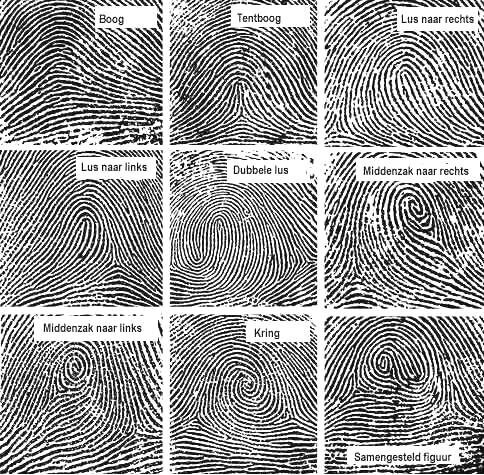
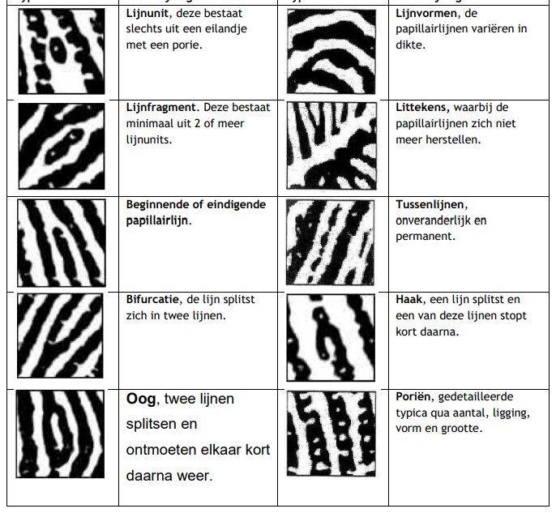
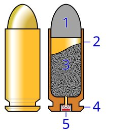
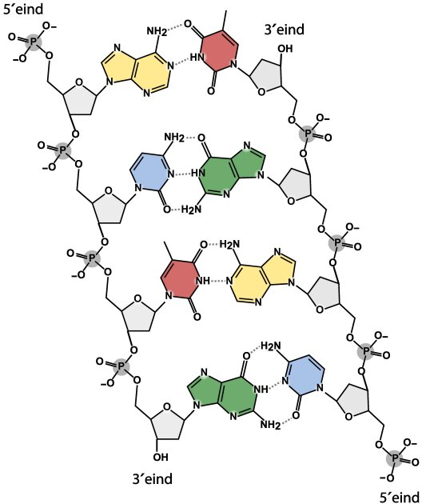
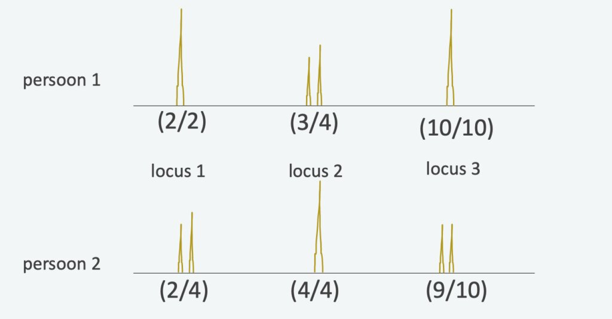
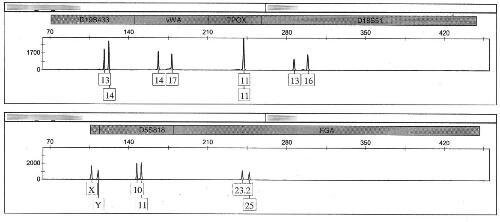

## Onderzoek doen

Een onderzoek bestaat o.a. uit het formuleren van een **onderzoeksvraag** en een **hypothese**. Een onderzoeksvraag is een algemene vraag waar het onderzoek antwoord op geeft. Een hypothese is een bewering waarvan in het onderzoek wordt vastgesteld of deze juist is of onjuist.  
Je spreekt van **tunnelvisie** als een onderzoek iets wil vinden, en andere details niet meeneemt in het onderzoek.

## Vingersporen

De bovenste laag van de huid (de opperhuid) bevat **poriën**. Deze zitten in **papillairlijnen**. Als je een voorwerp aanraakt, laat je een beetje zweet achter in het patroon van de papillairlijnen. Dit patroon is voor iedereen uniek. Als het water verdampt uit het zweet, blijft een **vingerspoor** achter.  
Het patroon van een vingerafdruk is (vaak) te herkennen aan de **kern** en de **delta**. De kern is het middelpunt van een patroon, en de delta is een punt waar papillairlijnen uit 3 richtingen samenkomen. Deze ligt vaak onder de kern.  
Hieronder zie je de **hoofdpatronen**. Deze worden bepaald door de plaats van de kern en delta.

Om vingerafdrukken volledig te onderscheiden kijk je naar kleine details: **typica**.

## Bodemonderzoek

De **geleidbaarheid** (**G**) duidt hoe goed een voorwerp elektrische stroom geleidt. Een grote geleidbaarheid betekent dus een goede geleider (en een kleine weerstand). De geleidbaarheid is dus het omgekeerde van de weerstand:

$$G = \frac{1}{R}$$

Hierin is $G$ de geleidbaarheid (in $\mathrm{S}$) en $R$ de weerstand (in $\Omega$).

De soortelijke geleidbaarheid (σ) is een stofeigenschap. Deze soortelijke geleidbaarheid hangt af van de **zuurgraad** (pH), de **zoutconcentratie** en de aanwezigheid van **klei**. Je kunt met deze eigenschap dus verschillende bodems met elkaar vergelijken.

$$G = \sigma \cdot \frac{A}{l}$$

Hierin is $G$ de geleidbaarheid (in $\mathrm{S}$), $\sigma$ de soortelijke geleidbaarheid (in $\mathrm{S}/\mathrm{m}$), $A$ de oppervlakte van de dwarsdoorsnede (in $\mathrm{m}^2$) en $l$ de lengte (in $\mathrm{m}$).

## Verhoormethoden

Er zijn verschillende **verhoormethoden** om een verdachte dingen te laten verklaren. Bij de **tactische verhoormethode** wordt de verdachte geconfronteerd met veel bewijzen. Bij **neurolinguistisch programmeren (NLP)** gaat de verhoorder mee in het gedrag van de verdachte om deze op zijn gemak te stellen. Bij het **maximaliseren of minimaliseren van schuld** wordt het delict groter of kleiner gemaakt om de verdachte te laten bekennen. Bij de **overrompelingsstrategie** gaat het om het beschuldigen van de verdachte als de dader zodat hij bekent. Bij de **murwmakende strategie** gaat het om het uitputten van de verdachte door veel te praten over zijn eigen leven. Bij een **confrontatie met visuele informatie** laat de politie beeldmateriaal zien om de verdachte te confronteren.

## Chromatografie

**Mengsels** kun je scheiden door gebruik te maken van de verschillen in stofeigenschappen. Bij **papierchromatografie** maak je gebruik van een loopvloeistof en chromatografiepapier. De loopvloeistof (**mobiele fase**) wordt omhoog gezogen in het papier (**stationaire fase**). Hoe beter een stof oplost in de loopvloeistof, hoe beter deze wordt meegenomen. Hoe slechter een stof hecht aan het papier, hoe beter deze wordt meegenomen.

## Ballistiek

Een **patroon** bevat alle onderdelen die nodig zijn om een kogel af te vuren: een **kogel** (1), een **huls** (2), **kruit** (3), een **rand** (4) en een **slaghoedje** (5). Als je de **trekker** overhaalt beweegt de **slagpin** tegen het slaghoedje. Het slaghoedje explodeert, waarna het kruit gaat ontbranden. Hierbij ontstaat veel gas, waardoor de kogel uit de loop wordt geduwd.

Bijna alle vuurwapens hebben een **getrokken loop**. Dit is een spiraal, bestaande uit **trekken** (lage delen) en **velden** (hoge delen). Hierdoor gaat de kogel draaien. De krassen die de trekken en velden achterlaten zijn redelijk uniek voor elk vuurwapen. Hierdoor kun je een kogel koppelen aan een wapen. De slagpin bevat codes die op het slaghoedje worden geslagen. Hierdoor kan een huls ook gekoppeld worden aan een wapen.  
Bij het afvuren van het patroon wordt chemische energie omgezet in kinetische energie:

$$E_\mathrm{kin} = \frac{1}{2} \cdot m \cdot v^2$$

Hierin is $E_\mathrm{kin}$ de kinetische energie (in $\mathrm{J}$), $m$ de massa (in $\mathrm{kg}$) en $v$ de snelheid (in $\mathrm{m}/\mathrm{s}$). Voor de toename van de kinetische energie geldt:

$$\Delta E_\mathrm{kin} = W = F_\mathrm{res} \cdot s$$

Hierin is $W$ de arbeid (in $\mathrm{J}$), $F_\mathrm{res}$ de resulterende kracht (in $\mathrm{N}$) en $s$ de afstand (in $\mathrm{m}$).

Als de kogel door de lucht vliegt, verliest deze weer energie door de luchtweerstand:

$$\Delta E_\mathrm{kin} = -F_\mathrm{w,l} \cdot s \qquad F_\mathrm{w,l} = \frac{1}{2} \cdot c_\mathrm{w} \cdot A \cdot \rho \cdot v^2$$

Hierin is $F_\mathrm{w,l}$ de luchtweerstandskracht (in $\mathrm{N}$), $c_\mathrm{w}$ de weerstandscoëfficiënt (zonder eenheid), $A$ het frontaal oppervlak (in $\mathrm{m}^2$), $\rho$ de dichtheid van de lucht (in $\mathrm{kg}/\mathrm{m}^3$) en $v$ de snelheid (in $\mathrm{m}/\mathrm{s}$).

De mate van vervorming door de inslag van een kogel kun je berekenen. Je gebruikt hierbij de vervormingsconstante.

## Bloed

Bloed is een mengsel van **bloedplasma**, **rode bloedcellen**, **witte bloedcellen** en **bloedplaatjes**.  
De rode bloedcellen vervoeren zuurstof door de aanwezigheid van het eiwit **hemoglobine**. Dit eiwit heeft een **ijzerion** waar een zuurstofmolecuul zich aan kan binden. Rode bloedcellen bevatten geen celkern en dus geen **DNA**.  
Bloedplasma bestaat voornamelijk uit water, eiwitten en andere opgeloste stoffen. De witte bloedcellen zijn erg belangrijk voor je immuunsysteem. De bloedplaatjes zijn belangrijk voor het stollen van je bloed.  
Om bloedsporen met het oog zichtbaar te maken kun je gebruik maken van **chemoluminescentie**. Dit zijn scheikunde reacties waarbij licht vrijkomt. Dit licht kun je gebruiken om te laten zien dat zo'n reactie plaatsvindt en als maat voor de reactiesnelheid.  
Een bekende vorm is de reactie van **luminol** met **waterstofperoxide** in een **basische omgeving**. Deze reactie gaat erg langzaam, maar kan sneller gaan met een **katalysator**. IJzerionen zijn hier een voorbeeld van. Deze zitten dus in rode bloedcellen.  
Rode bloedcellen zijn niet de enige stoffen die luminol sneller laten reageren: ook roest, koperionen, bleek en uitwerpselen doen dit. Een ander nadeel is het feit dat luminol DNA kan beschadigen.

## DNA

**Desoxyribonucleïnezuur** (**DNA**) bevat alle erfelijke eigenschappen van een organisme. Ons DNA bestaat uit meer dan 3 miljard basenparen, verdeeld over 46 **chromosomen** (23 paren).  
Je ouders hebben beide de helft van hun eigen DNA gegeven. DNA bestaat uit 2 lange ketens van **suiker-** en **fosfaatgroepen** in een **dubbele helix**. Aan iedere suikergroep zit een **nucleobase**. De twee ketens worden bij elkaar gehouden door de (niet erg sterke) **waterstofbrug**.  
Het DNA heeft 2 richtingen: 3' en 5'. Deze liggen tegenover elkaar: als de ene DNA-streng naar boven ligt in de 3'-richting, ligt de andere streng naar boven in de 5'-richting.  
Slechts een klein deel van het DNA wordt gebruikt voor de erfelijke eigenschappen (**wel-coderend**). De rest van het DNA is **niet-coderend** (ruim 98%).

Op sommige **loci** (plaatsen) staan **short tandem repeats** (**STRs**). Deze stukjes code herhalen zich een aantal keren. Omdat het aantal herhalingen kan verschillen, heten ze **hypervariabele gebieden**.  
Om een **DNA-profiel** te maken gebruik je het aantal herhalingen van maximaal 27 STRs. De plaats van een STR geef je aan met een code. Ieder persoon heeft een relijk uniek aantal van deze herhalingen. Een DNA-profiel bestaat dus alleen uit deze STRs, en niet uit alle basenbaren van alle chromosomen.  
Om een DNA-profiel te maken heb je veel DNA nodig. Daarom gebruiken we een **polymerasekettingreactie** (**PCR**) en **gelelektroforese**.

De PCR bestaat uit een aantal stappen. Het DNA wordt eerst verhit, zodat er 2 losse ketens ontstaan. Vervolgens hechten 2 primers zich aan de losse DNA-ketens. Een polymerase-enzym verlengt de primers vervolgens. Hierdoor ontstaan 2 nieuwe volledige DNA-moleculen. Dit proces wordt herhaald met deze 2 moleculen. Er ontstaan nu dus 4 volledige moleculen. Al deze 4 moleculen worden ook gedupliceerd, waardoor er 8 moleculen ontstaan. Je hebt dus na **n** cycli **2n** DNA-strengen. Na 40 cycli heb je dus al meer dan een biljoen stukken DNA.  
Om vervolgens te bepalen hoeveel herhalingen er precies aanwezig zijn, worden de DNA-fragmenten in een **gel** geplaatst (gelelektroforese). Vervolgens wordt een elektrisch veld aangelegd, waardoor de DNA-fragmenten door de gel gaan bewegen, want deze fragmenten zijn negatief geladen. Hoe lichter de fragmenten zijn, hoe verder ze bewegen.  
De uitkomst van deze gelekektroforese is een DNA-profiel met pieken bij de verschillende loci.

Hieruit kun je vervolgens een DNA-profiel vaststellen. Je noteert dit met eerst het lage aantal herhalingen, daarna het hoge aantal. Deze verschillende aantallen komen van de 2 chromosomen. Als je maar 1 piekje ziet, hebben beide chromosomen hetzelfde aantal herhalingen.  
Als je niet van alle 27 STRs data hebt, spreek je van een **onvolledig DNA-profiel**.  
Als er van meerdere personen DNA gekopieerd wordt, spreek je van een **DNA-mengprofiel**. Het **hoofdprofiel** is dan van de persoon met het meeste bijgedragen DNA en het **nevenprofiel** is dan van de persoon die het minste heeft bijgedragen. Je kunt deze profielen onderscheiden door te kijken naar de hoogtes van de pieken.

## Getallen en data

In ons dagelijkse leven gebruiken we **decimale getallen**. Iedere positie heeft een bepaalde waarde (machten van 10), en op elke positie staat een getal van 0 t/m 9\.  
Computers gebruiken binaire getallen, met slechts 2 opties per positie: 0 en 1\. Elke positie heeft een macht van 2 als waarde. Het binaire getal 100101 is dus 1 \* 20 \+ 1 \* 22 \+ 1 \* 25 \= 37\.  
Het aantal binaire getallen is het aantal **bits**. Met n bits kun je 2n aantal getallen maken. Het grootste getal dat je kunt maken is 2n \- 1\.  
Binaire getallen komen vaak voor in lange reeksen. Deze delen we op in **stukjes van 4 bits** (**nibbles**). Er zijn 16 verschillende nibbles mogelijk. Om deze makkelijk weer te geven gebruiken we **hexadecimale getallen**. Iedere positie heeft een macht van 16 als waarde. We gebruiken de getallen 0 t/m F. Het hexadecimale getal 3a5f is dus 1494310\.  
Op digitale apparaten wordt de grootte van een bestand vaak in **bytes** gegeven. Dit is gelijk aan 8 bits.  
De **hash-value** van een bestand is een digitale vingerafdruk en wordt gemaakt met een algoritme. Het is niet mogelijk om van een hash-value het originele bestand te reconstrueren. Daarom zijn deze waardes handig voor het vergelijken van bestanden.
