## Alkanen

**Koolwaterstoffen** zijn stoffen waarvan de moleculen alleen bestaan uit koolstof en waterstof. De simpelste koolwaterstoffen zijn de **alkanen**. Deze stoffen voldoen aan de formule $\ce{C_{n}H_{2n+2}}$. Alkanen hebben **geen dubbele bindingen**: het zijn **verzadigde koolwaterstoffen**.  
Het simpelste alkaan is methaan ($\ce{CH4}$). Daarna komen ethaan ($\ce{C2H6}$), propaan ($\ce{C3H8}$), enz. Vanaf pentaan zijn alkanen bij kamertemperatuur vloeibaar. De voorvoegsels van deze stoffen zijn meth-, eth-, prop-, but-, pent-, hex-, hept-, oct-, non- en dec-. Omdat deze stoffen geen dubbele bindingen hebben, krijgen ze het achtervoegsel **\-aan**.  
Omdat je aan de molecuulformule niet altijd kunt zien hoe de structuur van een stof eruitziet, gebruik je de **systematische naam** van een stof. **Als 2 stoffen dezelfde systematische naam hebben, zijn ze daadwerkelijk dezelfde stof.** 2 stoffen met dezelfde molecuulformule, maar met verschillende systematische namen zijn **isomeren**, zoals de eerste 2 stoffen hieronder (allebei $\ce{C4H10}$).  
Bij het maken van de systematische naam zoek je eerst naar de **langste koolstofketen**. Bij de derde stof hieronder is dat 3\. Dit hoort bij de stof **propaan** (Binas 66D). Deze koolwaterstof bevat geen dubbele bindingen. De stamnaam is dus **propaan**. Er zit een fluoratoom op het 2e koolstofatoom. De naam van deze stof is 2-fluorpropaan.

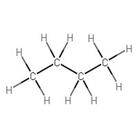 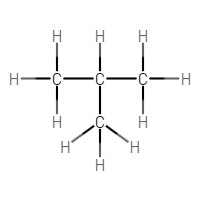 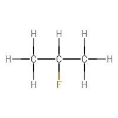

De 2 stoffen hieronder hebben allebei de naam 1-broombutaan. Dit zijn dus dezelfde stoffen. Je moet altijd tellen in de richting die de laagste nummers geeft. De eerste stof is dus niet 4-broombutaan.

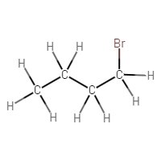 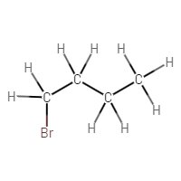

In de stof hieronder heb je 2 chlooratomen op posities 2 en 3\. De stamnaam is butaan. Omdat je 2 chlooratomen hebt, spreek je van dichloor. De naam van deze stof is dus 2,3-dichloorbutaan.

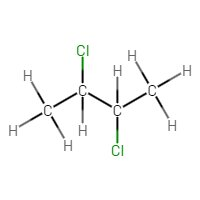

Als je verschillende halogenen hebt, schrijf je ze in alfabetische volgorde.  
De eerste stof hieronder is dus 4-broom-1,5-dichloorhexaan en **niet** 1,5-dichloor-4-broomhexaan.  
Een zijgroep van 1 koolstofatoom buiten de hoofdketen (een $\ce{CH3}$-groep) heet een **methylgroep**. Deze zet je, net als de halogenen, voor de stamnaam. De tweede stof hieronder is dus 3-methylheptaan.  
Bij de derde stof hieronder kun je op meerdere manieren een langste koolstofketen tellen. Het maakt echter niet uit welke methode je kiest, want je komt alsnog op dezelfde systematische naam uit (2,2-dimethylbutaan).

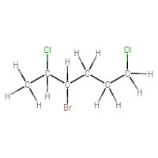 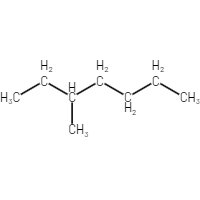 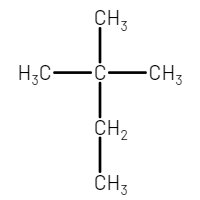

Een zijgroep met 2 koolstofatomen heet **ethyl**. Een zijgroep met 3 koolstofatomen heet **propyl**.

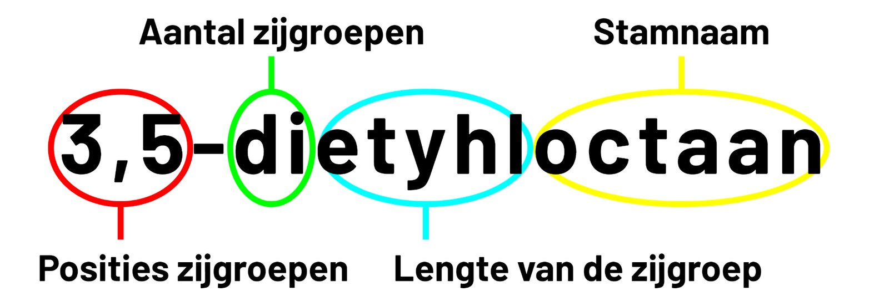

## Alkenen

**Alkenen** zijn **onverzadigde koolwaterstoffen**: ze hebben ergens in de hoofdketen een dubbele C=C binding. Alkenen gebruiken dezelfde voorvoegsels (eth-, prop-, but-, ...) met het achtervoegsel **\-een**. Het simpelste alkeen is etheen (metheen bestaat niet). Dit is de eerste stof hieronder. Met een nummer geef je aan bij welk koolstofatoom de dubbele binding begint. Bij etheen en propeen hoeft dit niet, omdat er maar 1 plek is waar de dubbele binding kan zitten. Vanaf buteen moet dat wel. De tweede stof is **but-1-een**. De derde stof is **but-2-een**.  
Als je meerdere dubbele bindingen hebt, zet je di-, tri-, ... voor de \-een en komt er een a achter de stamnaam. De vierde stof is dus octa-2,3,6-trieen (of octa-2,3,6-triëen). Bij de laatste stof tel je zo dat de zijgroepen de laagste nummers krijgen, want de dubbele bindingen krijgen in beide richtingen dezelfde nummers. Deze stof heet dus 7-ethyl-4,5-dimethyldeca-2,5,8-trieen.

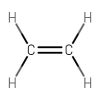 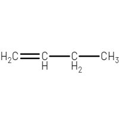 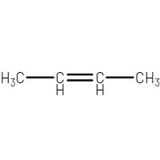

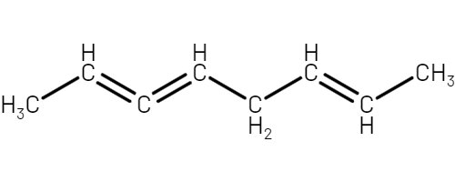 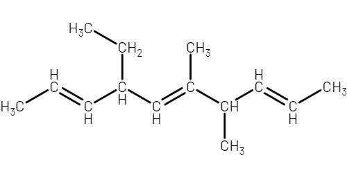

Alkenen met 1 dubbele binding voldoen aan de formule $\ce{C_{n}H_{2n}}$. Elke extra dubbele binding zorgt voor 2 waterstofatomen minder.  
Koolwaterstoffen met een drievoudige binding (**alkynen**) krijgen niet het achtervoegsel \-een maar \-yn. Ook bij deze stoffen geef je de plaats van de binding aan.

## Alcoholen en aminen

**Alcoholen** zijn stoffen met een **hydroxylgroep**: een zuurstofatoom met een waterstofatoom (-OH).  
Alcoholen krijgen het **achtervoegsel** \-ol. Je zet de positie van de OH-groep voor dit achtervoegsel. De simpelste alcohol is **methanol**. Daarna komt **ethanol**. Bij deze twee hoef je geen nummer te geven, omdat de OH-groep maar op 1 plek kan zitten. Als mensen het hebben over alcohol, bedoelen ze ethanol. Daarna komen **propaan-1-ol** en **propaan-2-ol**.  
De eerste stof hieronder is dus **butaan-1,2,3-triol**. Bij de tweede stof tel je zo dat de OH-groepen de laagste nummers krijgen. Deze stof heet dus **hexa-2,5-dieen-2,3-diol**.  
**Aminen** zijn stoffen met een **aminogroep**: een stikstofatoom met 2 waterstofatomen ($\ce{-NH2}$). Deze stoffen krijgen het achtervoegsel \-amine. De derde stof hieronder is dus propaan-1-amine.

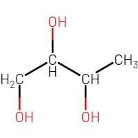 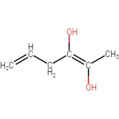 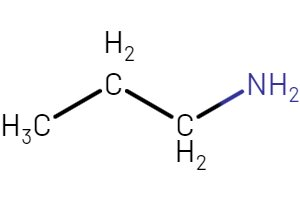

## Cycloverbindingen

Koolstofketens die een ring vormen krijgen het voorvoegsel **cyclo-**. De eerste stof hieronder (de vijfhoek) heet dus **cyclopentaan**. De tweede stof (de zeshoek) heet **cyclohexaan**. Let op\! Een ring van 6 koolstofatomen met 3 dubbele bindingen heet **benzeen** (triviale naam, de derde stof).

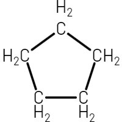 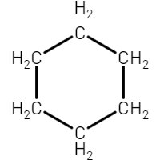 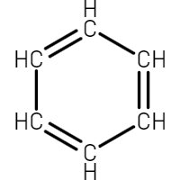

Als er zijgroepen aan de ring zitten, blijft cyclo- in de stamnaam staan. De stof hieronder heet dus 1-ethyl-2-methylcyclopentaan.

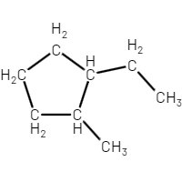

Omdat de dubbele bindingen in benzeen heen en weer kunnen springen, teken je soms een cirkel in het midden. Moleculen met een benzeenring noem je **aromaten**. Als je een benzeenring als zijgroep hebt, gebruik je het voorvoegsel fenyl-.

## Chemische reacties met koolstofverbindingen

Er zijn 3 koolstofchemische reacties die je moet kennen:

1. **Kraken** (kapotmaken)  
2. **Additie** (toevoegen)  
3. **Substitutie** (verwisselen)

**Kraken** gebeurt vooral met de lange alkanen uit aardolie. Bij het kraken verwarm je deze moleculen in een zuurstofvrije omgeving (zodat er geen verbranding plaatsvindt).  
Hierdoor gaan (sommige) atoombindingen kapot. Er ontstaan heel veel verschillende kleinere koolwaterstoffen, zoals alkanen en alkenen. Omdat je zoveel verschillende reactieproducten krijgt, moet je deze nog scheiden om de stoffen goed te kunnen gebruiken.  
Hiervoor gebruik je destillatie, want bij koolwaterstoffen kun je uitgaan van de vuistregel: **hoe groter het molecuul, hoe hoger het kookpunt**.  
De verschillende mengsels die je bij de destillatie opvangt heten **fracties**.  
Kraken vindt plaats in grote chemische fabrieken. Om de verschillende stofstromen duidelijk te maken kun je een **blokschema** maken. Een chemisch proces kan continu uitgevoerd worden (**continuproces**) of in losse porties (**batchproces**).

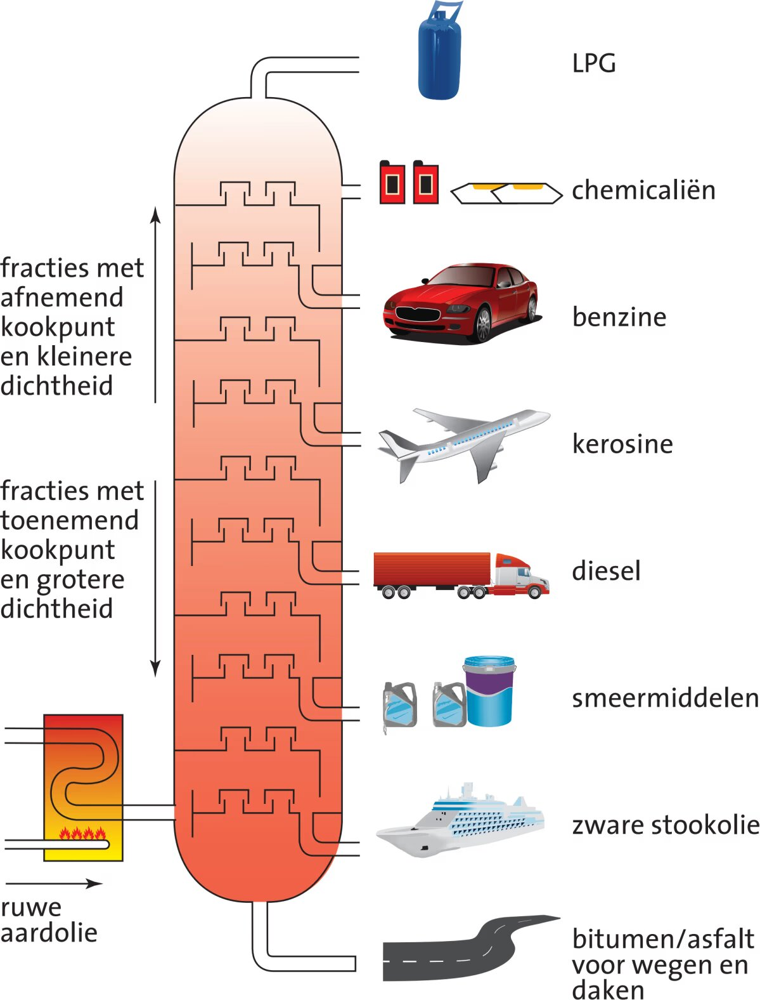

Voor **addities** heb je 2 dingen nodig:

1. Een stof met een dubbele C=C binding, zoals een **alkeen**  
2. Een halogeen, waterstofhalogeen, water of waterstof

Bij een additie klapt 1 binding van de dubbele binding open, en de additiestoffen binden hieraan. Als er meerdere mogelijkheden zijn voor de uitkomsten van de additie (de verschillende uitkomsten zijn dus isomeren), moet je alle mogelijkheden opschrijven. Let dan wel op het kloppend maken\!

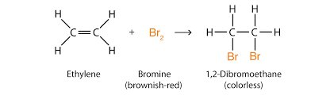

Voor **substitutie** heb je 3 dingen nodig:

1. Een alkaan  
2. Een halogeen  
3. Licht

1 van de waterstofatomen wordt verwisseld met 1 van de halogeenatomen. Na de pijl ontstaat dus een halogeenalkaan en een waterstofhalogeen.  
Voor elk waterstofatoom dat je wilt verwisselen, heb je 1 halogeen**molecuul** nodig.

## Milieueffecten

Plantenresten in de bodem zijn bij hoge temperatuur en onder hoge druk omgezet in **fossiele brandstoffen**. Brandstoffen die gemaakt zijn uit **biomassa** (plantaardig materiaal) heten **biobrandstoffen**. Biobrandstoffen hebben een netto CO₂-uitstoot van 0\.  
Fossiele brandstoffen zijn miljoenen jaren geleden gevormd. De planten waaruit ze zijn ontstaan namen tijdens hun leven koolstofdioxide op door fotosynthese (koolstofdioxide en water worden glucose en zuurstof). Dit is de **trage koolstofkringloop**. Omdat we deze brandstoffen nu in korte tijd verbranden, komt er extra koolstofdioxide in de atmosfeer.  
Bij het gebruik van biomassa is de tijd tussen de opname van koolstofdioxide en de verbranding kort, waardoor de hoeveelheid koolstofdioxide in de atmosfeer niet verandert (**snelle koolstofkringloop**).

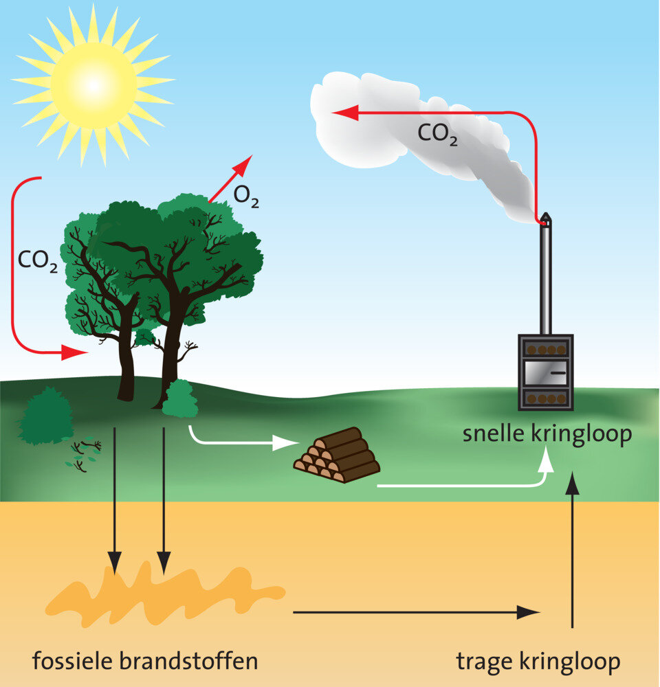

Door de toegenomen hoeveelheid koolstofdioxide in de lucht hebben we te maken met het **versterkt broeikaseffect**. Hierdoor verandert het klimaat.  
Door de uitstoot van zwaveldioxide ($\ce{SO2}$) ontstaat zwavelzuur. Door de uitstoot van stikstofoxiden ($\ce{NO_{x}}$) ontstaat salpeterzuur. Deze 2 stoffen zorgen voor **zure regen**. Hierdoor kunnen ecosystemen worden aangetast.  
Andere gevolgen voor het milieu zijn **smog** (luchtverontreiniging) en aantasting van de ozonlaag.
