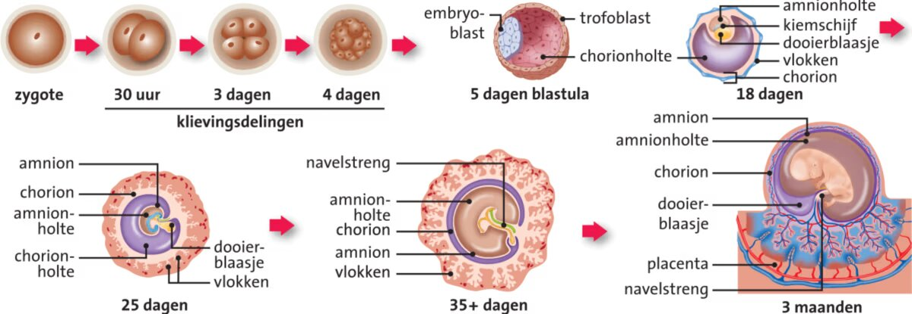
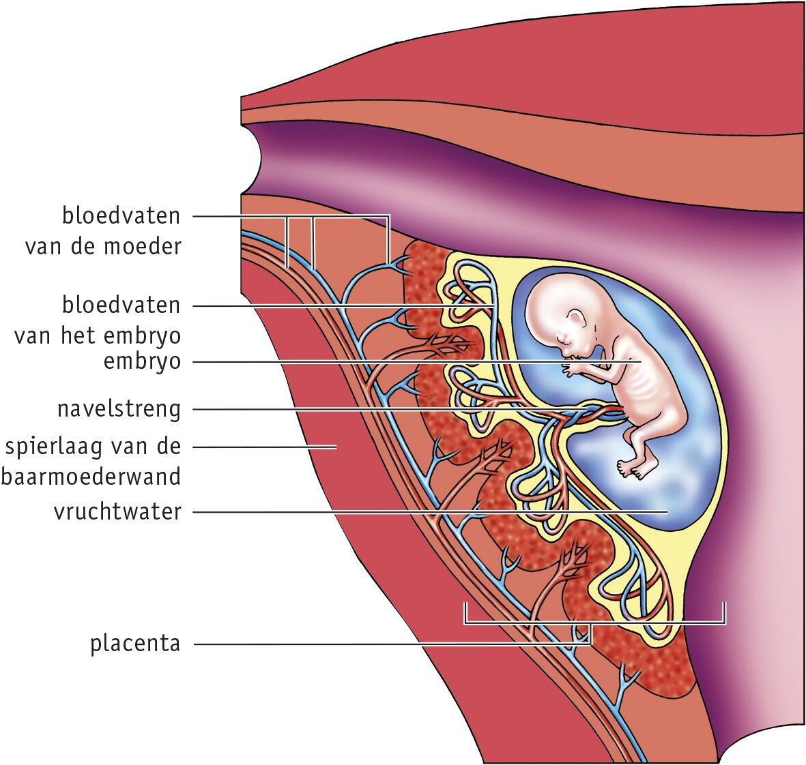
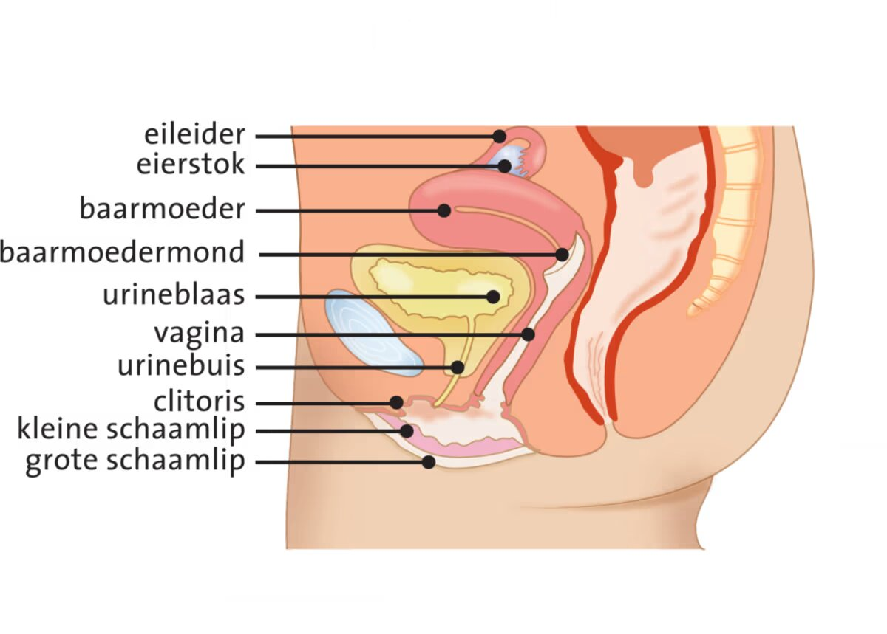
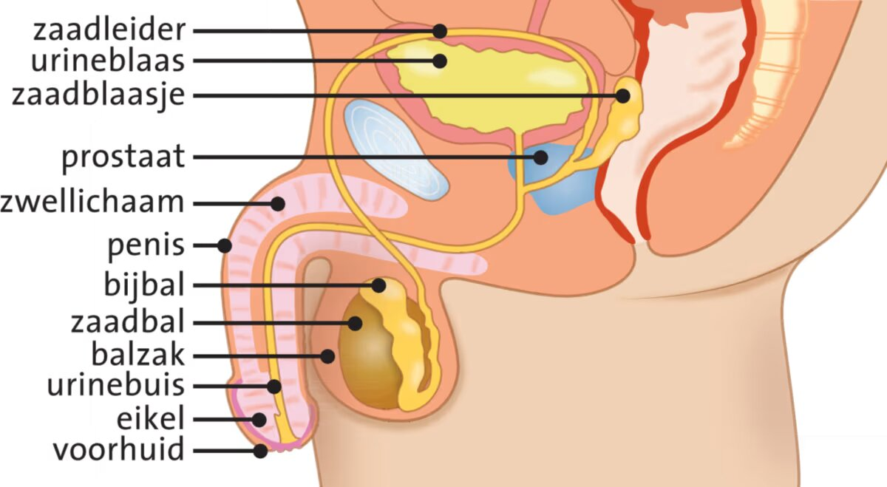
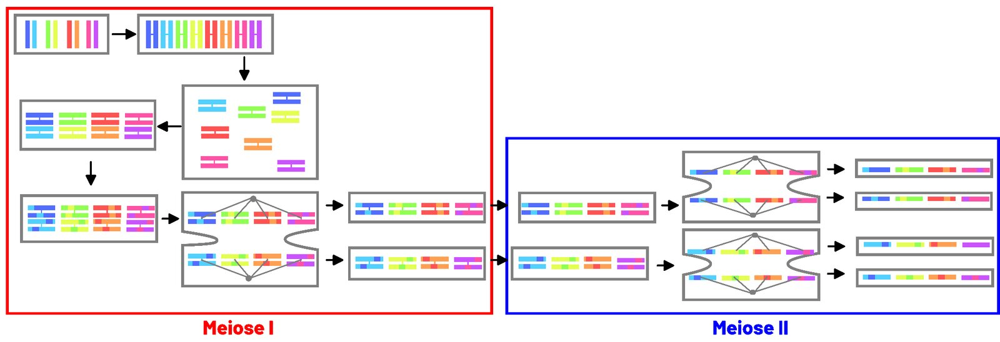
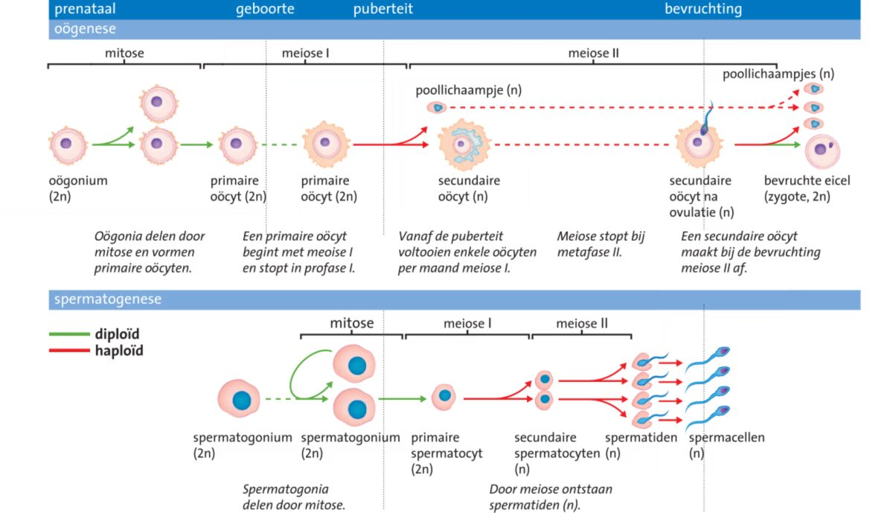

## Bevruchting

In de eierstokken (**ovaria**) van een vrouw rijpt elke maand een eicel. Na de **ovulatie** (eisprong) komt de eicel in de **eileider** terecht, waar de bevruchting kan plaatsvinden.

Bij een bevruchting dringen spermacellen door de laag **follikelcellen** rond de eicel. De eerste spermacel die het celmembraan van de eicel bereikt, versmelt met de eicel, waarna de kern van de spermacel versmelt met de kern van de eicel. Daarna wordt de eicel ondoordringbaar voor andere spermacellen: er ontstaat een **bevruchtingsmembraan**. De bevruchte eicel heet een **zygote**. *Zie Binas 86E.*

### Embryonale ontwikkeling

De zygote deelt zich een aantal keer door mitose: de **klievingsdelingen**. Na ongeveer 5 dagen is het klompje cellen een holle bol: de **blastula**. De blastula nestelt zich in het baarmoederslijmvlies (**innesteling**). Uit de buitenste cellaag van de blastula (de **trofoblast**) groeien **vlokken** het baarmoederslijmvlies in. Deze vlokken zorgen voor de opname van zuurstof en voedingsstoffen.

De **embryoblast** is het groepje stamcellen binnenin de blastula waaruit alle celtypen van het **embryo** ontstaan. Het embryo begint als een platte **kiemschijf**.

Rond de kiemschijf ontstaan 2 vliezen: het **amnion** (uit het **amnionblaasje**) en het **chorion** (uit de trofoblast). Het amnion omringt het **vruchtwater**, dat het embryo beschermt.

Na 8 weken heet het embryo een **foetus**.

### Placenta

Het embryo neemt voedingsstoffen en zuurstof op en geeft afvalstoffen af via de **placenta**. Hierin liggen de bloedvaten van de moeder en die van het kind dicht bij elkaar, waardoor stoffen kunnen worden uitgewisseld. De **navelstreng** verbindt het embryo met de placenta. *Zie Binas 84B en 86E.*

De bloedsomlopen van de moeder en het kind zijn van elkaar gescheiden: het bloed mengt niet. Toch kunnen schadelijke stoffen uit het bloed van de moeder (zoals alcohol, nicotine en sommige medicijnen) via de placenta in de bloedsomloop van het kind komen.

## Geslachtsorganen

De aanwezigheid van een **Y-chromosoom** bepaalt welke geslachtsorganen er ontstaan. Embryo's met een X- en een Y-chromosoom ontwikkelen zich vrijwel altijd tot man: er ontstaan **testes** (teelballen). Zonder Y-chromosoom ontstaan er ovaria. *Zie Binas 86A en 86B.*

### Vrouwelijke geslachtsorganen

Bij vrouwen rijpt in de ovaria elke maand (van de **puberteit** tot de **overgang**) een eicel, die vrijkomt bij de ovulatie. De eicel kan in de eileider worden bevrucht, waarna de bevruchte eicel naar de baarmoeder wordt vervoerd.

De **baarmoeder** is bekleed met slijmvlies dat elke maand aangroeit ter voorbereiding op een zwangerschap. Treedt er geen zwangerschap op, dan wordt het slijmvlies afgevoerd: de **menstruatie**.

De **vagina** vormt de toegang tot de baarmoeder. De **schaamlippen** beschermen de vagina. De **clitoris** is gevoelig voor prikkeling en kan bij stimulatie een orgasme veroorzaken.

### Mannelijke geslachtsorganen

De teelballen bevatten **zaadbuisjes**, waarin spermacellen worden gemaakt. De zaadbuisjes monden uit in de **bijballen**, waar de spermacellen rijpen en worden opgeslagen.

Bij seksuele opwinding vult bloed de **zwellichamen** van de penis: een **erectie**. Bij een **zaadlozing** worden de spermacellen via de zaadleiders en de penis naar buiten geduwd. De **zaadblaasjes** en de **prostaat** voegen hierbij vocht toe, waardoor **sperma** ontstaat.

### Geslachtskenmerken

- **Primaire geslachtskenmerken** zijn vanaf de geboorte aanwezig. Bij mannen zijn dit de penis en de balzak, bij vrouwen de schaamlippen en de vagina.
- **Secundaire geslachtskenmerken** ontstaan tijdens de puberteit. Bij mannen groeien de teelballen, prostaat, zaadblaasjes en penis, neemt de spiermassa toe, groeien de stembanden en ontstaat beharing. Bij vrouwen groeien de borsten, worden de heupen breder, ontstaat beharing en groeien en ontwikkelen de geslachtsorganen zich.
- **Tertiaire geslachtskenmerken** zijn de geestelijke veranderingen en gedragsveranderingen tijdens de puberteit.

### Seksualiteit

De meeste mensen zijn **heteroseksueel**, maar sommige mensen zijn **homoseksueel**, **lesbisch**, **biseksueel** of **aseksueel**. Mensen die zich niet thuis voelen in hun biologische geslacht zijn **transgender**. Mensen met geslachtskenmerken van beide geslachten zijn **intersekse**.

**Ongewenste intimiteiten**, zoals aanrakingen of opmerkingen, kunnen psychische schade veroorzaken. Ernstige vormen zijn aanranding en verkrachting.

## Geslachtscellen

Menselijke **geslachtscellen** bevatten 23 chromosomen: van elk type chromosoom 1 exemplaar. Deze cellen zijn **haploïd** (n). Als 2 geslachtscellen versmelten, bevat de nieuwe cel 46 chromosomen: van elk type 2 exemplaren. Deze cel is **diploïd** (2n).

Van elk chromosomenpaar in een lichaamscel is 1 chromosoom afkomstig van de moeder en 1 van de vader: de **homologe chromosomen**. Homologe chromosomen bevatten informatie over dezelfde erfelijke eigenschappen. *Zie Binas 86D.*

### Meiose

Geslachtscellen ontstaan door **meiose**: een celdeling waarbij het aantal chromosomen wordt gehalveerd. Meiose bestaat uit 2 delingen: **meiose I** en **meiose II**. *Zie Binas 76B2 en 76B3 voor de namen van de fasen; deze moet je kennen.*

1. **Interfase**: voor meiose I wordt het DNA verdubbeld. Elk chromosoom bestaat nu uit 2 identieke chromatiden.
2. **Meiose I**: de homologe chromosomen zoeken elkaar op en gaan als paar naast elkaar liggen. Hierbij vindt **crossing-over** plaats: de chromatiden van homologe chromosomen wisselen stukken uit. De paren gaan in het equatorvlak liggen, waarna van elk paar 1 chromosoom naar elke pool wordt getrokken. De 2 cellen die ontstaan zijn haploïd, maar elk chromosoom bestaat nog uit 2 chromatiden.
3. **Meiose II**: de chromatiden van elk chromosoom worden van elkaar gescheiden, net als bij de mitose. Er ontstaan 4 haploïde cellen.

Welk chromosoom van een paar naar welke pool gaat, is willekeurig. Chromosomen van de vader komen dus niet allemaal samen in 1 cel terecht. Door deze willekeurige verdeling en door crossing-over ontstaan steeds nieuwe combinaties van erfelijke eigenschappen: **recombinatie**.

### Oögenese

De vorming van vrouwelijke geslachtscellen begint al voor de geboorte. Er ontstaan miljoenen **kiemcellen**: de diploïde **oögonia**. Een deel van de oögonia begint aan de meiose, maar stopt in profase I. Deze cellen heten **primaire oöcyten** (2n) en liggen in **follikels**.

Vanaf de puberteit gaat de meiose onder invloed van hormonen verder. Elke menstruatiecyclus hervatten 5 tot 12 follikels de meiose, maar meestal maakt maar 1 follikel meiose I af.

De delingen van de oöcyten zijn ongelijk. 1 cel (de **secundaire oöcyt**) krijgt bijna al het cytoplasma, terwijl de andere cel (het **poollichaampje**) geen rol meer speelt. De secundaire oöcyt begint aan meiose II, maar stopt in metafase II. Pas na de bevruchting wordt de meiose afgemaakt en ontstaat de eigenlijke eicel.

De complete meiose voor de vorming van een eicel speelt zich dus af over een lange tijd: van voor de geboorte van de vrouw tot aan de bevruchting.

### Spermatogenese

Bij een man duurt de vorming van **spermacellen** ongeveer 2 maanden. In de zaadbuisjes liggen **spermatogonia** (kiemcellen, 2n) die zich steeds door mitose blijven delen. Vanaf de puberteit begint een deel van de spermatogonia als **primaire spermatocyt** (2n) aan de meiose.

Na meiose I ontstaan uit de primaire spermatocyt 2 haploïde **secundaire spermatocyten**. Na meiose II worden dit 4 **spermatiden**, die uitgroeien tot **spermacellen**.

## Hormonen en bevalling

Onder de **hypothalamus** zit de **hypofyse**: een kleine hormoonklier. De hypothalamus stuurt de hypofyse aan met het hormoon **GnRH**. De hypofyse geeft daardoor **FSH** (follikelstimulerend hormoon) en **LH** (luteïniserend hormoon) af aan het bloed. Met de afgifte van deze hormonen start de puberteit. *Zie Binas 89A.*

### Hormonen bij de man

Bij mannen stimuleert FSH de productie van spermacellen. LH stimuleert de vorming van **testosteron**. Testosteron is betrokken bij de vorming van spermacellen en bij het ontstaan van de secundaire geslachtskenmerken.

Testosteron remt de afgifte van GnRH, FSH en LH. Maakt het lichaam te weinig testosteron, dan wordt deze rem minder, waardoor de aanmaak van testosteron weer stijgt: **negatieve terugkoppeling**.

### Menstruatiecyclus

Bij vrouwen zijn de follikels in de ovaria gevoelig voor FSH en LH. *Zie Binas 86C.*

1. **Rijping van de follikels**: FSH start de menstruatiecyclus en laat follikels rijpen. De follikels maken **oestrogenen**, die de afgifte van GnRH remmen (negatieve terugkoppeling). Hierdoor rijpen er niet te veel follikels.
2. **Ovulatie**: rond dag 12 van de cyclus zorgen de oestrogenen juist voor meer GnRH-afgifte (**positieve terugkoppeling**). Hierdoor komen er genoeg hormonen (vooral LH) in het bloed om meiose I en de ovulatie te voltooien.
3. **Geel lichaam**: na de ovulatie vormen de achtergebleven follikelcellen het **gele lichaam**. Het gele lichaam geeft het hormoon **progesteron** af, dat de verdere groei en ontwikkeling van het baarmoederslijmvlies stimuleert.
4. **Menstruatie**: is de eicel niet bevrucht, dan verschrompelt het gele lichaam. De concentraties oestrogenen en progesteron in het bloed nemen snel af, waardoor de menstruatie en een nieuwe cyclus beginnen.

### Zwangerschap

Is de eicel wel bevrucht, dan maakt de trofoblast het hormoon **HCG**. HCG zorgt ervoor dat het gele lichaam blijft bestaan en progesteron blijft maken, waardoor er geen menstruatie plaatsvindt. Progesteron remt de afgifte van FSH en LH, waardoor er tijdens de zwangerschap geen nieuwe eicellen rijpen.

In de 3e maand van de zwangerschap neemt de placenta de taak van het gele lichaam over.

### Bevalling

Na ongeveer 9 maanden is de foetus volgroeid en kan de bevalling beginnen. **Prostaglandinen** zorgen voor het samentrekken van de spieren in de baarmoederwand: de **weeën**. Ook het hormoon **oxytocine** (uit de hypofyse) stimuleert het samentrekken van dit spierweefsel.

Doordat de baby tegen de baarmoederhals drukt, gaan er zenuwimpulsen naar de hersenen, waardoor de hypofyse nog meer oxytocine afgeeft (positieve terugkoppeling). Hierdoor gaan de weeën over in **persweeën**, die de baby naar buiten persen. Na de geboorte zorgen de **naweeën** voor de **nageboorte**: het naar buiten komen van de placenta.

**Prolactine** is een hormoon dat de melkvorming in de borsten stimuleert. Als een baby aan de tepel zuigt, wordt de afgifte van prolactine en oxytocine gestimuleerd. Oxytocine zorgt ervoor dat de moedermelk wordt afgegeven.

## Hulp bij zwangerschap

### Vruchtbaarheidsbehandelingen

- **Kunstmatige inseminatie** (**KI**): een oplossing als het spermacellen niet lukt om de eicel te bereiken. De gynaecoloog brengt het sperma met een slangetje in de baarmoeder.
- **IVF** (_in-vitrofertilisatie_): een bevruchting buiten het lichaam. Met een dun buisje worden eicellen uit de follikels gezogen. Deze worden in een petrischaal samengebracht met het sperma van de man. Een embryo kan daarna worden teruggeplaatst in de baarmoeder.
- **ICSI**: 1 enkele zaadcel wordt in de eicel geïnjecteerd. Verder verloopt het traject hetzelfde als bij IVF.

### Tweelingen

- **Twee-eiige tweelingen** ontstaan als er 2 verschillende eicellen door 2 verschillende zaadcellen worden bevrucht. Ze zijn genetisch niet identiek.
- **Eeneiige tweelingen** ontstaan als 1 bevruchte eicel zich splitst in 2 klompjes cellen. Ze zijn genetisch identiek.

### Prenatale diagnostiek

**Prenatale diagnostiek** is het opsporen van aangeboren of erfelijke afwijkingen bij een foetus. Dit kan op verschillende manieren:

- **Vlokkentest**: cellen uit de vlokken van de placenta halen
- **Vruchtwaterpunctie**: cellen uit het vruchtwater halen
- **Navelstrengpunctie**: bloed uit de navelstreng halen
- **NIPT**: bloed van de moeder afnemen en onderzoeken op DNA van de foetus

Ouders die moeten beslissen over het afbreken van een zwangerschap (**abortus**), maken een afweging op basis van biologische en ethische overwegingen.

### Ongeslachtelijke voortplanting

Het **kloneren** van embryo's is bij mensen ethisch omstreden, maar het wordt wel toegepast bij dieren en planten. Bij deze vorm van **ongeslachtelijke vermeerdering** is er wel eerst geslachtelijke voortplanting aan voorafgegaan.

Veel planten planten zich **ongeslachtelijk** voort, zoals aardappelen (met knollen), tulpen (met bollen) en aardbeien (met uitlopers). Hierdoor kan het aantal nakomelingen snel toenemen. De nakomelingen zijn genetisch identiek aan de ouderplant. Bij **weefselkweek** kweek je uit een klein stukje weefsel veel genetisch identieke planten, zodat planten met gunstige eigenschappen snel vermeerderd kunnen worden.

## Soa's

**Seksueel overdraagbare aandoeningen** (**soa's**) zijn infectieziekten die zich verspreiden via seksueel contact. Sommige **anticonceptiemiddelen** (zoals het condoom) beschermen naast zwangerschap ook tegen soa's.

### Bacteriële soa's

**Bacteriële soa's** zijn goed te bestrijden met antibiotica.

- **Chlamydia** is de meest voorkomende soa onder jongeren.
- **Gonorroe** nestelt zich in de slijmvliezen.
- **Syfilis** veroorzaakt opgezette lymfeknopen, griepachtige verschijnselen en vermoeidheid.

### Virale soa's

**Virale soa's** zijn moeilijk te bestrijden, omdat er geen eenvoudig middel bestaat om een virus onschadelijk te maken.

- **HPV** kan verschillende soorten kanker veroorzaken, zoals baarmoederhalskanker.
- **HBV** veroorzaakt leverontsteking (**hepatitis B**).
- **Herpes genitalis** veroorzaakt pijnlijke blaasjes en irritatie bij het plassen.
- **Hiv** geeft in het begin griepachtige klachten. Hiv vernietigt witte bloedcellen, een belangrijk onderdeel van je afweersysteem. Hiv is niet te genezen: je moet je hele leven hiv-remmers blijven slikken. Zonder behandeling kan hiv leiden tot **aids**, waarbij je levensbedreigende infecties krijgt. Een **seropositieve** uitslag betekent dat je besmet bent.

### Parasitaire soa's

**Parasitaire soa's** worden veroorzaakt door een ander organisme (een parasiet).

- **Trichomonas vaginalis** veroorzaakt klachten bij het plassen en een ontstoken vagina.
- **Schaamluis**: luizen in het schaamhaar.
