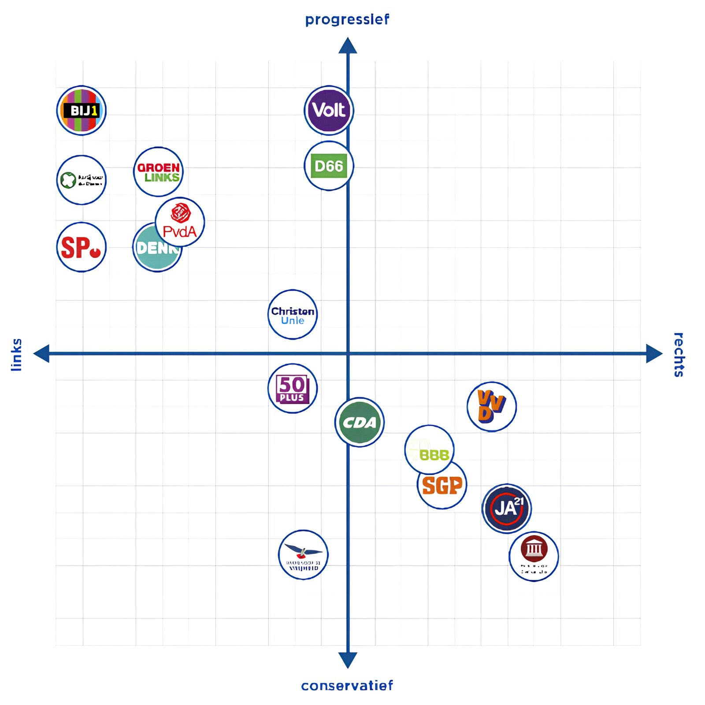

## Democratie

Een land, gebied of staat is **soeverein** als die het recht heeft om zonder inmenging beslissingen te nemen. **Politiek** is het maken van keuzes waaraan iedereen binnen een land is gebonden. De meeste keuzes die de politiek maakt zijn van **algemeen belang**: ze zijn voor veel mensen belangrijk.
**Democratie** gaat over de macht van het volk. Als burgers direct invloed uitoefenen op de politieke besluitvorming, spreek je van een **directe democratie**. In de meeste democratische landen is er echter een **representatieve democratie**: het volk kiest vertegenwoordigers die beslissingen maken en verantwoording afleggen. Een democratie wordt gekenmerkt door **individuele vrijheden**, **politieke grondrechten**, **wettelijk beperkte bevoegdheden** voor de politie en het leger, een **onafhankelijke rechtspraak** en **persvrijheid**.

Er zijn twee soorten representatieve democratieën:

* Binnen een **parlementair stelsel** kiest het volk een **parlement**. Er is dan een **parlementaire democratie**. Op basis van het parlement wordt er een regering gevormd. Vaak is er bij dit per stelsel nog een niet-gekozen staatshoofd, van wie de macht wordt beperkt door de grondwet (constitutie). Als dit een koning (monarch) is, zoals in Nederland, spreek je van een **constitutionele monarchie**.
* Binnen een **presidentieel stelsel** kiest het volk een parlement en een staatshoofd (president). Deze president staat dan aan het hoofd van de uitvoerende macht.

In landen zonder democratie is vaak sprake van een **autoritair regime**. Hierbij zijn de drie machten niet gescheiden van elkaar. Een kleine groep mensen heeft dus veel macht.  
Autoritaire regimes worden gekenmerkt door het **niet respecteren van grondrechten**, het **verbod op oppositiepartijen**, **overheidsgeweld**, **geen onafhankelijke rechtspraak**, **verkiezingsfraude**, **manipulatie**, **geen persvrijheid** en veel **censuur** (overheidscontrole van de media en kunst).  
De meest vergaande vorm van een autoritair regime is een **dictatuur**.

## Politiek

Een **ideologie** is een geheel van ideeën over de mens en de (gewenste) inrichting van de maatschappij. Politiek **links** en **rechts** zijn ideologieën. Links wil de ongelijkheid tussen mensen verminderen door een actieve overheid. Rechts wil juist een passieve overheid en veel eigen verantwoordelijkheid; de overheid moet zich weinig bemoeien met de economie en de samenleving. Het **politieke midden** kenmerkt zich zowel door linkse als rechtse standpunten.

Naast de ideologieën kenmerken politieke partijen zich ook door een stroming:

* Volgens het **liberalisme** is de individuele verantwoordelijkheid van burgers en een passieve overheid belangrijk (zelfredzaamheid). Liberale partijen (VVD, soms D66 en Volt) zijn vaak rechts.
* Volgens het **socialisme** moet de sociale ongelijkheid worden verminderd door een actieve overheid. Socialistische partijen  (SP, GroenLinks, PvdA) zijn vaak links. Deze partijen worden ook **sociaaldemocratisch** genoemd.  
  Een stroming binnen het socialisme is het **communisme**. Volgens het communisme zou gelijkheid bereikt worden door een revolutie van arbeiders.  
* Volgens het **confessionalisme** is het geloof, saamhorigheid en naastenliefde het belangrijkst. De volledige maatschappij zou in samenhang moeten samenwerken. Confessionalistische partijen in Nederland gaan vaak over het christelijke geloof.  Deze partijen (CDA, ChristenUnie, SGP) worden ook christendemocratisch genoemd en ze staan vaak in het midden.

Vanaf de jaren zestig is er sprake van **ontideologisering**: ideologie staat niet meer centraal in de maatschappelijke inrichting. Hierdoor ontstonden nieuwe stromingen:

* Volgens het **ecologisme** is de mens onderdeel van een ecosysteem. Vooral duurzaamheid en het klimaat zijn belangrijk. Ecologische partijen (PvdD (Partij voor de Dieren), GroenLinks) zijn vaak links.
* Volgens het **populisme** is de stem van het volk het belangrijkst. De politieke elite zou corrupt zijn. Populistische partijen  (PVV, FvD) zijn niet per se rechts of links, omdat het populisme niet de "traditionele" kenmerken van een ideologie heeft.

De indelingen op links, midden en rechts gaan vooral over de economie (sociaal-economisch). Als je partijen en stromingen onderscheidt op hun standpunten rond cultuur en de maatschappij (sociaal-cultureel), krijg je **progressieve**, **conservatieve** en **reactionaire** partijen.  
Progressieve partijen zijn vooruitstrevend: de maatschappij moet veranderen. Conservatieve partijen zijn juist behoudend: de maatschappij moet zo blijven. Reactionaire partijen gaan hier nog een stap verder: de maatschappij moet terug naar vroeger.

De laatste jaren is er nog een ander onderscheid ontstaan: **kosmopolitisme** en **nationalisme**. Volgens het kosmopolitisme is een land onderdeel van een geglobaliseerde wereld waar internationale samenwerking onvermijdelijk is. Volgens het nationalisme moet de eigen identiteit en cultuur juist worden beschermd tegen andere landen.

## Partijen

Een **politieke partij** is een groep mensen met ongeveer dezelfde ideeën over de samenleving. Naast de ideologische partijen bestaan er **one-issuepartijen** (50PLUS, BIJ1): partijen die zich vooral uiten over 1 onderwerp of 1 groep kiezers vertegenwoordigen. Een **niet-democratische partij** heeft standpunten die in strijd zijn met de rechtsstaat.

Een **zwevende kiezer** stemt niet altijd op dezelfde partij. **Strategisch stemmen** is het stemmen op een partij die daadwerkelijk in de regering kan komen.

Een **zetel** is een plaats binnen een parlement. 1 zetel wordt in principe bezet door 1 lid. Alle zetels (en dus leden binnen dat parlement) van 1 partij vormen een **fractie**. In feite mogen alle leden van de Tweede Kamer zelf bepalen hoe ze stemmen, maar vaak stemt iedereen binnen een fractie hetzelfde (**fractiediscipline**).  
Nederlandse partijen zitten op een matrix, ingedeeld op links \- rechts en progressief \- conservatief.

De **SP** (Socialistische Partij) is de meest linkse partij. Ze komen op voor burgers met een laag inkomen. De overheid zou voor goede uitkeringen en betaalbare woningen moeten zorgen.  
**PvdA-GroenLinks** (Partij van de Arbeid \- GroenLinks) is een linkse partij die opkomt voor de werkgelegenheid en een inclusieve samenleving.  
**D66** (Democraten 66\) is een progressieve en kosmopolitische partij. De partij vind onderwijs en de klimaatcisis belangrijk.  
De **SGP** (Staatkundig Gereformeerde Partij) is een streng christelijke partij. De SGP is de oudste partij in het parlement. Volgens de partij zijn de waarden en normen uit de Bijbel leidend.  
De **VVD** (Volkspartij voor Vrijheid en Democratie) is een liberale en rechtse partij die de vrijheden van burgers en bedrijven belangrijk vindt.  
De **BBB** (BoerBurgerBeweging) is een rechtse one-issuepartij die zich richt op de boeren en het platteland.  
Het **CDA** (Christen-Democratisch Appèl) is een confessionalistische partij die veel waarde hecht aan harmonie binnen de samenleving.  
De **PVV** (Partij voor de Vrijheid) is een nationalistische en populistische partij. De partij is tegen "islamistische invloeden" en de politieke elite.

## Stemmen

Alle Nederlandse staatsburgers van 18 jaar of ouder hebben **actief kiesrecht**: ze mogen tijdens verkiezingen hun stem uitbrengen. Ook hebben ze **passief kiesrecht**: het recht om je verkiesbaar te stellen.  
In Nederland gebruiken we een kiesstelsel gebaseerd op **evenredige vertegenwoordiging**: alle stemmen worden gelijk (evenredig) verdeeld over het aantal beschikbare zetels. Hierdoor gaan er geen stemmen verloren, en telt elke stem even vaak mee. Als je n% van de stemmen krijgt krijg je ook (ongeveer) n% van de zetels.

De **kiesdeler** is het aantal stemmen dat je nodig hebt om 1 zetel te behalen. De **kiesdrempel** is het minimum aan stemmen die een partij moet behalen om zetels te krijgen.

Bij een **districten- of meerderheidsstelsel** wordt een land verdeeld in districten, waarbij de afgevaardigde die de meeste stemmen haalt in 1 district, het parlementslid wordt (voor dat district). Er zijn dan dus evenveel zetels als districten. Een nadeel van dit systeem is dat er stemmen verloren gaan, want als jij niet op de winnaar in jouw district stemt, telt je stem niet mee.  
De media heeft veel invloed op de politiek en op het gedrag en de keuzes van politici. Daarom spreken sommige mensen van een **mediacratie**.

Na de verkiezing moet er een kabinet worden gevormd. Dit gebeurt op basis van de indeling van het parlement, want het kabinet wil graag een meerderheid in het parlement, zodat ze altijd een meerderheid hebben tijdens stemmingen. In Nederland heeft 1 partij nog nooit de meerderheid van de zetels gehaald, dus er moet een **coalitie** (samenwerking van meerdere partijen) gevormd worden. De partijen die niet deelnemen aan de coalitie noem je **oppositie**.

Tijdens de **verkenning** onderzoekt een **verkenner** welke coalitiemogelijkheden er zijn. Tijdens de **informatie** onderzoekt een **informateur** welke combinaties van partijen samen een kabinet willen vormen. Tijdens de **formatie** onderzoekt een **formateur** (vaak de nieuwe premier) wie de nieuwe leden van het kabinet worden.

Bij de vorming van een kabinet wordt een **regeerakkoord** opgesteld: een plan waarin de coalitie vastlegt wat ze de komende jaren willen doen.  
Als een kabinet is gevallen of afgetreden, wordt het een **demissionair kabinet**. Dit kabinet mag alleen nog lopende zaken afhandelen.

## Parlement, kabinet, regering

Het **kabinet** (ministers en staatssecretarissen) vormt het dagelijks bestuur van het land. De **regering** bestaat uit de ministers en de koning.  
Elke **minister** heeft een eigen beleidsterrein (denk aan Onderwijs, Defensie, Buitenlandse Zaken, ...). Bijna alle ministers staan aan het hoofd van een **ministerie**. Alle ministers overleggen elke vrijdag in de ministerraad. De **premier** (**minister-president**) is de voorzitter van deze raad.  
Een **staatssecretaris** is verantwoordelijk voor een deel van het beleidsterrein van een minister.

Volgens de **ministeriële verantwoordelijkheid** zijn niet de koning zelf, maar de ministers verantwoordelijk voor zijn uitspraken en gedrag. Ook zijn de ministers verantwoordelijk voor hun eigen beleid en voor wat hun ambtenaren doen.

Het Nederlandse parlement (**Staten-Generaal**) bestaat uit de **Tweede Kamer** en de **Eerste Kamer**. De Tweede Kamer heeft meer macht.  
De taken van de Tweede Kamer zijn het maken van wetten en het controleren van de regering. De Tweede Kamer heeft een aantal rechten:

* **Stemrecht**: Hiermee kunnen Kamerleden wetsvoorstellen aannemen of verwerpen.  
* **Recht van amendement**: Kamerleden mogen wetsvoorstellen aanpassen.  
* **Recht van initiatief**: Het recht om zelf een wetsvoorstel in te dienen.  
* **Recht van motie**: De mogelijkheid om een minister te verzoeken iets wel of niet te doen.  
* **Budgetrecht**: Het recht om de Rijksbegroting goed te keuren of af te wijzen.  
* **Vragenrecht**: Kamerleden mogen vragen stellen aan een minister.  
* **Recht van interpellatie**: Het recht om een spoeddebat aan te vragen.  
* **Recht van onderzoek en enquête**: De mogelijkheid om een deel van het regeringsbeleid te onderzoeken.

Het **poldermodel** is de Nederlandse politieke cultuur waarbij veel compromissen gesloten worden.  
**Dualisme** is de duidelijke taakverdeling tussen de regering en het parlement (de regering regeert en het parlement controleert).

## Beslissen

Alle personen, groepen, bestuursorganen, bedrijven en andere instanties die betrokken zijn bij een politiek besluit noem je **politieke actoren**. De wisselwerking tussen deze actoren noem je het **politieke debat**.  
Een manier om steun te krijgen voor een plan of idee is **lobbyen**: via persoonlijk contact proberen steun te krijgen.  
Een **belangengroep** komt op voor de belangen voor 1 groep binnen de samenleving. Een **actiegroep** zet zich in om een maatschappelijk doel te behalen.

## Lokaal en internationaal bestuur

Het bestuur van gemeentes en provincies voeren taken uit die de landelijke overheid niet uitvoert. Volgens het **subsidiariteitsbeginsel** voegen hogere instanties geen taken uit die lagere instanties kunnen uitvoeren. Bij **decentralisatie** stelt de landelijke overheid de grote lijnen vast en de lagere overheden maken de precies invulling.

In de tabel vind je de structuur van het bestuur op verschillende niveaus.

|  | Gemeente | Provincie | Land |
| :---: | :---: | :---: | :---: |
| **Volksvertegen- woordiging** | Gemeenteraad | Provinciale Staten | Parlement (Staten-Generaal) |
| **Dagelijks bestuur** | College van burgemeester en wethouders | Gedeputeerde Staten | Kabinet |
| **Voorzitter** | Burgemeester (zowel voorzitter van het college van B en W als de gemeenteraad) | Commissaris van de Koning (zowel voorzitter van de gedeputeerde als de Provinciale Staten) | Minister-president (voorzitter kabinet) |

Het dagelijks bestuur wordt altijd gecontroleerd door de volksvertegenwoordiging.

Bij een **supranationale** samenwerking dragen nationale overheden bevoegdheden over aan een overkoepelende internationale organisatie.  
