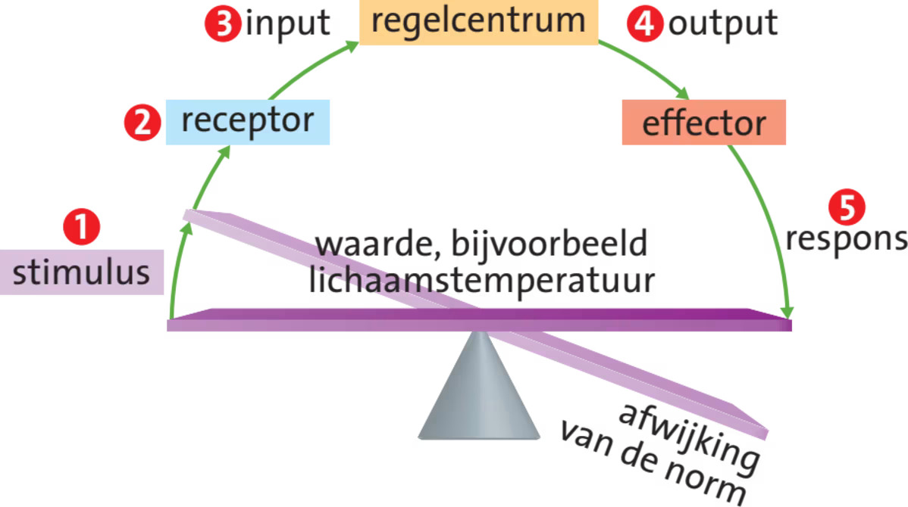
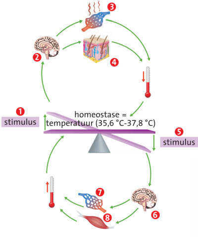
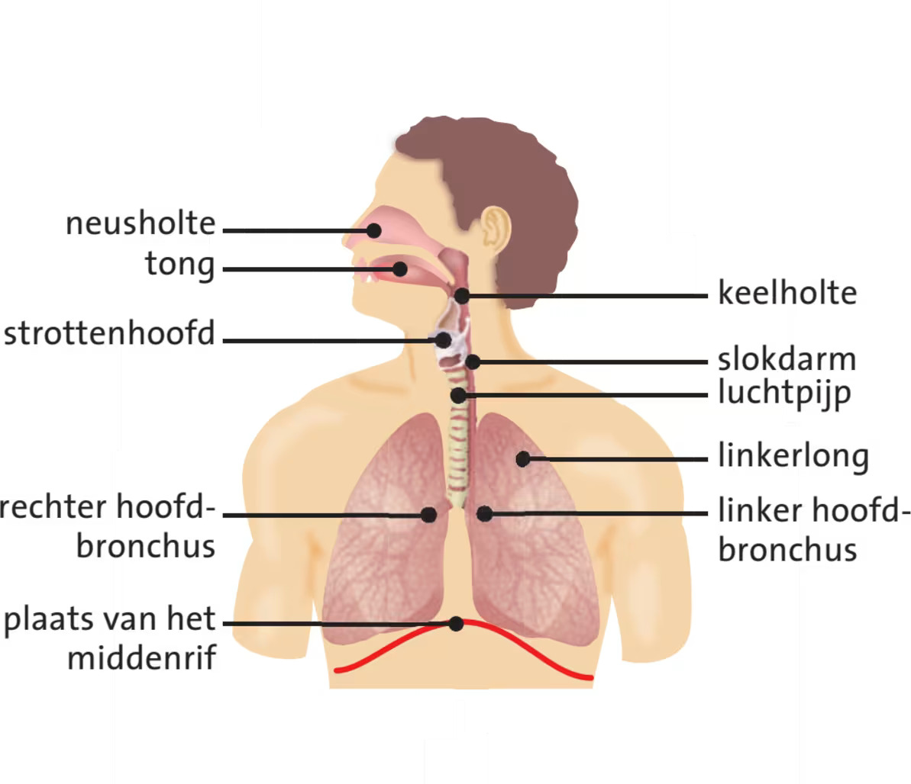
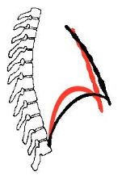
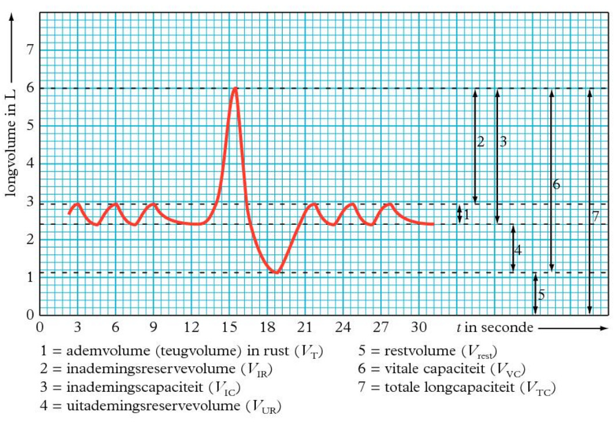
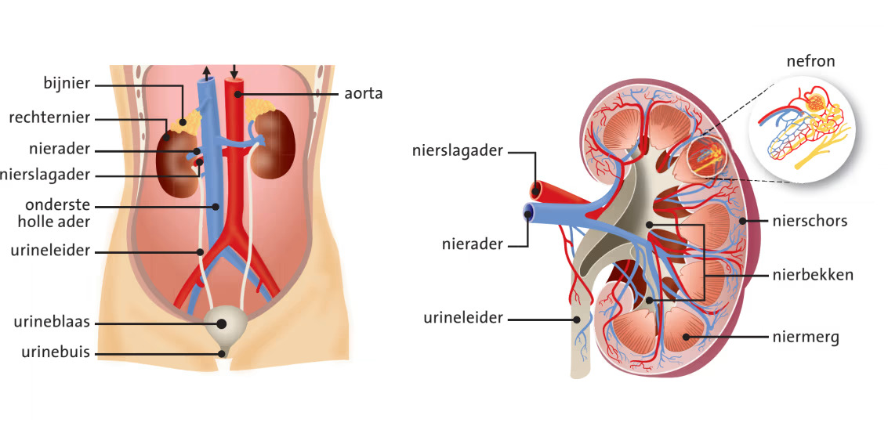
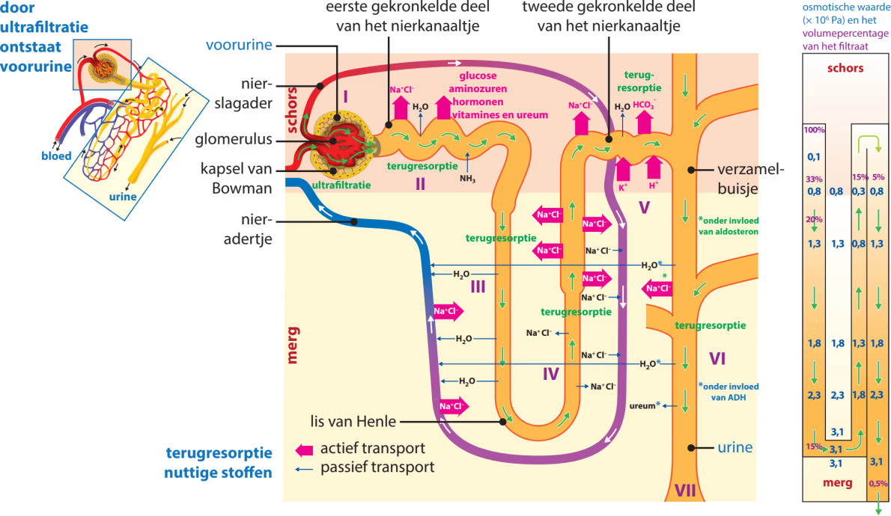
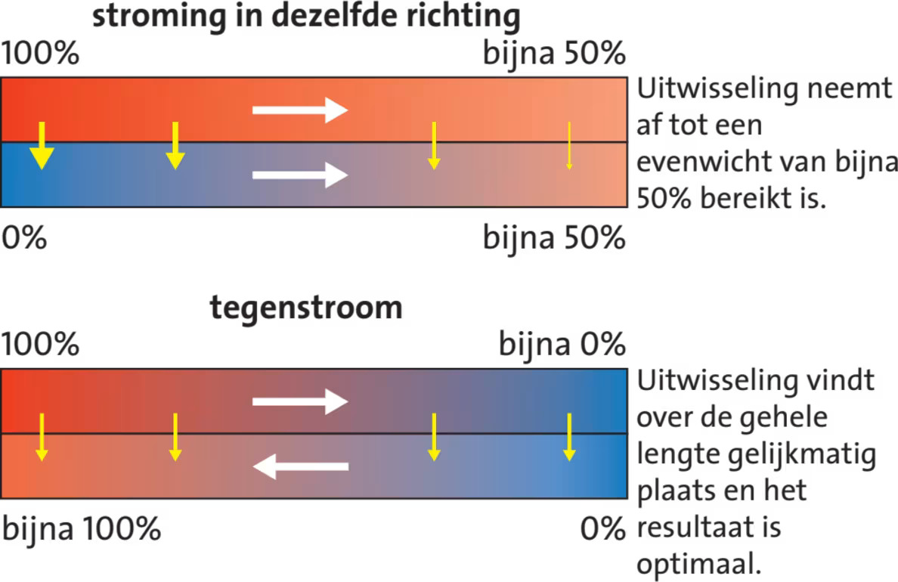

## Inwendig milieu

Een **regelkring** houdt een bepaalde waarde rond een **norm** (gewenste waarde). Dit zorgt voor **homeostase**: het in stand houden van een **dynamisch evenwicht** rond een norm. Bij een dynamisch evenwicht varieert de waarde tussen een ingestelde minimum- en maximumwaarde.

Regelkringen voorkomen grote afwijkingen van de norm. Ze bestaan uit **receptoren** (die een waarde in het lichaam meten), een **regelcentrum** (dat effectoren aanstuurt) en **effectoren** (klieren of spieren, aangestuurd door een regelcentrum in het centrale zenuwstelsel, die de afwijking corrigeren).

Regelkringen werken met **negatieve terugkoppeling**: een afwijking zet een proces in gang dat die afwijking tegengaat.

### Temperatuurregulatie

De **temperatuurregulatie** is een regelkring. Je **kerntemperatuur** (in het centrale deel van je lichaam) is ongeveer 37 °C. De **hypothalamus** meet de kerntemperatuur, is het regelcentrum en bevat de norm. De **schiltemperatuur** (in de buitenste lagen) wordt door andere receptoren gemeten en door andere hersendelen gereguleerd.

Bij een dalende kerntemperatuur stuurt de hypothalamus signalen naar de effectoren. Kringspieren in de slagadertjes naar de huid trekken samen, zodat er minder bloed naar de schil stroomt en er meer warm bloed bij de kern blijft.

Bij koorts is de norm voor de kerntemperatuur verhoogd, waardoor de effectoren reageren alsof er onderkoeling dreigt. De kerntemperatuur kan oplopen tot 41 °C. Koorts is meestal een reactie op een infectie: immuuncellen werken beter en ziekteverwekkers delen slechter bij een hogere temperatuur.

Door regelkringen voor zaken als glucoseniveau, osmotische waarde en zoutconcentratie blijft je **inwendig milieu** in balans.

## De lever

De lever krijgt veel bloed binnen via de **poortader** vanuit de darmen.

Een aantal functies van de lever:

- **Verwarming**: de lever is de belangrijkste bron van warmte in je lichaam
- **Rode bloedcellen opruimen**: de lever en de milt ruimen afgestorven bloedcellen op. IJzer (uit Hb) wordt opgeslagen als **ferritine**. Uit hemoglobine ontstaat hierbij de afvalstof **biliverdine**, die wordt omgezet in **bilirubine**.
- **Ontgiften**: de lever breekt giftige stoffen af (**detoxificatie**). Alcohol wordt met alcoholdehydrogenase omgezet in ethanal, wat vervolgens met aldehydedehydrogenase wordt omgezet in azijnzuur (acetaat). Acetaat kan in vet worden omgezet, waardoor leververvetting kan ontstaan. Overmatig alcoholgebruik kan levercellen doden. Bindweefsel vervangt deze dode levercellen dan: **levercirrose**.
- **Stoffen opslaan**: de lever slaat ijzer, glycogeen, vitamines en mineralen op
- **Bloed leveren**: de lever is een bloedreservoir en kan extra bloed leveren aan de bloedsomloop.
- **Gal vormen**

### Koolhydraatstofwisseling

Na een koolhydraatrijke maaltijd stijgt de **bloedsuikerspiegel** (glucoseconcentratie in het bloed). **Insuline** (uit de alvleesklier) zorgt ervoor dat cellen glucose opnemen. In de lever en de spieren stimuleert insuline ook de omzetting van glucose in **glycogeen**: **glycogenese**.

Spieren dissimileren glucose. Na inspanning is de bloedsuikerspiegel te laag, waardoor de alvleesklier **glucagon** afgeeft. De lever zet onder invloed van glucagon glycogeen om in glucose en geeft die af aan het bloed. Is het glycogeen op, dan wordt glucose gemaakt uit aminozuren en vetten: **gluconeogenese**.

### Vetstofwisseling

De lever kan ongeschikte vetzuren ombouwen tot nuttige vetzuren. **Essentiële vetzuren** kan de lever niet maken, dus die moet je via voedsel binnenkrijgen.

### Eiwitstofwisseling

**Niet-essentiële aminozuren** kan de lever zelf maken uit andere aminozuren. **Essentiële aminozuren** kan de lever niet maken, die moet je via voedsel binnenkrijgen. De lever bouwt aminozuren om door **transaminering**: de aminogroep wordt 'geruild' met de ketongroep van een ketozuur. Andere aminozuren worden afgebroken.

Het afbreken begint met **deaminering**: het verwijderen van de aminogroep. De lever koppelt de vrijgekomen ammoniak aan $\ce{CO2}$ tot **ureum**, dat via het bloed en de nieren in de urine terechtkomt.

De rest van het aminozuur dient als brandstof of voor omzetting in vet of glucose.

## Longen

Bij het inademen gaat de lucht via de neus of mond, de keelholte, **luchtpijp**, **hoofdbronchus**, **bronchus** en **bronchiolus** naar een **longblaasje**. De **(hoofd)bronchiën** hebben kraakbeenringen om dichtklappen te voorkomen. Bronchiolen hebben deze niet. De kleinste bronchiolen hebben glad spierweefsel.

In de longblaasjes diffundeert $\ce{O2}$ naar het bloed en $\ce{CO2}$ andersom: **gaswisseling**. Ook tussen het bloed en de weefselcellen vindt gaswisseling plaats. De gassen gaan door 2 cellagen heen: de wand van het longblaasje en de wand van het haarvat.

De hoeveelheid gas wordt weergegeven als **gasspanning**: de **zuurstofspanning** ($p\ce{O2}$) en de **koolstofdioxidespanning** ($p\ce{CO2}$).

De diffusiesnelheid staat beschreven in de **wet van Fick**:

$$n=DA\frac{\Delta c}{\Delta x}$$

Hierin is $n$ het aantal mol dat per seconde diffundeert, $D$ de diffusiecoëfficiënt (afhankelijk van het diffusiemedium en de temperatuur, maar wel constant in de longblaasjes), $A$ het diffusieoppervlak, $\Delta c$ het concentratieverschil en $\Delta x$ de diffusieafstand.

Bij neusademhaling vangen slijmvliezen ziektekiemen en stofdeeltjes op. De langere weg maakt de lucht warmer en vochtiger, waardoor de longblaasjes minder snel uitdrogen.

Het slijmvlies in de luchtpijp, de bronchiën en de bronchiolen bevat trilhaarcellen en slijmcellen. De trilharen bewegen het slijm omhoog naar de keelholte, waar je het doorslikt.

### Astma en COPD

**Astma** is een chronische longziekte waarbij de slijmvliezen in de bronchiolen ontstoken raken, waardoor er meer slijm ontstaat (grotere diffusieafstand). Tijdens een astma-aanval trekken de spieren rond de bronchiolen samen, waardoor de lucht moeilijker in de longblaasjes komt (kleiner concentratieverschil).

**COPD** (Chronic Obstructive Pulmonary Disease) is een verzamelnaam voor chronische bronchitis en longemfyseem, vaak veroorzaakt door roken.
Bij chronische bronchitis hoopt slijm zich op, waardoor de lucht moeilijker in de longblaasjes komt.
Bij longemfyseem zijn longblaasjes kapot, waardoor het diffusieoppervlak kleiner wordt.

## Ademhaling

**Longventilatie** is het verversen van lucht in je longen door **ventilatiebewegingen**.

De longen zijn omgeven door het **longvlies**. Het middenrif en de borstwand zijn omgeven door het **borstvlies**. Tussen deze vliezen zit de **interpleurale ruimte** met een dunne laag vloeistof. De onderdruk houdt de vliezen bij elkaar. De vloeistof in deze ruimte werkt als smeermiddel zodat ze soepel langs elkaar schuiven.

De **ademhalingsspieren** zijn de middenrifspieren, de tussenribspieren, de kleine borstspier en de nekspieren.

Bij een rustige inademing trekken de **middenrifspieren** en de **buitenste tussenribspieren** samen. De borstkas gaat omhoog en naar voren en het middenrif wordt platter (zie de zwarte lijn in de afbeelding).

Bij een diepe inademing gebruik je ook de nekspieren en de kleine borstspier.

Bij een rustige uitademing ontspannen deze spieren, waardoor het middenrif omhoog komt en het borstbeen omlaag zakt (zwaartekracht). Het longvolume neemt af, en de lucht wordt naar buiten geperst.

Bij een diepe uitademing gebruik je ook de **binnenste tussenribspieren**.

Het **ademvolume** is de hoeveelheid lucht die je per ademhaling in rust ververst. De **vitale capaciteit** is het maximum dat je kunt in- en uitademen. De **totale longcapaciteit** is alles wat in je longen past. Het **restvolume** is de lucht die na het volledig uitademen achterblijft. *Zie Binas 83B.*

Niet alle lucht doet mee aan gaswisseling: ongeveer 150 mL blijft in de luchtwegen (**dode ruimte**).

Het **ademhalingscentrum** in de hersenstam regelt de ademhaling en bevat de normen voor de $p\ce{CO2}$ en de $p\ce{O2}$. **Chemoreceptoren** (in de halsslagaders) meten onder andere de $p\ce{CO2}$, de pH en de $p\ce{O2}$. **Drukreceptoren** (in de aorta) nemen druk waar. Bij een hoge $p\ce{CO2}$, een lage pH of een zeer lage $p\ce{O2}$ geven ze signalen om sneller en dieper te ademen. De $p\ce{CO2}$ is hierbij de belangrijkste factor.

## Nieren

De **nieren** filteren afvalstoffen en overtollige stoffen uit je bloed. Per dag maken ze ongeveer 180 L **voorurine**, waarvan 99% teruggaat naar het bloed. Wat overblijft is de **urine**.

### Bouw

Een nier bestaat uit de **nierschors** (buiten) en het **niermerg** (binnen). De urine gaat via het **nierbekken** en de **urineleider** naar de **urineblaas**, en verlaat via de **urinebuis** het lichaam.

De nier is opgebouwd uit **nefronen** (niereenheden): de functionele eenheden die het bloed filteren en urine maken. Een nefron bestaat uit een **nierbuisje**: het **kapsel van Bowman** (met daarin de **glomerulus**, een kluwen haarvaten), het **eerste gekronkelde deel**, de **lis van Henle** en het **tweede gekronkelde deel**. De nierbuisjes monden uit in **verzamelbuisjes**, die de urine naar het nierbekken voeren. Langs het nierbuisje lopen overal haarvaten.

### Urinevorming

Bij **terugresorptie** (**reabsorptie**) worden stoffen teruggehaald naar het bloed. Dit gebeurt via passief transport, actief transport, gefaciliteerd transport en osmose. Bij **cotransport** lift een stof mee op het actieve transport van een andere stof. Gaan beide stoffen dezelfde kant op, dan heet dit **sympoort**. Gaan ze tegenovergesteld, dan heet dit **antipoort**.

De vorming van urine gaat in de volgende stappen:

1. **Ultrafiltratie** (in de glomerulus): door de hoge bloeddruk wordt plasma door de poreuze wand van de haarvaten geperst. Grote eiwitten passen niet door de poriën en blijven in het bloed. Water, zouten, glucose en afvalstoffen komen wel in de voorurine.
2. **Eerste gekronkelde nierbuisje**: nuttige stoffen (glucose, aminozuren, ionen) worden actief teruggeresorbeerd naar het bloed. Doordat de ionenconcentratie in het bloed stijgt, stroomt er ook water vanuit de voorurine naar het bloed door osmose. De wandcellen voegen ammoniak ($\ce{NH3}$) toe aan de voorurine.
3. **Dalend been van de lis van Henle**: de wand is alleen doorlaatbaar voor water. Het niermerg heeft een hoge osmotische waarde (veel $\ce{Na+}$ en $\ce{Cl-}$), waardoor water vanuit de voorurine door osmose naar het niermerg stroomt en daar wordt opgenomen door de haarvaten. De voorurine wordt daardoor geconcentreerder.
4. **Stijgend been van de lis van Henle**: de wand is alleen doorlaatbaar voor ionen. $\ce{Na+}$ en $\ce{Cl-}$ gaan vanuit de voorurine naar het niermerg (passief in het dunne deel, actief in het dikke deel).
5. **Tweede gekronkelde nierbuisje**: $\ce{H+}$-ionen gaan vanuit het bloed naar de voorurine en $\ce{HCO3-}$-ionen gaan vanuit de voorurine naar het bloed. Hierdoor blijft de pH van het bloed constant.
6. **Verzamelbuisje**: het hormoon **ADH** maakt de wand doorlaatbaarder voor water. Door de hoge osmotische waarde van het niermerg stroomt er water vanuit de voorurine naar het niermerg door osmose, waar het wordt opgenomen door de haarvaten. De urine wordt daardoor geconcentreerder.

De bloedstroom rond de lis van Henle loopt tegengesteld aan de voorurine. Dit heet het **tegenstroomprincipe**. Doordat de stromen tegengesteld zijn, blijft er een concentratieverschil bestaan en verloopt de uitwisseling optimaal.

### Osmoregulatie

**ADH** (antidiuretisch hormoon) uit de hypofyseachterkwab wordt afgegeven bij een te hoge osmotische waarde van het bloed. ADH maakt de wand van de verzamelbuisjes doorlaatbaarder voor water, waardoor de nieren extra water terugresorberen uit de voorurine. Er ontstaat dan een kleiner volume geconcentreerdere urine.
