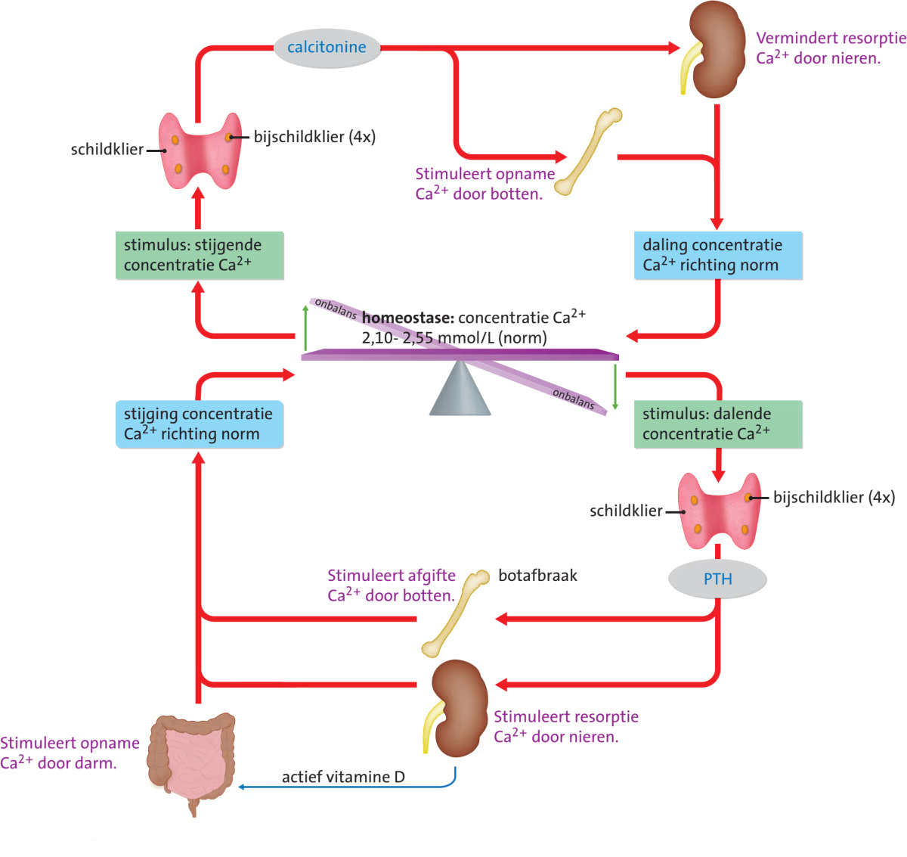
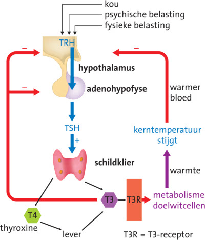
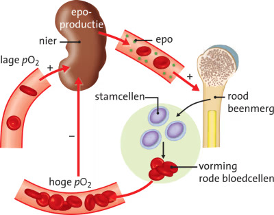

## Hormonen

Een **hormoon** is een **signaalstof** die via het bloed zijn doelwitcellen bereikt. **Hormoonklieren** zijn **endocriene klieren**: ze geven hun producten af aan het **inwendig milieu** (het bloed, en via het bloed weefselvloeistof, lymfe en cytoplasma). **Exocriene klieren**, zoals zweetklieren en verteringsklieren, geven hun producten juist af aan het **uitwendig milieu**: alles wat zich buiten het dekweefsel bevindt, zoals de huid en holten in je lichaam (waaronder het verteringskanaal). Hormonen komen overal in je bloed terecht, maar ze hebben alleen invloed op hun **doelwitorgaan**, omdat alleen cellen met een passende receptor voor dat hormoon erop reageren.

Hormonen spelen een grote rol bij **homeostase**: het zo constant mogelijk houden van het inwendig milieu. Er is dan een **dynamisch evenwicht**: de waarden variëren rond een bepaald gemiddelde.

De meeste hormonale regelkringen werken met **negatieve terugkoppeling**: een stijging van de concentratie van het ene hormoon leidt in een aantal stappen tot een daling van de concentratie van een ander hormoon, en omgekeerd. Hierdoor schommelen de hormoonconcentraties in het bloed voortdurend rond een norm. Bij **positieve terugkoppeling** vergroot de effector (een spier of klier) juist de afwijking van de norm: de verandering wordt versterkt. Een voorbeeld is de zuigreflex bij borstvoeding, die de afgifte van oxytocine versterkt. Twee hormonen met tegengestelde werking (zoals insuline en glucagon) noem je **antagonisten**.

**Geslachtshormonen** zijn hormonen die onder andere betrokken zijn bij het vormen van de geslachtscellen.

## De hypofyse

De **hypofyse** is de centrale hormoonklier (zo groot als een erwt, onder het midden van de grote hersenen) en coördineert de aansturing van andere hormoonklieren. De hypofyse krijgt informatie vanuit de **hypothalamus**, een hersendeel vlak boven de hypofyse. De hypofyse vormt de verbinding tussen het zenuwstelsel en het hormoonstelsel. De hypofyse bestaat uit de **neurohypofyse** (achterkwab, zenuwweefsel) en de **adenohypofyse** (voorkwab, klierweefsel).

De hypothalamus maakt **neurohormonen**: **releasing hormones** (RH's) die de hormoonafgifte door de adenohypofyse stimuleren, en **inhibiting hormones** (IH's) die de afgifte remmen.

## Soorten hormonen

**Steroïdhormonen** (zoals testosteron) zijn hydrofoob en apolair, gemaakt uit cholesterol. Ze gaan door het celmembraan en hechten aan een **hormoonreceptor** in het grondplasma. Samen vormen ze een **hormoon-receptorcomplex**, dat een gen in het DNA activeert.

**Tyrosinehormonen** zijn ook hydrofoob, gemaakt van het aminozuur tyrosine. Ze binden aan receptoren in het grondplasma of in het celmembraan.

**Peptidehormonen** zijn hydrofiel en polair, gemaakt van aminozuren. Ze binden aan receptoren in het celmembraan. Soms ontstaat er een **second messenger** (secundaire boodschapper): een molecuul in het grondplasma dat de boodschap van het hormoon (de primaire boodschapper) overneemt en overdraagt op het molecuul dat in de cel de actie uitvoert.

## Groeihormoon en ACTH

De hypothalamus geeft **GHRH** af, wat zorgt voor de afgifte van **GH** (groeihormoon) door de adenohypofyse. GH stimuleert de aanmaak van de **groeifactor** **IGF** (insulin-like growth factor) in de lever. Bij kinderen stimuleert IGF de deling van kraakbeencellen in de groeischijven van de pijpbeenderen. Na de puberteit blijft GH aanwezig voor andere functies, zoals het aanzetten van vetcellen tot afbraak van vetten.

De hypothalamus geeft ook **CRH** af, wat leidt tot de afgifte van **ACTH** (adrenocorticotroop hormoon) door de hypofyse. ACTH stimuleert de bijnierschors tot de afgifte van onder andere het stresshormoon **cortisol**.

## Calciumhuishouding en botvorming

$\ce{Ca^{2+}}$ wordt gebruikt als second messenger, bij de overdracht van zenuwimpulsen en bij spiersamentrekking. Bij een te lage $\ce{Ca^{2+}}$-concentratie haalt het lichaam $\ce{Ca^{2+}}$ uit de botten: **botontkalking**.

De **schildklier** (een hormoonklier in de hals) en de **bijschildklieren** regelen de $\ce{Ca^{2+}}$-concentratie:

- Bij een **te hoge concentratie** geeft de schildklier **calcitonine** af. Dit stimuleert botcellen om $\ce{Ca^{2+}}$ op te nemen en vermindert de terugresorptie van $\ce{Ca^{2+}}$ uit de voorurine.
- Bij een **te lage concentratie** geven de bijschildklieren **PTH** (**parathormoon**) af. Dit stimuleert de afgifte van $\ce{Ca^{2+}}$ uit de botten en vergroot de terugresorptie van $\ce{Ca^{2+}}$ uit de voorurine. PTH stimuleert ook de vorming van actief vitamine D in de nieren, wat de darmcellen aanzet om extra $\ce{Ca^{2+}}$ uit voedsel op te nemen. Je huidcellen maken inactief vitamine D (een prohormoon).

Calcitonine en PTH hebben een tegengestelde werking: het zijn **antagonisten**.

Het groeihormoon activeert de **osteoblasten** (botvormende cellen). Onder invloed van PTH maken osteoblasten groeifactoren aan, die de ontwikkeling van **osteoclasten** (botafbrekende cellen) stimuleren.

Oestrogenen remmen de botafbraak door de productie van groeifactoren en de activiteit van osteoclasten te remmen. Testosteron heeft een vergelijkbare werking. Bij mannen neemt testosteron op latere leeftijd minder sterk af dan oestrogenen bij vrouwen, waardoor **osteoporose** bij mannen minder vaak voorkomt.

## Bloedsuikerspiegel

Na een koolhydraatrijke maaltijd stijgt de **bloedsuikerspiegel** (glucoseconcentratie in het bloed). De **eilandjes van Langerhans** zijn groepjes hormoonproducerende cellen in de alvleesklier. De **β-cellen** geven dan **insuline** af. Insuline zorgt ervoor dat weefsels glucose opnemen en in lever- en spiercellen omzetten in **glycogeen** (een polysacharide van vertakte ketens glucose, als reservestof opgeslagen in de lever en de spieren): **glycogenese**. Insulinemoleculen binden aan receptoren in het celmembraan, waardoor er een cascade van reacties ontstaat. Hierdoor ontstaan blaasjes met **glucosepoortjes** die versmelten met het celmembraan, waardoor er meer glucosemoleculen de cel binnenkomen. Insuline heeft niet op alle cellen effect: hersencellen nemen bijvoorbeeld ook zonder insuline glucose op uit het bloed.

Bij een te lage bloedsuikerspiegel (bijvoorbeeld na inspanning) geven de **α-cellen** van de eilandjes van Langerhans **glucagon** af. De lever zet onder invloed van glucagon glycogeen om in glucose en geeft die af aan het bloed. Is het glycogeen op, dan wordt glucose gemaakt uit aminozuren en vetten: **gluconeogenese**.

**Adrenaline** is een tyrosinehormoon uit het bijniermerg dat bij stress in het bloed komt en het lichaam activeert. Adrenaline werkt ook als neurotransmitter. Je lever- en spiercellen zetten onder invloed van adrenaline glycogeen om in glucose. Door adrenaline verslappen de spieren in de slagaderwanden naar de skeletspieren, en trekken de spieren in de slagaderwanden van de darmen samen. Het bloed stroomt daardoor naar je spieren. Adrenaline laat je hart sneller kloppen en verdiept je ademhaling.

### Diabetes

De eilandjes van Langerhans van een diabetespatiënt maken weinig of geen insuline aan, of de receptoren van insuline werken niet goed. Het bloed bevat dan hoge concentraties glucose. Veel glucose komt dan terecht in de voorurine, maar de nefronen kunnen deze overmaat niet uit de voorurine terughalen.

Bij **diabetes type 1** maken de β-cellen van de eilandjes van Langerhans weinig of geen insuline aan, door een aangeboren auto-immuunziekte. Patiënten moeten dan zelf insuline inspuiten.

**Diabetes type 2** komt veel vaker voor. Het lichaam reageert dan niet meer goed op insuline, doordat het aantal insulinereceptoren afneemt en/of doordat de receptoren minder gevoelig zijn voor insuline.

## Schildklierhormonen en temperatuur

Als je **kerntemperatuur** daalt, geeft je hypothalamus **TRH** af, wat de afgifte van **TSH** door de adenohypofyse stimuleert. TSH stimuleert de schildklier tot de afgifte van de **schildklierhormonen** **T4** (**thyroxine**) en **T3**. T3 is het werkzame hormoon (levercellen zetten T4 om in T3).

T3-moleculen passeren het celmembraan, koppelen aan een receptoreiwit en activeren een gen in het DNA. Hierdoor ontstaan eiwitten die de glucose- en vetverbranding stimuleren. T3 heeft een negatieve terugkoppeling met TRH.

## Hormonen en de nieren

**Osmoreceptoren** in de hypothalamus meten de osmotische waarde van het bloed. Bij een te hoge osmotische waarde geeft de neurohypofyse (hypofyseachterkwab) **ADH** (antidiuretisch hormoon) af. ADH maakt de wand van de verzamelbuisjes doorlaatbaarder voor water, waardoor de urine geconcentreerder wordt.

**Aldosteron** (uit de bijnierschors) wordt afgegeven bij een te lage $\ce{Na+}$-concentratie. Het zorgt voor meer terugresorptie van $\ce{Na+}$ en meer uitscheiding van $\ce{K+}$. Door de hogere $\ce{Na+}$-concentratie stroomt er ook meer water naar het bloed door osmose.

Bij een lage bloeddruk of lage $\ce{Na+}$-concentratie geven de nieren **renine** af. Renine zet angiotensinogeen om tot angiotensine II, dat zorgt voor de afgifte van aldosteron en vaatvernauwing.

## Hormonen en voedselvertering

Voor een maaltijd maakt de maagwand **ghreline**. Dit stimuleert via **NPY** het eetcentrum in de hypothalamus, waardoor je trek krijgt. Na het eten maken vetcellen **leptine**, waardoor NPY wordt afgeremd. Insuline remt het eetcentrum ook.

**Verteringshormonen** spelen een belangrijke rol bij de voedselvertering. Het verteringshormoon **gastrine** (uit de maag) stimuleert de maagzuurproductie. **Secretine** (uit de twaalfvingerige darm) stimuleert de afgifte van $\ce{HCO3-}$ door de alvleesklier, waardoor de maagzuurproductie wordt geremd.

## Zuurstoftekort en EPO

Bij **bloedarmoede** zijn er te weinig rode bloedcellen om de zuurstofdruk op peil te houden. Je lichaam maakt dan **EPO** (erytropoëtine) aan in de nierschors (en voor een klein deel in de lever). EPO stimuleert stamcellen in het rode beenmerg om te delen en te differentiëren tot nieuwe rode bloedcellen.

