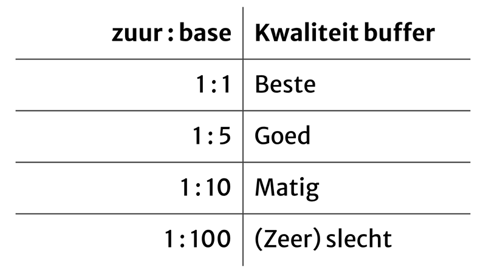

## Zuren en basen

Een **zuur** is een stof die $\ce{H+}$ afstaat, en een **base** is een stof die $\ce{H+}$ opneemt. Los $\ce{H+}$ bestaat niet in water, want het reageert direct tot $\ce{H3O+}$.

De **waardigheid** van een zuur is het aantal $\ce{H+}$ dat het kan afstaan. Bij anorganische zuren is dat vaak het aantal H-atomen in de formule, bij organische zuren het aantal $\ce{-COOH}$-groepen.

### pH

Met de **pH** geef je aan hoe zuur of basisch een oplossing is. De schaal loopt van 0 tot 14:

- pH = 7: neutraal
- pH < 7: zuur (hoe lager, hoe zuurder)
- pH > 7: basisch (hoe hoger, hoe basischer)

> Let op: zuurheid vergelijk je alleen **binnen** de zure kant, en basischheid alleen binnen de basische kant. Een zuur kan dus nooit "basischer" zijn dan een ander zuur, maar wel "minder zuur"

## Sterkte van zuren en basen

De **sterkte** van een zuur geeft aan hoe graag het $\ce{H+}$ afstaat. Een **sterk zuur** staat zijn $\ce{H+}$ graag af, een **zwak zuur** wat minder graag. Bij basen werkt het hetzelfde: een **sterke base** neemt graag $\ce{H+}$ op, een **zwakke base** wat minder graag.

Of een zuur of base sterk of zwak is, zoek je op in Binas 49. Het sterkste zuur staat linksbovenin, en hoe verder je naar beneden gaat, hoe zwakker het zuur. De (theoretische) grens ligt bij $\ce{H3O+}$: alles erboven is sterk, alles eronder zwak. Bij basen is het andersom: de sterkste base staat rechtsonderin, en de grens ligt bij $\ce{OH-}$. Alles eronder is sterk, alles erboven zwak.

## Zuren en basen oplossen

### Zuren

Als je het sterke zuur $\ce{HZ}$ in water oplost, lost het eerst "gewoon" op:

$$\ce{HZ (l) ->[{opl.}] HZ (aq)}$$

Omdat het een sterk zuur is, **ioniseert** $\ce{HZ (aq)}$ daarna volledig (het wil heel graag van zijn $\ce{H+}$ af):

$$\ce{HZ (l) ->[{opl.}] HZ (aq) + H2O (l) -> H3O+ + Z-}$$

Er blijft dus geen $\ce{HZ (aq)}$ over. Je schrijft een $\ce{HZ}$-oplossing daarom als $\ce{H3O+ + Z-}$ (niet als $\ce{HZ (aq)}$!). Het deeltje dat overblijft na het afstaan van $\ce{H+}$ (hier $\ce{Z-}$) heet de **geconjugeerde base** van $\ce{HZ}$.

Een voorbeeld is **zoutzuur**: dat is een oplossing van het sterke zuur waterstofchloride ($\ce{HCl}$) in water, dus je schrijft het als $\ce{H3O+ + Cl-}$.

Een zwak zuur lost ook eerst gewoon op, maar ioniseert daarna niet volledig. Er ontstaat dan een evenwicht:

$$\ce{HB (l) ->[{opl.}] HB (aq) <--> H3O+ + B-}$$

De schrijfwijze van een $\ce{HB}$-oplossing is daarom $\ce{HB (aq)}$.

### Basen

Basen zitten vaak in een zout, en zouten ioniseren altijd volledig als ze oplossen in water:

$$\ce{Na2CO3 (s) -> 2 Na+ + CO3^{2-}}$$

Daarna kan de opgeloste base een $\ce{H+}$ van water opnemen. Hoe sterker de base, hoe beter dat lukt.

Een sterke base (zoals $\ce{H-}$ uit $\ce{NaH}$) reageert aflopend met water. $\ce{NaH}$ lost eerst op, en daarna reageert al het $\ce{H-}$ met water:

$$\ce{NaH (s) -> Na+ + H-}$$
$$\ce{H- + H2O (l) -> H2 (g) + OH-}$$

Samen in 1 reactievergelijking:

$$\ce{NaH (s) + H2O (l) -> Na+ + H2 (g) + OH-}$$

Een zwakke base (zoals $\ce{CO3^{2-}}$) reageert maar gedeeltelijk met water. Er ontstaat dan een evenwicht:

$$\ce{CO3^{2-} + H2O (l) <--> HCO3- + OH-}$$

## Rekenen met de pH

### Sterke zuren en basen

Bij sterke zuren en basen geldt:

- $\mathrm{pH} = -\log [\ce{H3O+}]$
- $[\ce{H3O+}] = 10^{-\mathrm{pH}}$
- $\mathrm{pOH} = -\log [\ce{OH-}]$
- $[\ce{OH-}] = 10^{-\mathrm{pOH}}$
- $\mathrm{pH} + \mathrm{pOH} = 14$

> Het aantal **significante cijfers van de concentratie** bepaalt het aantal **decimalen** van de p(O)H.

### Zwakke zuren en basen

Een zwak zuur ioniseert niet volledig, dus $[\ce{H3O+}]$ is kleiner dan de concentratie van het opgeloste zuur. Je kunt de pH berekenen met de **zuurconstante** $K_z$:

1. Stel de reactievergelijking op van het zwakke zuur met water.
2. Maak een BOEC-schema, met $x$ als de concentratie zuur die ioniseert.
3. Stel de evenwichtsvoorwaarde op, vul de concentraties uit het BOEC-schema en $K_z$ (Binas 49) in, en los $x$ op met de ABC-formule.
4. Bereken de pH met $\mathrm{pH} = -\log(x)$ (want $x = [\ce{H3O+}]$).

Bij een **meerwaardig zuur** (waardigheid 2 of hoger) kijk je alleen naar de eerste ionisatiestap. De stappen daarna zijn zo klein dat je ze mag verwaarlozen.

> Voorbeeld: bereken de pH van een $\ce{HF}$-oplossing van 0,100 M.
>
> De oplossingsreactie is:
>
> $$\ce{HF (aq) + H2O (l) <--> H3O+ + F-}$$
>
> Stel dat $x$ de concentratie is die ioniseert, en neem 1 L oplossing (dan is het aantal mol gelijk aan de concentratie). Het BOEC-schema wordt dan (water laat je weg):
>
> |                      | $\ce{HF (aq)}$ | $\ce{H3O+}$ | $\ce{F-}$ |
> | -------------------- | -------------- | ----------- | --------- |
> | **B**egin (mol)      | 0,100          | 0           | 0         |
> | **O**mzetting (mol)  | $-x$           | $+x$        | $+x$      |
> | **E**venwicht (mol)  | $0{,}100 - x$  | $x$         | $x$       |
> | **C**oncentratie (M) | $0{,}100 - x$  | $x$         | $x$       |
>
> De $K_z$ van $\ce{HF}$ is $6{,}3 \cdot 10^{-4}$. Invullen in de evenwichtsvoorwaarde geeft:
>
> $$K_z = \frac{[\ce{H3O+}][\ce{F-}]}{[\ce{HF}]} = \frac{x \cdot x}{0{,}100 - x} = 6{,}3 \cdot 10^{-4}$$
>
> Dit kun je herschrijven naar:
>
> $$x^2 + 6{,}3 \cdot 10^{-4} \cdot x - 6{,}3 \cdot 10^{-5} = 0$$
>
> Met de ABC-formule:
>
> $$x = \frac{-6{,}3 \cdot 10^{-4} + \sqrt{(6{,}3 \cdot 10^{-4})^2 + 4 \cdot 6{,}3 \cdot 10^{-5}}}{2} = 7{,}6 \cdot 10^{-3}~\mathrm{M}$$
>
> Omdat $x = [\ce{H3O+}]$, is de pH:
>
> $$\mathrm{pH} = -\log(x) = -\log(7{,}6 \cdot 10^{-3}) = 2{,}12$$

Bij een zwakke base werkt het precies hetzelfde, alleen gebruik je dan de **baseconstante** $K_b$ (ook in Binas 49) en is $x = [\ce{OH-}]$. Je rekent dus eerst de pOH uit. Wil je de pH weten, dan reken je die om met $\mathrm{pH} = 14 - \mathrm{pOH}$.

### Verhouding bij een ingestelde pH

Je kunt ook de verhouding tussen een zuur en zijn geconjugeerde base uitrekenen **bij een ingestelde pH**. Dat gaat zo:

1. Stel de reactievergelijking op van het zwakke zuur met water.
2. Stel de evenwichtsvoorwaarde op en herschrijf die naar $\frac{K_z}{[\ce{H3O+}]} = \frac{[\ce{B-}]}{[\ce{HB}]}$.
3. Bereken $[\ce{H3O+}]$ met de pH, zoek $K_z$ op in Binas 49 en vul alles in.

> Voorbeeld: bereken de verhouding $[\ce{NO2-}] : [\ce{HNO2}]$ in een $\ce{HNO2}$-oplossing met een pH van 2,00.
>
> De reactievergelijking is:
>
> $$\ce{HNO2 (aq) + H2O (l) <--> H3O+ + NO2-}$$
>
> De evenwichtsvoorwaarde is:
>
> $$K_z = \frac{[\ce{H3O+}][\ce{NO2-}]}{[\ce{HNO2}]}$$
>
> Herschrijven geeft:
>
> $$\frac{K_z}{[\ce{H3O+}]} = \frac{[\ce{NO2-}]}{[\ce{HNO2}]}$$
>
> Uit de pH volgt $[\ce{H3O+}] = 10^{-2{,}00} = 0{,}0100~\mathrm{M}$. Met de $K_z$ van $\ce{HNO2}$ geeft dat:
>
> $$\frac{[\ce{NO2-}]}{[\ce{HNO2}]} = \frac{5{,}6 \cdot 10^{-4}}{0{,}0100} = 5{,}6 \cdot 10^{-2}$$
>
> De verhouding $[\ce{NO2-}] : [\ce{HNO2}]$ is dus $0{,}056 : 1$.

### Omzettingspercentage

Met deze verhouding kun je ook uitrekenen hoeveel procent van het zuur geïoniseerd is: het **omzettingspercentage**.

1. Bereken de verhouding $[\ce{B-}] : [\ce{HB}]$ zoals hierboven.
2. Vul de verhouding in de formule voor het omzettingspercentage in:

$$\text{omzettingspercentage} = \frac{[\ce{B-}]}{[\ce{HB}] + [\ce{B-}]} \cdot 100\%$$

> Voorbeeld: bereken het omzettingspercentage van $\ce{HF}$ bij een pH van 2,50.
>
> Eerst reken je de verhouding uit. Uit de pH volgt $[\ce{H3O+}] = 10^{-2{,}50} = 3{,}2 \cdot 10^{-3}~\mathrm{M}$:
>
> $$\frac{[\ce{F-}]}{[\ce{HF}]} = \frac{K_z}{[\ce{H3O+}]} = \frac{6{,}3 \cdot 10^{-4}}{3{,}2 \cdot 10^{-3}} = 0{,}20$$
>
> De verhouding $[\ce{F-}] : [\ce{HF}]$ is dus $0{,}20 : 1$. Invullen in de formule geeft:
>
> $$\text{omzettingspercentage} = \frac{0{,}20}{1 + 0{,}20} \cdot 100\% = 17\%$$
>
> Er is dus 17% van het $\ce{HF}$ geïoniseerd.

## Buffers

Een **bufferoplossing** is een oplossing van een zwak zuur met zijn geconjugeerde base, in een 'goede' verhouding (zie afbeelding). De pH van een bufferoplossing verandert niet (of amper) als er zuur, base of water wordt toegevoegd.

Als vuistregel werkt een buffer goed als de verhouding zuur : base tussen 1 : 10 of 10 : 1 ligt.

De pH van een buffer kun je op 2 manieren uitrekenen. Met de evenwichtsvoorwaarde:

$$[\ce{H3O+}] = K_z \cdot \frac{[\ce{HB}]}{[\ce{B-}]}$$

Of met de **bufferformule**:

$$\mathrm{pH} = \mathrm{p}K_z - \log \frac{n_\text{zuur}}{n_\text{base}} = \mathrm{p}K_z + \log \frac{n_\text{base}}{n_\text{zuur}}$$

Hierin is $n_\text{zuur}$ het aantal mol zwak zuur en $n_\text{base}$ het aantal mol geconjugeerde base.

## Zuur-basereacties

Bij een zuur-basereactie staat een zuur $\ce{H+}$ af aan een base. In het algemeen ziet dat er zo uit:

$$\ce{H3O+ + B- -> HB + H2O}$$

Een paar voorbeelden:

- Zoutzuur met natronloog: $\ce{H3O+ + OH- -> 2 H2O}$
- Zoutzuur met natriumoxide: $\ce{2 H3O+ + O^{2-} -> 3 H2O}$

Kijk bij een reactie ook altijd of er een neerslag ontstaat (Binas 45A).

Sommige deeltjes kunnen niet los in water bestaan:

- $\ce{H2CO3}$ valt meteen uiteen in $\ce{H2O + CO2}$.
- $\ce{O^{2-}}$ reageert meteen met water: $\ce{O^{2-} + H2O -> 2 OH-}$.

Bij het opstellen van een zuur-basereactie kijk je eerst goed welke beginstoffen er zijn. Er zijn dan maar 2 mogelijkheden: een aflopende reactie of helemaal geen reactie. **Bij een zuur-basereactie is er nooit een evenwicht.** Een evenwicht krijg je alleen als je een zwak zuur of een zwakke base in water oplost.

Welke van de 2 het is, zie je in Binas 49:

- Staat het zuur boven de base, dan is er een aflopende reactie.
- Staat het zuur onder de base, dan is er geen reactie.
- Staan het zuur en de base op dezelfde regel, dan heb je geen zuur-basereactie, maar gewoon een oplossing van een zwak zuur met zijn geconjugeerde base. Daarin is **wel** een evenwicht.

Een meerwaardig zuur blijft $\ce{H+}$ afstaan zolang het overgebleven zuur boven de base staat (en er genoeg base is).

> Voorbeeld: fosforzuur ($\ce{H3PO4}$) met een overmaat ammoniak ($\ce{NH3}$).
>
> Per stap kijk je of het zuur boven $\ce{NH3}$ staat:
>
> - $\ce{H3PO4}$ staat boven $\ce{NH3}$, dus er is een reactie: $\ce{H3PO4 + NH3 -> H2PO4- + NH4+}$
> - $\ce{H2PO4-}$ staat ook boven $\ce{NH3}$, dus er is weer een reactie: $\ce{H2PO4- + NH3 -> HPO4^{2-} + NH4+}$
> - $\ce{HPO4^{2-}}$ staat onder $\ce{NH3}$, dus er is geen reactie meer.
>
> Fosforzuur reageert dus in 2 stappen met ammoniak. De volledige reactie is:
>
> $$\ce{H3PO4 + 2 NH3 -> HPO4^{2-} + 2 NH4+}$$

## Titraties

Met een titratie bepaal je de onbekende concentratie van een zuur of base in een oplossing. Een titratie bestaat uit de volgende stappen:

1. Neem met een pipet een nauwkeurig afgemeten volume van de oplossing waarvan je de concentratie wilt weten.
2. Doe hier een paar druppels van een geschikte indicator bij.
3. Druppel uit een buret een zuur of base met een bekende concentratie bij de oplossing, tot de indicator omslaat. De kleur moet dan precies in het "midden" liggen: bij een indicator die geel is bij een lage pH en blauw bij een hoge pH, moet de oplossing dus precies groen zijn.
4. Lees op de buret af hoeveel mL je hebt toegevoegd.

Je voert een titratie minimaal 2 keer uit. De afwijking tussen de 2 metingen moet kleiner zijn dan 2,5%:

$$\text{afwijking} = \frac{|V_1 - V_2|}{V_1 + V_2} \cdot 100\%$$

### Concentratie berekenen

Op het **equivalentiepunt** heb je precies genoeg toegevoegd om alles te laten reageren. Bij een molverhouding van 1 : 1 is het aantal mol zuur dan gelijk aan het aantal mol base:

$$n_\text{zuur} = n_\text{base}$$

Omdat $n = c \cdot V$, geldt:

$$c_\text{zuur} \cdot V_\text{zuur} = c_\text{base} \cdot V_\text{base}$$

Als je een zuur titreert met een base, is $V_\text{zuur}$ het volume dat je met de pipet hebt afgemeten en $V_\text{base}$ het volume dat je uit de buret hebt toegevoegd. Hiermee kun je de onbekende concentratie berekenen.

### Titratiecurve

Een **titratiecurve** is een grafiek van de pH tegen het toegevoegde volume. De curve heeft een S-vorm, met het equivalentiepunt in het midden van het steile stuk. Rond het equivalentiepunt verandert de pH dus heel snel.

### Indicator kiezen

Je kiest een indicator waarvan het **omslagtraject** (het pH-gebied waarin de kleur verandert) rond de pH van het equivalentiepunt ligt (zie Binas 52A), want dan slaat de kleur om op het equivalentiepunt. De pH bij het equivalentiepunt hangt af van welk zuur en welke base je gebruikt:

| Zuur  | Base  | pH bij equivalentiepunt |
| ----- | ----- | ----------------------- |
| Sterk | Sterk | 7                       |
| Sterk | Zwak  | < 7                     |
| Zwak  | Sterk | > 7                     |
| Zwak  | Zwak  | Onvoorspelbaar          |

Met een zwak zuur en een zwakke base kun je geen titratie doen, omdat de pH rond het equivalentiepunt niet snel genoeg verandert.

### Terugtitraties

Sommige stoffen kunnen tijdens de titratie verdampen, zoals $\ce{NH3}$. Dan gebruik je een **terugtitratie**: je titreert niet de stof zelf, maar wat er overblijft van een stof die je in overmaat hebt toegevoegd.

Bij $\ce{NH3}$ voeg je eerst een bekende hoeveelheid $\ce{H3O+}$ in overmaat toe. Al het $\ce{NH3}$ reageert dan weg:

$$\ce{NH3 (aq) + H3O+ -> NH4+ + H2O (l)}$$

Er blijft nu nog wat $\ce{H3O+}$ over. Hoeveel dat is, bepaal je door het te titreren met $\ce{OH-}$:

$$\ce{H3O+ + OH- -> 2 H2O (l)}$$

De concentratie $\ce{NH3}$ reken je dan zo uit:

1. Bereken $n_{\ce{H3O+},\text{totaal}}$ met de concentratie en het volume van het zuur dat je hebt toegevoegd.
2. Bereken $n_{\ce{OH-}}$ met de concentratie en het volume van de base uit de buret. Op het equivalentiepunt geldt $n_{\ce{H3O+},\text{over}} = n_{\ce{OH-}}$.
3. Bereken $n_{\ce{NH3}} = n_{\ce{H3O+},\text{totaal}} - n_{\ce{H3O+},\text{over}}$ (de molverhouding $\ce{NH3} : \ce{H3O+}$ is 1 : 1).
4. Bereken $[\ce{NH3}]$ met $c = \frac{n}{V}$.

> Voorbeeld: aan 10,00 mL ammoniak wordt 25,00 mL zoutzuur van 0,1000 M toegevoegd. Het overgebleven $\ce{H3O+}$ wordt getitreerd met 13,20 mL natronloog van 0,1000 M. Bereken $[\ce{NH3}]$.
>
> Het totale aantal mol $\ce{H3O+}$ is:
>
> $$n_{\ce{H3O+},\text{totaal}} = 0{,}1000 \cdot 0{,}02500 = 2{,}500 \cdot 10^{-3}~\mathrm{mol}$$
>
> Het aantal mol $\ce{H3O+}$ dat over is, is gelijk aan het aantal mol $\ce{OH-}$:
>
> $$n_{\ce{H3O+},\text{over}} = 0{,}1000 \cdot 0{,}01320 = 1{,}320 \cdot 10^{-3}~\mathrm{mol}$$
>
> Dat geeft:
>
> $$n_{\ce{NH3}} = 2{,}500 \cdot 10^{-3} - 1{,}320 \cdot 10^{-3} = 1{,}180 \cdot 10^{-3}~\mathrm{mol}$$
>
> $$[\ce{NH3}] = \frac{1{,}180 \cdot 10^{-3}}{0{,}01000} = 0{,}1180~\mathrm{M}$$
