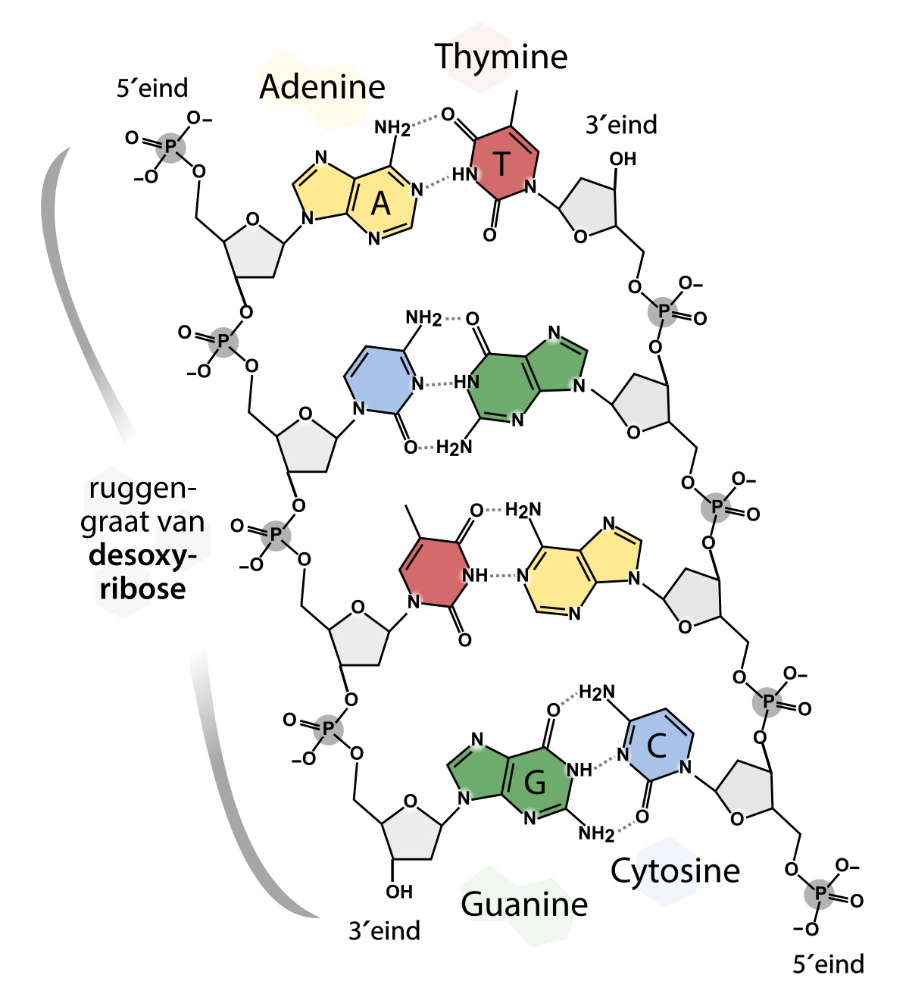
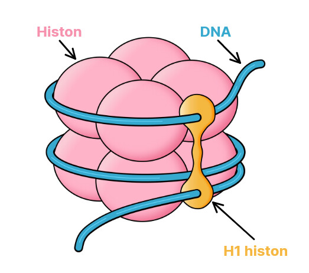
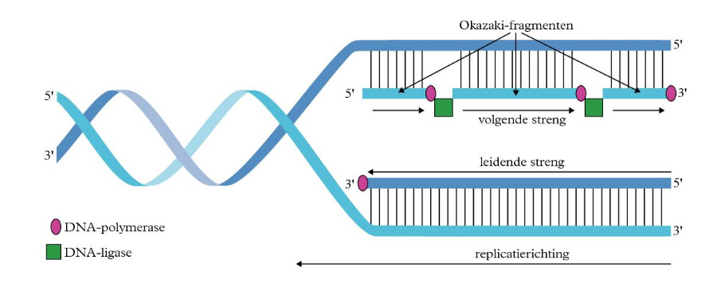
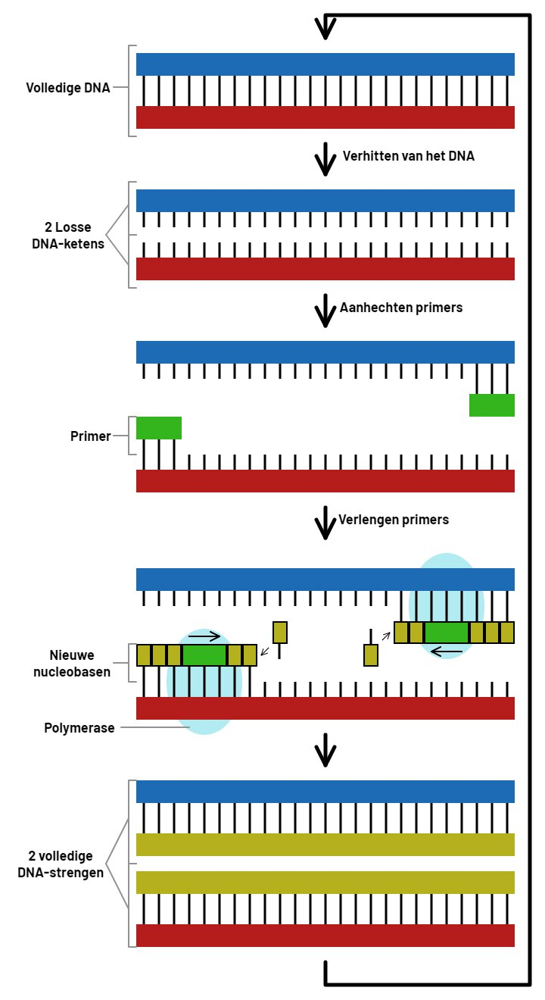
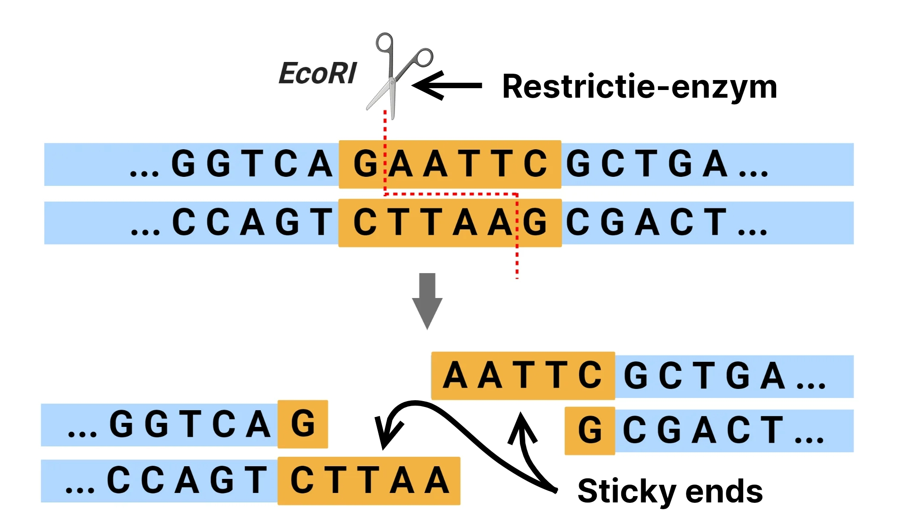
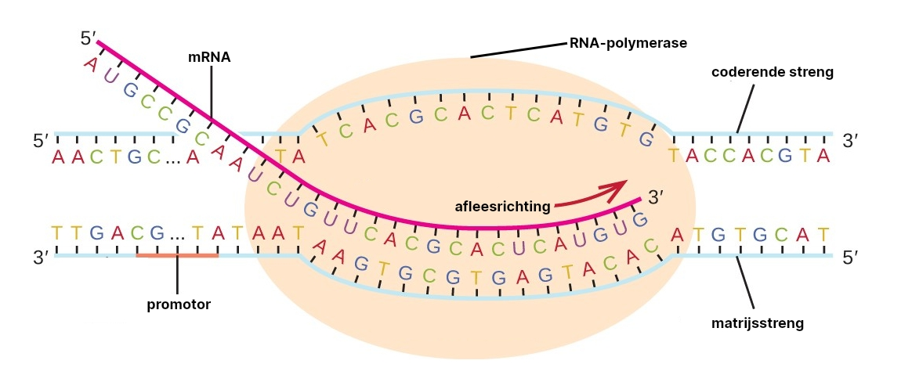
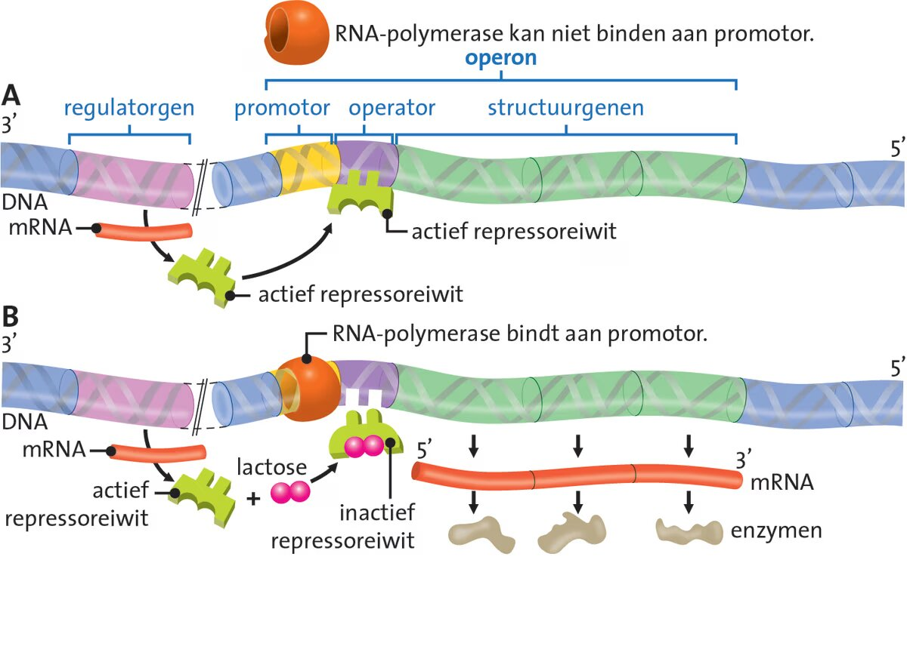
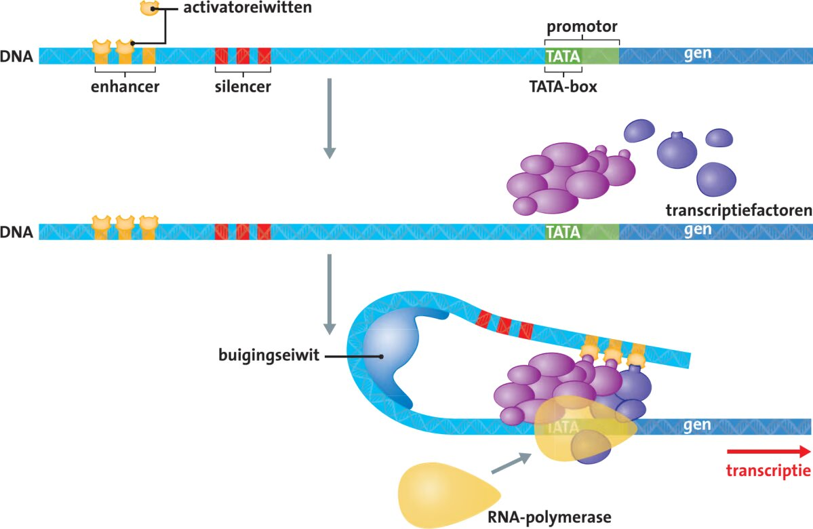

> Bekijk ook de samenvattingen van [H2](/4VWO/TW1/biol_h2), [H3](/4VWO/P2/biol_h3), [H4](/4VWO/TW2/biol_h4) en [H13](/5VWO/TW2/biol_h13).

## DNA

### Bouw van DNA

**DNA** (**desoxyribonucleïnezuur**) bevat de **genetische informatie** voor het maken van eiwitten. DNA is **dubbelstrengs** en heeft de vorm van een **dubbele helix**. DNA bestaat uit **nucleotiden**, die bestaan uit een **fosfaatgroep**, **desoxyribose** en een **stikstofbase** (**a**denine, **c**ytosine, **g**uanine of **t**hymine). De basen van de 2 strengen vormen **basenparen**: A bindt altijd aan T (met 2 waterstofbruggen) en C aan G (met 3 waterstofbruggen).

Elke streng heeft een **5'-uiteinde** en een **3'-uiteinde**. De 2 strengen lopen in tegengestelde richting.

### Chromosomen

Een chromosoom bestaat uit 1 lang DNA-molecuul dat om **histonen** (structuureiwitten) gewikkeld is. Een **nucleosoom** is een bolletje van 8 histonen met DNA eromheen. Een **H1-histon** houdt dit bij elkaar, als een soort paperclip.

DNA en histonen samen heten **chromatine**. Als de cel zich niet deelt, ligt de chromatine los in de kern, zodat genen afgelezen kunnen worden. Tijdens de celdeling spiraliseert de chromatine.

### Genoom

Al het DNA van een organisme samen is het **genoom**. Het meeste DNA zit in de celkern: het **kern-DNA**. Het menselijk genoom bevat duizenden **genen**: stukken DNA die coderen voor 1 of meer eiwitten.

Ook mitochondriën bevatten DNA: **mtDNA** (mitochondriaal DNA). Bij de bevruchting komen de mitochondriën van de zaadcel niet in de eicel terecht, dus je mtDNA komt alleen van je moeder.

Het grootste deel van het DNA is **niet-coderend DNA**. Het codeert niet voor eiwitten, maar heeft andere functies, zoals het maken van bepaalde soorten RNA en het aan- en uitzetten van genen in het **coderende DNA**.

**Repetitief DNA** bestaat uit een korte nucleotidevolgorde die vaak achter elkaar herhaald wordt, zoals **STR's** (**short tandem repeats**). Het aantal herhalingen verschilt sterk per persoon. Omdat je 1 allel van je vader en 1 van je moeder erft, zijn STR's geschikt voor verwantschapsonderzoek.

## DNA-replicatie

Bij **DNA-replicatie** wordt het DNA verdubbeld:

1. **Helicase** ritst het DNA open door de waterstofbruggen tussen de 2 strengen te verbreken. Zo ontstaan **replicatievorken**.
2. **Primase** (een **RNA-polymerase**) maakt op het startpunt een korte **primer** van RNA.
3. **DNA-polymerase I** koppelt vanaf de primer DNA-nucleotiden aan de oude streng. Het kan de oude streng alleen van 3' naar 5' aflezen (de **leesrichting**), dus de nieuwe streng groeit van 5' naar 3'. Omdat de 2 strengen in tegengestelde richting lopen, verschilt dit per streng:
   - Bij de **leidende streng** leest DNA-polymerase I in dezelfde richting als waarin de replicatievork opengaat. De nieuwe streng wordt hier in 1 keer gemaakt.
   - Bij de **volgende streng** leest DNA-polymerase I van de replicatievork af. Als de vork verder opengaat, moet DNA-polymerase I steeds opnieuw beginnen bij een nieuwe primer. De nieuwe streng ontstaat hier dus in stukjes: de **Okazaki-fragmenten**.
4. **DNA-polymerase II** vervangt de RNA-primers door DNA, en **DNA-ligase** koppelt de Okazaki-fragmenten aan elkaar.

Elk nieuw DNA-molecuul bestaat uit 1 oude en 1 nieuwe streng: de replicatie is **semi-conservatief**.

## DNA-technieken

### PCR

Met **PCR** (**polymerasekettingreactie**) kun je DNA vermenigvuldigen in een lab. PCR werkt hetzelfde als DNA-replicatie, maar in plaats van helicase en primase gebruik je temperatuurwisselingen en DNA-primers.

In een buisje doe je het DNA, losse nucleotiden, 2 soorten **DNA-primers** en **Taq-polymerase** (een DNA-polymerase dat bestand is tegen hoge temperaturen). Elke primer past op 1 uiteinde van het stuk DNA dat je wilt kopiëren. Het mengsel doorloopt daarna steeds dezelfde cyclus:

1. Het mengsel wordt verwarmd tot 95 °C. De waterstofbruggen breken, waardoor het DNA uiteenvalt in 2 losse strengen.
2. Het mengsel wordt afgekoeld tot ongeveer 52 °C. De primers binden aan de passende stukken van de losse strengen.
3. Het mengsel wordt verwarmd tot 72 °C. Taq-polymerase verlengt de primers met de losse nucleotiden tot nieuwe strengen.

Elke cyclus verdubbelt het DNA, dus na $n$ cycli heb je $2^n$ keer zoveel DNA.

### Elektroforese

Met **gelelektroforese** scheid je DNA-fragmenten op grootte. DNA is negatief geladen en beweegt in een elektrisch veld door een gel naar de positieve pool. Kleine fragmenten hebben minder weerstand en komen verder. Zo ontstaan bandjes die op grootte zijn gesorteerd.

Bij **capillaire elektroforese** bewegen de fragmenten door een dun buisje (een **capillair**) in plaats van door een gel. De primers zijn gelabeld met een fluorescerende stof. Aan het einde van het capillair wordt deze stof met een laser gedetecteerd. Een computer zet dit om in een grafiek met pieken: hoe later een piek, hoe groter het fragment. Deze methode is sneller en nauwkeuriger dan gelelektroforese.

### Sequencen

**Sequencen** is het bepalen van de nucleotidevolgorde met PCR en elektroforese. Naast de gewone nucleotiden (**dNTP's**) doe je een kleine hoeveelheid **dideoxynucleotiden** (**ddNTP's**: ddA, ddC, ddG en ddT) in het buisje. Een ddNTP mist de OH-groep aan het 3e C-atoom. Wordt er een ddNTP ingebouwd, dan kan er geen nucleotide meer aan vast en stopt de keten met groeien. Op welke plek een ddNTP wordt ingebouwd is toeval. Er ontstaan dus fragmenten van alle lengtes, die elk eindigen op een ddNTP.

Als je de fragmenten op lengte sorteert, kun je de volgorde van de ddNTP's aflezen. Dat kan op 2 manieren:

- Bij **gelelektroforese** doe je 4 aparte reacties, elk met 1 soort ddNTP. Deze laat je naast elkaar door de gel lopen. Vervolgens kun je de bandjes aflezen.
- Bij **capillaire elektroforese** heeft elk soort ddNTP een eigen fluorescerende kleur. Je hoeft dan maar 1 reactie te doen.

### Restrictie-enzymen

**Restrictie-enzymen** knippen DNA bij een specifieke nucleotidevolgorde. Vaak knippen ze de 2 strengen niet recht tegenover elkaar door, waardoor aan de uiteinden een stukje enkelstrengs DNA overblijft: een **sticky end**. Aan een sticky end kun je weer een ander stuk DNA plakken.

Dit wordt gebruikt bij **gentherapie**, waarbij een arts probeert een gemuteerd gen te vervangen door een werkende versie. Een gen dat op deze manier in het DNA van een ander organisme wordt ingebracht heet een **transgen**.

Onderzoekers kunnen een gen ook uitschakelen om de functie ervan te onderzoeken. Zo'n uitgeschakeld gen heet een **knock-out-gen**.

## Eiwitsynthese

### Transcriptie

Eiwitten worden in de ribosomen gemaakt. De code uit het kern-DNA wordt daarom eerst overgeschreven op **mRNA** (**messenger-RNA**): **transcriptie**. RNA is enkelstrengs en heeft de base **uracil** (U) in plaats van T. Bij eukaryoten bevat een mRNA-molecuul de informatie van 1 gen.

De **promotor** is een stuk DNA vlak voor een gen. De promotor regelt de activatie van het gen en is het startpunt van de transcriptie. **RNA-polymerase** bindt in de promotor bij de **TATA-box** (5' TATAAA 3' op de coderende streng), ongeveer 25 basenparen voor het gen. Ook bepaalt de promotor welke streng wordt afgelezen: de **matrijsstreng**. RNA-polymerase leest deze streng af van 3' naar 5'. Het mRNA is complementair aan de matrijsstreng en heeft dus dezelfde volgorde als de andere streng (de **coderende streng**), maar met U in plaats van T.

RNA-polymerase stopt bij het eindsignaal (3' TTATTT 5' op de matrijsstreng). Het gevormde RNA heet **pre-mRNA**. Bij eukaryoten wordt het pre-mRNA in de kern bewerkt tot mRNA:

1. Aan het 3'-uiteinde wordt een **poly-A-staart** (een reeks A-nucleotiden) gekoppeld.
2. Aan het 5'-uiteinde wordt een G-nucleotide met een $\ce{CH3}$-groep gekoppeld: de **5'-cap**. Deze cap maakt het mRNA stabieler.
3. De **introns** (niet-coderende delen) worden eruit geknipt: **splicing**. De overgebleven delen zijn de **exons**.

Bij **alternatieve splicing** worden de exons op verschillende manieren gecombineerd, waardoor uit 1 gen meerdere eiwitten kunnen ontstaan.

### Translatie

Bij **translatie** wordt het mRNA afgelezen en een polypeptideketen gemaakt. Elke 3 opeenvolgende nucleotiden vormen een **codon**. Een codon codeert voor 1 aminozuur, of geeft aan waar de translatie start of stopt. Het coderende deel begint met het **startcodon** AUG en eindigt met een **stopcodon** (UAA, UAG of UGA). Ervoor en erachter ligt een niet-coderend deel: een **UTR** (**untranslated region**).

Een ribosoom bestaat uit een klein en een groot deel. Het mRNA bindt met de 5'-cap aan het kleine deel, waarna het ribosoom naar het startcodon schuift. Voor elk aminozuur zijn er 1 of meer soorten **tRNA** (**transport-RNA**). Een tRNA heeft aan de ene kant een aminozuur en heeft aan de andere kant een **anticodon**, dat bindt aan het passende codon. Op AUG bindt bijvoorbeeld altijd het anticodon UAC.

Het eerste tRNA brengt methionine mee. Daarna bindt het passende tRNA aan het volgende codon en koppelt het ribosoom de aminozuren aan elkaar. Zo groeit de polypeptideketen. Bij een stopcodon bindt een **ontkoppelingseiwit** aan het mRNA, waardoor de keten loskomt.

De 3e base van een codon bindt minder goed aan het anticodon: de **wiebelbase**. Codons die alleen in de 3e base verschillen, coderen vaak voor hetzelfde aminozuur. GGU en GGC coderen bijvoorbeeld allebei voor glycine. Uit de aminozuurvolgorde van een eiwit kun je de nucleotidevolgorde dus niet afleiden. Eiwitten zijn daarom niet geschikt voor forensisch DNA-onderzoek.

## Mutaties

Er zijn 3 soorten **mutaties**:

- **Puntmutaties** zijn veranderingen van 1 basenpaar.
  - Bij een **substitutie** is een basenpaar vervangen door een ander.
  - Bij een **deletie** is een basenpaar verwijderd.
  - Bij een **insertie** is een basenpaar toegevoegd.
- **Chromosoommutaties** zijn veranderingen in de bouw van een chromosoom.
  - Bij een **deletie** is een deel verdwenen.
  - Bij een **duplicatie** is een deel verdubbeld.
  - Bij een **inversie** is een deel omgekeerd.
  - Bij een **translocatie** zit een deel vast aan een ander chromosoom.
- **Genoommutaties** zijn veranderingen in het aantal chromosomen.

Een mutatie in niet-coderend DNA, een intron of een wiebelbase heeft vaak geen gevolgen. Ontstaat er door een mutatie een stopcodon, dan wordt het eiwit korter en werkt het waarschijnlijk niet. Is bij een insertie of deletie het aantal basenparen geen veelvoud van 3, dan verschuiven alle volgende codons: een **leesraamverschuiving**. Er ontstaat dan een compleet ander eiwit.

Een mutatie in een geslachtscel komt in alle cellen van de nakomeling en kan dus zeer ernstig zijn. Een mutatie in een lichaamscel is meestal niet ernstig: de andere cellen hebben de mutatie niet, en de mutatie wordt niet doorgegeven aan nakomelingen. Mutaties in genen die de celcyclus regelen, kunnen wel ernstig zijn. Een mutatie in een **tumorsuppressorgen** (een gen dat celdeling remt) of een **proto-oncogen** (een gen dat celdeling stimuleert) kan leiden tot tumorvorming.

Het **DNA-repair-systeem** bestaat uit enzymen die beschadigingen in het DNA opsporen en herstellen.

## Genregulatie

**Genexpressie** is het tot uiting komen van een gen: het gen wordt afgelezen en er wordt een eiwit van gemaakt. Met **genregulatie** bepaalt een organisme welke genen tot expressie komen, en hoeveel. Zo maakt een cel alleen de eiwitten die nodig zijn.

### Prokaryoten

Prokaryoten hebben 1 cirkelvormig DNA-molecuul en passen hun eiwitproductie snel aan de omstandigheden aan. Ze hebben 2 soorten genen:

- **Structuurgenen** coderen voor eiwitten, zoals enzymen.
- **Regulatorgenen** regelen de expressie van andere genen.

Structuurgenen die samenwerken, liggen achter elkaar op het DNA, met daarvoor 1 promotor en een **operator**. Samen vormen ze een **operon**. Een regulatorgen codeert voor een **repressoreiwit**, dat het operon aan- en uitzet:

1. Het repressoreiwit bindt aan de operator, waardoor RNA-polymerase niet aan de promotor kan binden.
2. Een bepaalde stof bindt aan het repressoreiwit, dat daardoor inactief wordt en de operator loslaat.
3. RNA-polymerase kan nu aan de promotor binden en leest de structuurgenen af. De cel maakt enzymen om de stof te verwerken.
4. Is de stof op, dan wordt het repressoreiwit weer actief en stopt de transcriptie.

Een voorbeeld is het **lac-operon**: lactose maakt het repressoreiwit inactief, waarna de cel enzymen maakt die lactose afbreken.

### Eukaryoten

Alle lichaamscellen van een eukaryoot hebben hetzelfde DNA, maar elke cel activeert alleen de genen die ze nodig heeft (**enhancing**) en schakelt de rest uit (**silencing**).

Bij eukaryoten heeft elk gen een eigen promotor en is er geen operator. **Transcriptiefactoren** zijn eiwitten die bepalen bij welk gen RNA-polymerase de transcriptie kan starten. Een transcriptiefactor bindt aan de TATA-box, en daaraan binden weer andere transcriptiefactoren. Stukken niet-coderend DNA voor of achter het gen regelen de transcriptie:

- **Enhancers** stimuleren de transcriptie. **Activatoreiwitten** binden aan een enhancer, waarna een buigingseiwit een lus in het DNA vormt. Zo komt de enhancer in contact met de transcriptiefactoren op de TATA-box. RNA-polymerase bindt aan dit complex en start de transcriptie.
- **Silencers** remmen de transcriptie doordat **repressoreiwitten** eraan binden.

### Epigenetica

Genexpressie hangt ook af van de **chromatinestructuur**: als het DNA strak om de histonen zit, kan RNA-polymerase er niet bij. De cel past dit aan door zijgroepen aan de histonen te koppelen:

- **Acetylering** (het koppelen van acetylgroepen, $\ce{-CO-CH3}$) maakt de chromatine losser (**euchromatine**), waardoor de transcriptie toeneemt.
- **Methylering** (het koppelen van methylgroepen, $\ce{-CH3}$) maakt de chromatine compacter (**heterochromatine**), waardoor de transcriptie afneemt.

Dit zijn **epigenetische factoren**: ze veranderen de genexpressie, maar niet de nucleotidevolgorde. Bij **DNA-methylering** worden methylgroepen aan cytosine in de promotor gekoppeld, zodat RNA-polymerase daar niet kan binden.

Alle cellen hebben dus hetzelfde genoom, maar een ander **epigenoom**. Zo ontstaan uit stamcellen cellen met verschillende vormen en functies.
