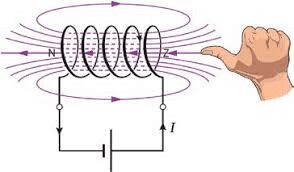
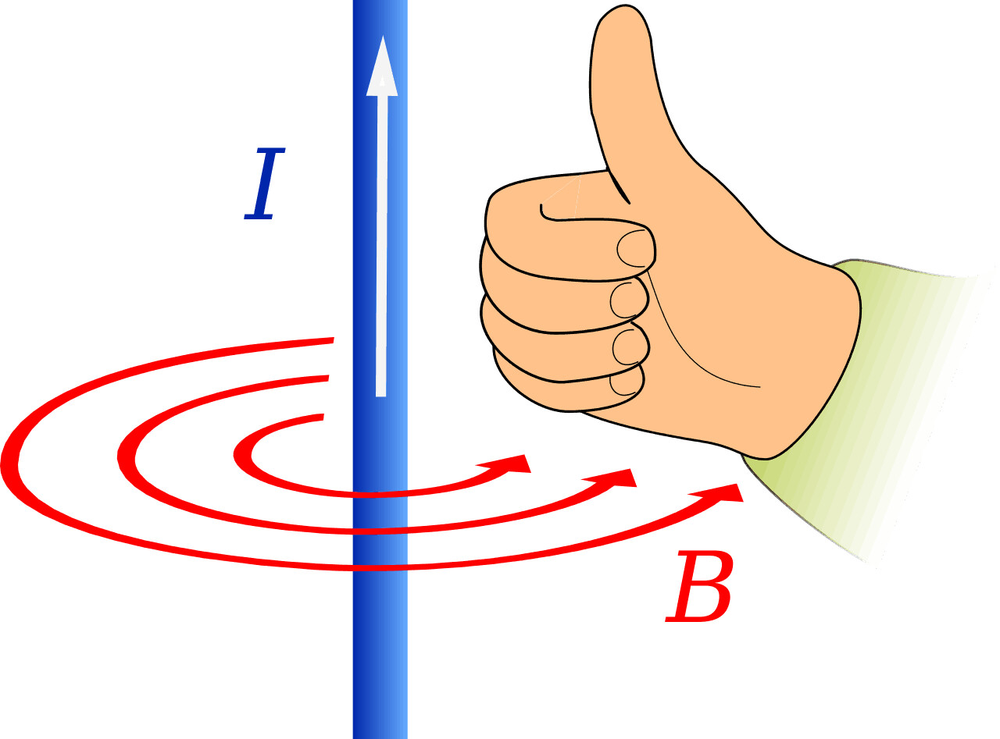
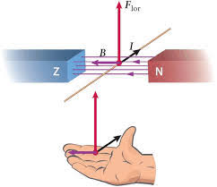
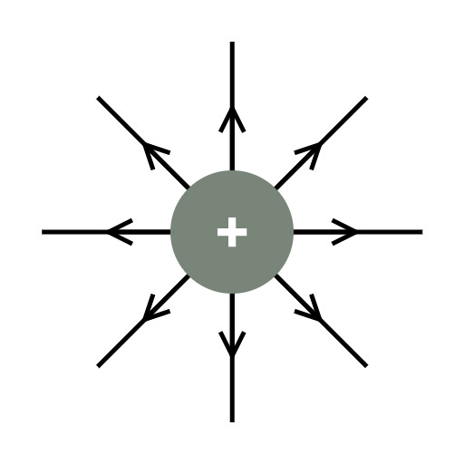
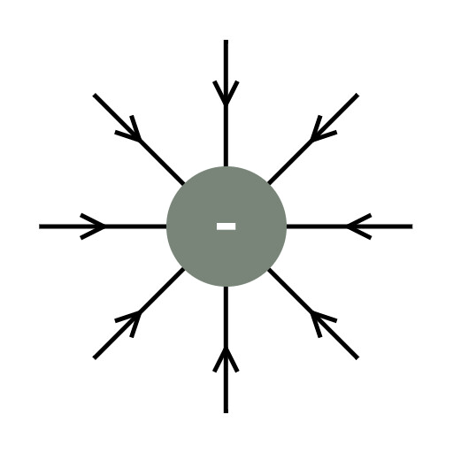
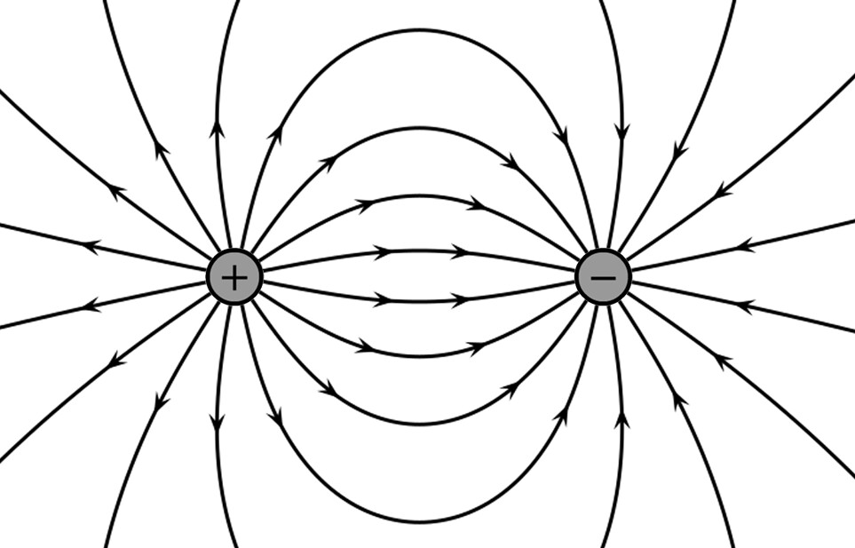
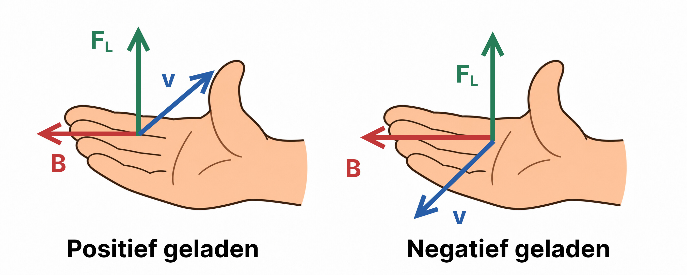

## Elektriciteit

### Lading en stroom

Elektriciteit is **bewegende lading**. Verschillende ladingen trekken elkaar aan, dezelfde ladingen stoten elkaar af. De kleinste lading is de **elementaire lading** $e$ ($1{,}6 \cdot 10^{-19}\,\mathrm{C}$). Stroom kan alleen bewegen als de stroomkring gesloten is. **Geleiders** zijn materialen die stroom doorlaten. **Isolatoren** laten geen stroom door.

In een metalen geleider zorgen **vrije elektronen** voor de stroom. In vloeistoffen kunnen ook **ionen** de stroom geleiden.

De **spanning** ($U$) is de elektrische energie per coulomb lading ($1\,\mathrm{V} = 1\,\mathrm{J}/\mathrm{C}$) en de **stroomsterkte** ($I$) is de hoeveelheid lading die per seconde langs een punt gaat ($1\,\mathrm{A} = 1\,\mathrm{C}/\mathrm{s}$). De stroom beweegt van plus naar min. De stroomsterkte meet je met een **stroommeter** (in serie) en de spanning met een **spanningsmeter** (parallel). Om schakelingen overzichtelijk te tekenen maak je gebruik van een **schakelschema**.

### Weerstand

De **weerstand** bepaalt hoeveel stroom er loopt bij een bepaalde spanning. Voor de weerstand geldt de **wet van Ohm**:

$$R = \frac{U}{I}$$

Hierin is $R$ de weerstand (in $\mathrm{\Omega}$), $U$ de spanning (in $\mathrm{V}$) en $I$ de stroomsterkte (in $\mathrm{A}$).

De **soortelijke weerstand** laat zien hoe goed of slecht een materiaal geleidt. Hoe langer en dunner de draad, hoe hoger de weerstand. De weerstand hangt vaak af van de temperatuur. Apparaten of draden waarbij de weerstand constant is, noem je **ohmse weerstanden**. Veel draden en apparaten hebben geen constante weerstand, omdat bij hogere spanningen de draden warm worden en dus een andere weerstand krijgen.

Een **schuifweerstand** is een speciale weerstand waarvan je de waarde makkelijk kan aanpassen. Een schuifweerstand kun je ook gebruiken om in een combinatieschakeling de spanning aan te passen. Een deel van de spanning wordt dan verdeeld over het lampje en het eerste deel van de schuifweerstand, en het andere deel gaat door het rechterdeel. Door de grootte van het rechterdeel aan te passen, verandert de spanning over het lampje.

De weerstand van **halfgeleiders** kan worden aangepast door atomen toe te voegen. Een voorbeeld is de **diode**: een halfgeleider die stroom in een richting doorlaat. In de doorlaatrichting neemt het aantal vrije elektronen toe, in de sperrichting is het aantal vrije elektronen klein en loopt er geen stroom.

Er zijn ook speciale halfgeleidende weerstanden waarvan de weerstand afhankelijk is van omgevingsfactoren:

| Component | Effect                                |
| :-------- | :------------------------------------ |
| **LDR**   | Meer licht → lagere weerstand         |
| **NTC**   | Hogere temperatuur → lagere weerstand |
| **PTC**   | Hogere temperatuur → hogere weerstand |

### Vermogen en rendement

Het **vermogen** is de hoeveelheid elektrische energie die per seconde wordt verbruikt.

$$P = UI$$

Hierin is $P$ het vermogen (in $\mathrm{W}$), $U$ de spanning (in $\mathrm{V}$) en $I$ de stroomsterkte (in $\mathrm{A}$).

$$E = Pt$$

Hierin is $E$ de energie (in $\mathrm{J}$), $P$ het vermogen (in $\mathrm{E}$) en $t$ de tijd (in $\mathrm{s}$). Energie kun je ook meten in $\mathrm{kWh}$ ($1\,\mathrm{kWh} = 3{,}6\,\mathrm{MJ}$).

Het **rendement** van een apparaat is de factor van de ingaande energie die wordt omgezet in nuttige energie.

$$\eta = \frac{E_\text{nut}}{E_\text{in}}$$

Hierin is $\eta$ het rendement (als factor, of als percentage doe je $\times 100\%$), $E_\text{nut}$ de nuttige energie (in $\mathrm{J}$) en $E_\text{in}$ de ingaande energie (in $\mathrm{J}$).

### Schakelingen in huis

In een huis zijn alle apparaten parallel aan elkaar geschakeld, zodat elk apparaat 230 V ontvangt. In een parallelschakeling wordt de stroomsterkte verdeeld tussen alle vertakkingen (**stroomdeling**). Elk apparaat heeft dus zijn eigen stroomkring. In een serieschakeling wordt de spanning juist over elk apparaat verdeeld (**spanningsdeling**). De stroomsterkte is dan overal hetzelfde.

|                   | Serieschakeling                     | Parallelschakeling                                                |
| :---------------- | :---------------------------------- | :---------------------------------------------------------------- |
| **Spanning**      | $U_\text{tot} = U_1 + U_2 + \ldots$ | $U_\text{tot} = U_1 = U_2 = \ldots$                               |
| **Stroomsterkte** | $I_\text{tot} = I_1 = I_2 = \ldots$ | $I_\text{tot} = I_1 + I_2 + \ldots$                               |
| **Weerstand**     | $R_\text{tot} = R_1 + R_2 + \ldots$ | $\frac{1}{R_\text{tot}} = \frac{1}{R_1} + \frac{1}{R_2} + \ldots$ |

In **combinatieschakelingen** gelden 2 wetten: de **wet van behoud van lading** (bij een splitsing blijft de totale stroom even groot) en de **wet van behoud van energie** (de energie van de bron is gelijk aan de totale energie die langs de schakeling wordt afgegeven). De formules pas je toe op de afzonderlijke delen.

Als er te veel apparaten op een **groep** worden aangesloten, kan de stroomsterkte boven 16 A uitkomen: **overbelasting**. Bij **kortsluiting** raken 2 elektriciteitsdraden, waardoor de stroom een "shortcut" neemt. De weerstand wordt dan heel klein en de stroomsterkte enorm groot. De **zekeringen** in de meterkast beveiligen elke groep door de stroom uit te zetten als de stroomsterkte te groot wordt.

Een **aardlekschakelaar** vergelijkt constant de ingaande en uitgaande stroomsterkte. Als het verschil groter is dan 30 mA, zet hij de stroom voor **het hele huis** uit. Zo beschermt hij je tegen stroom door je lichaam.

## Elektromagnetisme

### Magneten

Elke magneet heeft een noordpool en een zuidpool. Gelijke polen stoten elkaar af, ongelijke trekken elkaar aan. Dit is de **magnetische krachtwerking**. Elk voorwerp heeft heel veel kleine magneetgebiedjes, maar die staan vaak in een willekeurige volgorde, waardoor ze elkaar opheffen. Binnen sommige materialen staan deze gebiedjes wel dezelfde kant op, waardoor het materiaal **permanent** magnetisch is.

Als je een magneet bij een niet-magnetisch metaal houdt, gaan de magneetgebiedjes in het metaal met de magneet meewijzen, waardoor het metaal ook **tijdelijk** magnetisch wordt.

Een noordpool van een kompasnaald wijst altijd naar de zuidpool van een andere magneet. De **magnetische veldlijnen** geven voor elke plek aan naar welke richting het kompas zou wijzen. Deze veldlijnen zijn altijd gesloten (ze lopen buiten de magneet van noord naar zuid en binnen de magneet van zuid naar noord) en ze snijden elkaar nooit.

### Magnetische velden

Een **magnetisch veld** is een ruimte waarin magnetische veldlijnen lopen. In elk punt is de **richting van het magnetisch veld** de richting waarin de noordpool van een kompasnaald wijst (dus altijd naar de zuidpool van de magneet).

> Nu denk je misschien 'een kompas wijst toch naar het noorden, niet naar het zuiden?', en dat klopt, maar bij de **geografische noordpool** van de aarde (dus wat we allemaal 'de noordpool' noemen) ligt de **magnetische zuidpool** van de magneet in de aarde, maar we noemen het alsnog het noorden.

De **magnetische veldsterkte** ($B$) meet je in Tesla ($\mathrm{T}$). Hoe dichter de veldlijnen bij elkaar liggen, hoe sterker het magneetveld.

Binnen een **inhomogeen magneetveld** zijn de veldlijnen niet overal evenwijdig, waardoor er een nettokracht wordt uitgeoefend op een kompasnaaldje. In een **homogeen** magneetveld zijn de veldlijnen overal evenwijdig, waardoor er geen nettokracht wordt uitgeoefend (er vindt alleen draaiing plaats).

### Stroom(spoelen)

**Elektromagneten** zijn magneten die ontstaan door het lopen van stroom in een **spoel**. Deze magneten kun je dus aan en uit zetten.

De richting van het magnetisch veld bepaal je met de **rechterhandregel bij een spoel**: de gekromde vingers van je rechterhand geven de draairichting van de stroom aan, en je uitgestoken duim geeft de richting van de veldlijnen aan (binnen de spoel). De noordpool van de spoel is de plek waar de veldlijnen uit de spoel komen.

Rondom een losse rechte draad is ook een magneetveld. Dit magneetveld heeft geen begin of einde, en een rechte stroomdraad heeft dan ook geen magnetische polen. De richting bepaal je met de **rechterhandregel bij een stroomdraad**: je uitgestoken duim wijst in de richting van de stroom, en de gekromde vingers geven de draairichting van het magneetveld aan.

### Lorentzkracht

De **lorentzkracht** is een elektromagnetische kracht: de wisselwerking tussen elektrische stroom en een magneetveld.

$$F_\text{L} = BIl$$

Hierin is $F_\text{L}$ de lorentzkracht (in $\mathrm{N}$), $B$ de magnetische veldsterkte (in $\mathrm{T}$), $I$ de stroomsterkte (in $\mathrm{A}$) en $l$ de lengte van de stroomdraad in het magneetveld (in $\mathrm{m}$).

De richting van de lorentzkracht bepaal je met de **rechterhandregel voor de lorentzkracht**: de duim wijst in de richting van de stroom, de gestrekte vingers wijzen in de richting van het magneetveld, en de lorentzkracht wijst in de richting van de palm.

Een elektromotor maakt ook gebruik van de lorentzkracht. In een elektromotor zit een rotor met 1 of meer spoelen die kunnen draaien in een magneetveld. Door de lorentzkracht gaat de rotor draaien. Na een halve draaing moet de stroomrichting worden omgewisseld, anders zou de lorentzkracht de draaiing juist tegenwerken. Dit wordt gedaan met een sleepcontact.

### Inductie

De beweging van een staafmagneet wekt een **inductiespanning** op in een spoel. Door de magneet heen en weer te bewegen, ontstaat er wisselspanning.

De **magnetische flux** is het denkbeeldige aantal magnetische veldlijnen door een bepaald oppervlak. Hierbij telt alleen de component van het magneetveld die loodrecht op het oppervlak staat ($B_\perp$).

$$\Phi = B_\perp A$$

Hierin is $\Phi$ de magnetische flux (in $\mathrm{Wb}$), $B_\perp$ de loodrechte component van de magnetische veldsterkte (in $\mathrm{T}$) en $A$ het oppervlak (in $\mathrm{m}^2$).

Een verandering van de magnetische flux door de windingen van een spoel induceert een spanning. Hoe sneller de flux verandert en hoe meer windingen de spoel heeft, hoe groter de inductiespanning.

$$U_\text{ind} \propto N \frac{\mathrm{d}\Phi}{\mathrm{d}t}$$

Hierin is $U_\text{ind}$ de inductiespanning (in $\mathrm{V}$), $N$ het aantal windingen, $\Phi$ de magnetische flux (in $\mathrm{Wb}$) en $t$ de tijd (in $\mathrm{s}$).

Bij een toenemende flux door een gesloten kring is de inductiestroom de ene kant op. Bij afname van de flux is de inductiestroom omgekeerd.

## Elektrische velden

### Lading en elektrische kracht

Voorwerpen kunnen **elektrisch geladen** zijn. Geladen voorwerpen oefenen een **elektrische kracht** op elkaar uit: tegengestelde ladingen trekken elkaar aan, gelijke ladingen stoten elkaar af.

Voor de elektrische kracht tussen 2 geladen voorwerpen geldt de **wet van Coulomb**:

$$F_\text{el} = f \frac{qQ}{r^2}$$

Hierin is $F_\text{el}$ de elektrische kracht (in $\mathrm{N}$), $f$ de **constante van Coulomb** ($8{,}988 \cdot 10^{9}\,\mathrm{N}\,\mathrm{m}^2\,\mathrm{C}^{-2}$), $q$ en $Q$ de ladingen van de 2 voorwerpen (in $\mathrm{C}$) en $r$ de afstand tussen de middelpunten (in $\mathrm{m}$).

### Elektrisch veld

De wisselwerking tussen geladen voorwerpen beschrijf je met een **elektrisch veld**: de ruimte rondom een geladen voorwerp. Een geladen voorwerp in het elektrisch veld van een ander geladen voorwerp ondervindt een elektrische kracht.

De grootte van deze kracht hangt af van de lading van het voorwerp en van de sterkte van het elektrisch veld op de plek waar het voorwerp zich bevindt. Die sterkte heet de **elektrische veldsterkte** ($\vec{E}$): de elektrische kracht op een kleine positieve lading, per coulomb van die lading.

$$\vec{E} = \frac{\vec{F}_\text{el}}{q}$$

Hierin is $\vec{E}$ de elektrische veldsterkte (in $\mathrm{N}/\mathrm{C}$), $\vec{F}_\text{el}$ de elektrische kracht (in $\mathrm{N}$) en $q$ de lading (in $\mathrm{C}$).

### Veldlijnen

**Elektrische veldlijnen** geven in elk punt de richting aan van de kracht op een positief geladen deeltje. Bij een positieve lading wijzen de veldlijnen dus van de lading af, en bij een negatieve lading wijzen ze naar de lading toe.

De velden rond de 2 geladen bolletjes hierboven zijn **radiale velden**. Dicht bij het geladen bolletje is de elektrische kracht het grootst, want daar liggen de veldlijnen het dichtst bij elkaar.

Bij 2 bollen met verschillende ladingen beginnen de veldlijnen bij de positieve lading en eindigen ze bij de negatieve lading.

Een elektrisch veld waarbij de veldlijnen evenwijdig lopen en de afstand tussen de veldlijnen overal even groot is, noem je een **homogeen veld**. Een homogeen veld ontstaat bijvoorbeeld tussen 2 evenwijdige geladen platen. De veldsterkte is dan overal even groot.

### Elektrisch versnellen

In een **deeltjesversneller** worden geladen deeltjes versneld met een elektrisch veld. Dit veld ontstaat tussen een **kathode** (negatief) en een **anode** (positief) met een spanning ertussen: de **versnelspanning** ($U$). De elektrische kracht verricht arbeid op een geladen deeltje, waardoor de kinetische energie van het deeltje toeneemt.

Volgens de wet van behoud van energie wordt de elektrische energie omgezet in kinetische energie:

$$\Delta E_\text{k} = -\Delta E_\text{el}$$

Hierin is $\Delta E_\text{k}$ de verandering van de kinetische energie (in $\mathrm{J}$) en $\Delta E_\text{el}$ de verandering van de elektrische energie (in $\mathrm{J}$). Het minteken geeft aan dat de elektrische energie afneemt als de kinetische energie toeneemt.

De verandering van de elektrische energie hangt af van de lading en de versnelspanning:

$$\Delta E_\text{el} = qU$$

Hierin is $\Delta E_\text{el}$ de verandering van de elektrische energie (in $\mathrm{J}$), $q$ de lading van het deeltje (in $\mathrm{C}$) en $U$ de versnelspanning (in $\mathrm{V}$). Bij het versnellen neemt de kinetische energie van het deeltje dus toe met $qU$.

> De energie van geladen deeltjes geef je vaak aan in **elektronvolt** ($\mathrm{eV}$). Dit is de energie die een deeltje met 1 elementaire lading $e$ krijgt bij een versnelspanning van $1\,\mathrm{V}$ ($1\,\mathrm{eV} = 1{,}6 \cdot 10^{-19}\,\mathrm{J}$).

In een **lineaire deeltjesversneller** wordt een deeltje meerdere keren achter elkaar versneld. Bij elke versnelling neemt de kinetische energie verder toe.

### Magnetisch afbuigen

Een stroom is een stroom van bewegende lading. De lorentzkracht werkt dus ook op losse bewegende geladen deeltjes. Een geladen deeltje ondervindt alleen een lorentzkracht als de snelheid een component loodrecht op het magneetveld heeft.

Voor de lorentzkracht op een bewegend geladen deeltje geldt:

$$F_\text{L} = Bqv$$

Hierin is $F_\text{L}$ de lorentzkracht (in $\mathrm{N}$), $B$ de magnetische veldsterkte (in $\mathrm{T}$), $q$ de lading van het deeltje (in $\mathrm{C}$) en $v$ de snelheid van het deeltje loodrecht op het magneetveld (in $\mathrm{m}/\mathrm{s}$).

> Deze formule kun je afleiden uit $F_\text{L} = BIl$. Met $I = \frac{q}{t}$ krijg je $F_\text{L} = \frac{Bql}{t}$, en $\frac{l}{t} = v$ dus $F_\text{L} = Bqv$.

De richting van de lorentzkracht bepaal je met dezelfde **rechterhandregel voor de lorentzkracht** als bij een stroomdraad in een magneetveld. Bij een positief geladen deeltje wijst de duim in de richting van de snelheid. Bij een negatief geladen deeltje wijst de duim juist tegen de richting van de snelheid in, want de stroomrichting is tegengesteld aan de bewegingsrichting van negatieve lading.

De lorentzkracht staat altijd loodrecht op de snelheid van het deeltje. Daardoor verandert alleen de richting van de snelheid, en niet de grootte. In een homogeen magneetveld voert een geladen deeltje dus een **eenparige cirkelbeweging** uit, met de lorentzkracht als middelpuntzoekende kracht:

$$F_\text{mpz} = F_\text{L} \quad \Rightarrow \quad \frac{mv^2}{r} = Bqv \quad \Rightarrow \quad r = \frac{mv}{Bq}$$

Hierin is $r$ de straal van de cirkelbaan (in $\mathrm{m}$), $m$ de massa van het deeltje (in $\mathrm{kg}$), $v$ de snelheid (in $\mathrm{m}/\mathrm{s}$), $B$ de magnetische veldsterkte (in $\mathrm{T}$) en $q$ de lading (in $\mathrm{C}$). Deze straal heet de **larmorstraal**.
