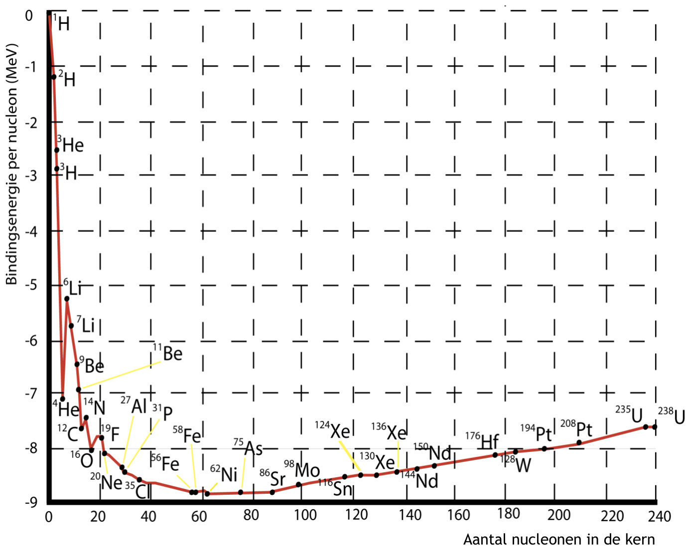

## Atomen en kernreacties

### Atomen

Een atoom bestaat uit een kern met positief geladen **protonen** en ongeladen **neutronen**, met daaromheen een wolk van negatief geladen **elektronen**. Protonen en neutronen heten samen **nucleonen**. Bij een neutraal atoom is het aantal elektronen gelijk aan het aantal protonen.

Het aantal protonen ($Z$, het **atoomnummer**) bepaalt welk **element** een atoom is. Het aantal neutronen ($N$) kan verschillen: atomen van hetzelfde element met een verschillend aantal neutronen heten **isotopen**. Het **massagetal** ($A$) is het aantal nucleonen in de kern:

$$A = Z + N$$

Atoomkernen en losse deeltjes noteer je als volgt (met $\ce{X}$ het symbool van het element of deeltje):

$$\ce{^{A}_{Z}X}$$

Een proton noteer je als $\ce{^{1}_{1}p}$, een neutron als $\ce{^{1}_{0}n}$ en een elektron als $\ce{^{0}_{-1}e}$.

Een atoom dat elektronen heeft afgestaan of opgenomen (**ionisatie**), is niet meer neutraal en heet een **ion**.

### Kernreacties

Bij een **kernreactie** verandert de kern van een atoom. Hierbij gelden de volgende behoudswetten:

- Behoud van **massagetal** (niet massa!)
- Behoud van **lading**
- Behoud van **leptongetal**

### Leptongetal en neutrino's

Het **leptongetal** is, net als lading en massa, een eigenschap van deeltjes. Elektronen hebben leptongetal $+1$ en **positronen** (de positief geladen antideeltjes van elektronen) hebben leptongetal $-1$. Protonen en neutronen hebben leptongetal 0.

**Neutrino's** zijn deeltjes zonder lading en met een verwaarloosbaar kleine massa (Binas 26A). Hier heb je alleen **elektronneutrino's** nodig. Het elektronneutrino ($\nu_e$) heeft leptongetal $+1$ en het **elektronantineutrino** ($\bar{\nu}_e$) heeft leptongetal $-1$.

In de reactievergelijking $\ce{^{14}_{6}C -> ^{14}_{7}N + ^{0}_{-1}e}$ kloppen het massagetal en de lading al, maar het leptongetal niet: voor de pijl is het 0 en na de pijl $+1$. Er moet na de pijl dus nog een deeltje met massagetal 0, lading 0 en leptongetal $-1$ bij. Dit is het elektronantineutrino. De reactie wordt dus $\ce{^{14}_{6}C -> ^{14}_{7}N + ^{0}_{-1}e + ^{0}_{0}\bar{\nu}_e}$.

### Radioactief verval

Veel isotopen zijn instabiel: hun kern vervalt spontaan tot een stabielere kern. Daarbij zendt de kern een deeltje uit, soms samen met een foton ($\gamma$):

- Bij **$\alpha$-verval** komt er een $\alpha$-deeltje (een $\ce{^{4}_{2}He}$-kern) vrij: $\ce{^{A}_{Z}X -> ^{A-4}_{Z-2}Y + ^{4}_{2}He}\ (+ \ce{^{0}_{0}\gamma})$
- Bij **$\beta^+$-verval** verandert een proton in een neutron en komen er een positron en een elektronneutrino vrij: $\ce{^{A}_{Z}X -> ^{A}_{Z-1}Y + ^{0}_{+1}e + ^{0}_{0}\nu_e}\ (+ \ce{^{0}_{0}\gamma})$
- Bij **$\beta^-$-verval** verandert een neutron in een proton en komen er een elektron en een elektronantineutrino vrij: $\ce{^{A}_{Z}X -> ^{A}_{Z+1}Y + ^{0}_{-1}e + ^{0}_{0}\bar{\nu}_e}\ (+ \ce{^{0}_{0}\gamma})$

### Kernsplijting en kernfusie

Bij **kernsplijting** beschiet je een zware atoomkern (vaak uranium) met een neutron. De kern valt dan uiteen in 2 lichtere kernen en een paar neutronen, waarbij energie vrijkomt. Als mensen het over kernenergie hebben, bedoelen ze vrijwel altijd kernsplijting.

Bij **kernfusie** smelten 2 lichte atoomkernen samen tot 1 zwaardere kern, waarbij ook energie vrijkomt. Een voorbeeld is de fusie van de waterstofisotopen **deuterium** ($\ce{^{2}_{1}H} = \ce{D}$) en **tritium** ($\ce{^{3}_{1}H} = \ce{T}$), de **D-T-reactie**:

$$\ce{^{2}_{1}H + ^{3}_{1}H -> ^{4}_{2}He + ^{1}_{0}n}$$

Bij het opstellen van een vergelijking voor splijting of fusie gebruik je dezelfde behoudswetten als bij verval: het massagetal, de lading en het leptongetal moeten voor en na de pijl gelijk zijn.

## Kernkrachten en bindingsenergie

### Krachten in de kern

Binnen de atoomkern spelen 2 belangrijke krachten een rol:

- De **coulombkracht** is de kracht tussen geladen deeltjes: gelijke ladingen stoten elkaar af en tegengestelde ladingen trekken elkaar aan.
- De **sterke kernkracht** is een aantrekkende kracht tussen nucleonen. Deze kracht is veel sterker dan de coulombkracht, maar werkt alleen op heel korte afstand.

### Bindingsenergie

De **chemische bindingsenergie** (Binas 58) is de energie die nodig is om een binding tussen 2 atomen te verbreken (zoals bij een chemische reactie).

De **nucleaire bindingsenergie** is de energie die nodig is om een atoomkern te splitsen in losse nucleonen. Deze energie is vele malen groter dan de chemische bindingsenergie.

Andersom komt de bindingsenergie juist vrij bij het vormen van de binding. Daarom wordt de bindingsenergie vaak als negatief getal gegeven: hoe negatiever, hoe sterker de binding.

### Bindingsenergie per nucleon

De **bindingsenergie per nucleon** is de totale bindingsenergie van een kern gedeeld door het aantal nucleonen.

In de grafiek zie je:

- Tot massagetal 62 wordt de bindingsenergie per nucleon steeds negatiever: hoe meer nucleonen, hoe sterker ze met elkaar verbonden zijn. Bij het fuseren van lichte kernen komt dus energie vrij.
- Ni-62, Fe-58 en Fe-56 hebben de meest negatieve bindingsenergie per nucleon. Dit zijn dus de stabielste kernen.
- Vanaf Ni-62 wordt de bindingsenergie per nucleon weer minder negatief, omdat de coulombkracht (die op grotere afstand werkt) dan belangrijker wordt dan de kernkracht. Bij het splijten van zware kernen komt dus ook energie vrij.

### Massadefect

De massa van een atoomkern is kleiner dan de som van de massa's van de losse nucleonen. Dit verschil heet het **massadefect**. Deze massa is bij de vorming van de kern als energie vrijgekomen, en die energie is gelijk aan de nucleaire bindingsenergie. Hierbij hoort de volgende formule <small>(misschien wel de bekendste uit de natuurkunde)</small>:

$$E = \Delta m c^2$$

Hierin is $E$ de energie (in $\mathrm{J}$), $\Delta m$ het massadefect (in $\mathrm{kg}$) en $c$ de lichtsnelheid ($2{,}998 \cdot 10^8\,\mathrm{m}/\mathrm{s}$).

### Rekenen met bindingsenergie en massadefect

#### Bindingsenergie van 1 kern

Hierbij vergelijk je de kern met de losse protonen en neutronen waaruit hij bestaat. Het massadefect is dan:

$$\Delta m = Z \cdot m_\text{p} + N \cdot m_\text{n} - m_\text{kern}$$

Hierin is $\Delta m$ het massadefect (in $\mathrm{kg}$ of $\mathrm{u}$), $Z$ het aantal protonen, $m_\text{p}$ de massa van een proton, $N$ het aantal neutronen, $m_\text{n}$ de massa van een neutron en $m_\text{kern}$ de massa van de kern (allemaal in $\mathrm{kg}$ of $\mathrm{u}$). **Let op: in Binas 25A staat de atoommassa, dus daar moet je de massa van de $Z$ elektronen nog van aftrekken.**

Met $E = \Delta m c^2$ reken je het massadefect om naar de bindingsenergie van de kern.

#### Vrijgekomen energie bij een reactie

Hierbij vergelijk je wat voor de pijl staat met wat na de pijl staat. Dit kan op 2 manieren:

- **Via de bindingsenergieën**: $E_\text{vrij} = E_\text{b,voor} - E_\text{b,na}$
- **Via het massadefect**: $\Delta m = m_\text{voor} - m_\text{na}$, en dit reken je met $E = \Delta m c^2$ om

### Verdeling van de vrijgekomen energie

De vrijgekomen energie wordt als kinetische energie verdeeld over de reactieproducten, waarbij het lichtste deeltje de meeste energie krijgt. Bij 2 reactieproducten geldt:

$$E_1 = \frac{E_\text{tot} \cdot m_2}{m_1 + m_2} \qquad E_2 = \frac{E_\text{tot} \cdot m_1}{m_1 + m_2}$$

Hierin is $E_\text{tot}$ de totale vrijgekomen energie (in $\mathrm{J}$), $E_1$ en $E_2$ de kinetische energie van reactieproduct 1 en 2 (in $\mathrm{J}$) en $m_1$ en $m_2$ de massa van reactieproduct 1 en 2 (in $\mathrm{kg}$).

## Voorwaarden voor fusie

### Activeringsenergie

Om een reactie te laten starten, moet eerst een **energiebarrière** worden overwonnen. De energie die daarvoor nodig is, heet de **activeringsenergie**. Volgens de klassieke natuurkunde is daarvoor een temperatuur van een paar miljard kelvin nodig, wat in de praktijk niet haalbaar is.

Volgens de quantummechanica gedragen deeltjes zich ook als golven, en is er een (kleine) kans dat een deeltje zich aan de andere kant van de barrière bevindt. Er is dus een kans dat de reactie toch plaatsvindt, ook als de deeltjes niet genoeg energie hebben om over de barrière heen te komen: het deeltje 'graaft een tunnel' onder de barrière door. Dit effect heet **tunneling**. Daardoor is fusie al mogelijk bij een temperatuur van 'slechts' ongeveer 150 miljoen graden.

### Omstandigheden voor fusie

Voor kernfusie is dus een extreem hoge temperatuur nodig, zodat de kernen hard genoeg op elkaar botsen. Daarnaast moeten er genoeg deeltjes dicht op elkaar zitten en moeten ze lang genoeg bij elkaar worden gehouden, zodat ze vaak genoeg botsen (zie het [lawsoncriterium](#lawsoncriterium)).

### Brandstof

Fusie van lichte atoomkernen levert de meeste energie (per nucleon) op. De gunstigste brandstoffen zijn daarom isotopen van waterstof en helium:

- **Deuterium** ($\ce{D}$) is niet radioactief en zit in gewoon water.
- **Tritium** ($\ce{T}$) is wel radioactief ($\beta^-$-verval) en komt in de natuur nauwelijks voor, maar je kunt het zelf maken uit lithium.
- **Helium-3** ($\ce{^{3}_{2}He}$) komt op aarde nauwelijks voor.

De **D-T-reactie** is het gunstigst voor een fusiereactor:

- Er komt veel energie vrij.
- De kans op fusie is het grootst.
- De brandstof is goed beschikbaar.
- Het reactieproduct $\ce{^{4}_{2}He}$ is stabiel en niet radioactief

Nadelen zijn dat tritium radioactief is en dat de [neutronen](#neutronen) de reactorwand beschadigen en radioactief maken.

### Kans op fusie

De kans op fusie bij een botsing hangt af van de botsingsenergie (en dus van de temperatuur) en van het soort deeltjes.

In de grafiek zie je dat de D-T-reactie de grootste kans op fusie heeft, en dat al bij een relatief lage botsingsenergie.

<!-- ### Temperatuur en energie

De temperatuur van een plasma geef je vaak aan in $\mathrm{eV}$ (of $\mathrm{keV}$). Om van energie naar temperatuur om te rekenen gebruik je de **constante van Boltzmann** $k$ ($1{,}38 \cdot 10^{-23}\,\mathrm{J}/\mathrm{K}$):

$$E = kT$$

Hierin is $E$ de energie (in $\mathrm{J}$), $k$ de constante van Boltzmann (in $\mathrm{J}/\mathrm{K}$) en $T$ de temperatuur (in $\mathrm{K}$). Hieruit volgt dat $1\,\mathrm{eV}$ overeenkomt met $\frac{1{,}602 \cdot 10^{-19}}{1{,}38 \cdot 10^{-23}} = 1{,}16 \cdot 10^4\,\mathrm{K}$. Een plasma van $15\,\mathrm{keV}$ heeft dus een temperatuur van ongeveer $1{,}7 \cdot 10^8\,\mathrm{K}$.

Voor de **gemiddelde kinetische energie** van de deeltjes in een plasma (of gas) geldt:

$$E_\text{k,gem} = \frac{3}{2}kT$$

Hierin is $E_\text{k,gem}$ de gemiddelde kinetische energie van een deeltje (in $\mathrm{J}$), $k$ de constante van Boltzmann (in $\mathrm{J}/\mathrm{K}$) en $T$ de temperatuur (in $\mathrm{K}$).

Dit is een gemiddelde: sommige deeltjes hebben meer energie en sommige minder. Je hoeft de brandstof dus niet helemaal te verwarmen tot de temperatuur die hoort bij de botsingsenergie met de grootste kans op fusie. Samen met tunneling is een temperatuur van een paar honderd miljoen kelvin daarom genoeg. -->

## Plasma

### Eigenschappen van een plasma

Bij extreem hoge temperaturen ontstaat er een 4e fase: **plasma**. In een plasma zijn de elektronen losgekomen van hun kernen, dus de atomen zijn geïoniseerd. Als meer dan 1% van de atomen in een gas geïoniseerd is, gedraagt het gas zich al als een plasma. Een plasma...

- Is **elektrisch neutraal** (er zijn evenveel positieve als negatieve ladingen)
- Is **geleidend** (het bevat vrije elektronen en ionen)
- Is **gevoelig voor magneetvelden** (vanwege de vrije geladen deeltjes)
- **Straalt licht uit**

Voorbeelden van plasma's zijn de zon, bliksem, het noorderlicht en tl-buizen.

### Geladen deeltjes in een magneetveld

> **Bekijk de [samenvatting van natuurkunde over dit onderwerp](/6VWO/TW1/nat_h1&h8&h12#elektrische-velden). Je moet weten wat elektrische en magnetische velden zijn, hoe ze geladen deeltjes beïnvloeden, hoe de lorentzkracht werkt ($F_\text{L} = Bqv$) en hoe je de rechterhandregel gebruikt.**

In een fusiereactor staat het plasma in een sterk magneetveld. De lorentzkracht staat loodrecht op de snelheid en op het magneetveld, en dus maken de deeltjes een cirkel loodrecht op het veld. Langs de veldlijnen werkt er geen lorenzkracht, dus daar bewegen ze normaal. Dat geeft samen een **helix** (spiraalbaan) om de magnetische veldlijnen heen. De lorentzkracht is hierbij de middelpuntzoekende kracht ($F_\text{L} = F_\text{mpz}$, dus $Bqv = \frac{mv^2}{r}$). De straal van de cirkelbaan heet de **larmorstraal**:

$$r = \frac{mv}{Bq}$$

Hierin is $r$ de larmorstraal (in $\mathrm{m}$), $m$ de massa van het deeltje (in $\mathrm{kg}$), $v$ de snelheid van het deeltje loodrecht op het magneetveld (in $\mathrm{m}/\mathrm{s}$), $B$ de magnetische veldsterkte (in $\mathrm{T}$) en $q$ de lading van het deeltje (in $\mathrm{C}$).

### Cyclotronfrequentie

Het aantal rondjes dat een deeltje per seconde om een veldlijn draait, heet de **cyclotronfrequentie**:

$$f = \frac{1}{T} = \frac{Bq}{2\pi m}$$

Hierin is $f$ de cyclotronfrequentie (in $\mathrm{Hz}$), $T$ de omlooptijd (in $\mathrm{s}$), $B$ de magnetische veldsterkte (in $\mathrm{T}$), $q$ de lading van het deeltje (in $\mathrm{C}$) en $m$ de massa van het deeltje (in $\mathrm{kg}$).

## De fusiereactor

### Eisen

Een fusiereactor moet aan een aantal eisen voldoen:

- De geladen deeltjes die nodig zijn voor de fusie moeten in het plasma blijven.
- De wanden van de reactor moeten zo weinig mogelijk door deeltjes worden geraakt.
- Het plasma moet flink verhit kunnen worden om fusie mogelijk te maken.

### Magnetische opsluiting

Om de deeltjes in het plasma te houden, is een sterk magneetveld nodig. De reactor is donutvormig: een **torus**. Bij een torus zijn er 2 richtingen: **toroïdaal**: 'rond de donut' (blauw) en **poloïdaal**: 'door de donut' (rood).

Alleen een toroïdaal magneetveld is niet genoeg: de deeltjes hebben dan de neiging om naar buiten toe te vliegen. Daarom is er ook een poloïdaal magneetveld nodig. Een toroïdaal en een poloïdaal magneetveld vormen samen een spiraalvormig magneetveld, dat de deeltjes in het plasma houdt.

### Tokamak en stellarator

Er zijn 2 belangrijke ontwerpen om zo'n magneetveld te maken: de **tokamak** en de **stellarator**.

Een **tokamak** heeft 2 soorten (eenvoudige) spoelen: spoelen om de torus heen voor het toroïdale magneetveld en 1 grote spoel in het midden. De spoel in het midden wekt een stroom door het plasma op, en die stroom maakt het poloïdale magneetveld. Deze stroom verwarmt het plasma ook meteen ([ohmse verhitting](#het-plasma-verhitten)).

Een **stellarator** heeft 1 set complexe, gedraaide spoelen, die samen direct het hele spiraalvormige magneetveld maken. Er loopt dus geen stroom door het plasma.

Het voordeel van een tokamak is dat de spoelen vrij eenvoudig zijn, waardoor een tokamak relatief makkelijk te bouwen is. Een nadeel is dat een deel van het magneetveld afhangt van de stroom door het plasma. Deze stroom kan soms haperen, waardoor er grotere magneten nodig zijn, wat weer kan zorgen voor meer schade aan de reactor. Daarnaast kan de spoel in het midden de stroom maar een beperkte tijd opwekken. De stroom moet dus steeds aan- en uitgezet worden, waardoor een tokamak niet continu kan werken.

Bij een stellarator hebben de supergeleidende magneten een complexe vorm, waardoor het ontwerp ingewikkeld is (maar met de computers van deze tijd is dat eigenlijk best te doen). Ook moet er meer energie in het magneetveld worden gestoken en verliest een stellarator relatief meer deeltjes en energie dan een tokamak. Het grote voordeel is wel dat het plasma in een stellarator veel stabieler is.

### Het plasma verhitten

Er zijn 3 belangrijke manieren om het plasma te verhitten:

1. **Ohmse verhitting**: je laat een stroom door het plasma lopen. De bewegende elektronen botsen met andere deeltjes, wat warmte oplevert.
2. **Microgolfverhitting** (ECRH): je stuurt microgolven met precies de [cyclotronfrequentie](#cyclotronfrequentie) (zodat er resonantie is) het plasma in. Daardoor gaan de elektronen sneller ronddraaien, dus hun kinetische energie en dus de temperatuur stijgt (eigenlijk dus een gigantische magnetron).
3. **Neutrale-bundelverhitting**: je schiet snelle neutrale deeltjes het plasma in. Omdat ze ongeladen zijn, worden ze niet door het magneetveld tegengehouden. In het plasma geven ze hun energie door botsingen af aan andere deeltjes.

## Energiebalans

### Energiestromen

Bij de D-T-reactie ontstaan een heliumkern en een neutron. Omdat het neutron ongeladen is vliegt het direct naar de reactorwand. Het voordeel van neutronen als reactieproduct is dat hun kinetische energie heel makkelijk kan worden opgevangen. De neutronen verhitten de lithiumwand (waarin ook tritium wordt gemaakt). Met die warmte wordt water omgezet in stoom, die een turbine aandrijft. Een generator zet de beweging van de turbine om in elektrische energie. Een deel van die elektrische energie gaat terug naar het plasma (voor de verhitting).

De heliumkern is geladen en blijft dus in het plasma. Hij geeft zijn energie door botsingen af aan andere deeltjes en verhit zo het plasma.

Energie stroomt het plasma dus in via de externe verhitting en de heliumkernen. Energie stroomt het plasma uit via de neutronen, via straling die het plasma uitzendt en via deeltjes die toch ontsnappen en tegen de (koude) wand botsen.

### Q-factor

Een fusiereactor is pas nuttig als er meer energie wordt opgewekt dan er wordt verbruikt. Dit geef je aan met de **Q-factor**:

$$Q = \frac{E_\text{uit}}{E_\text{in}} = \frac{P_\text{uit}}{P_\text{in}}$$

Hierin is $E_\text{uit}$ de energie die vrijkomt (in $\mathrm{J}$), $E_\text{in}$ de energie die nodig is (in $\mathrm{J}$), $P_\text{uit}$ het vermogen dat vrijkomt (in $\mathrm{W}$) en $P_\text{in}$ het vermogen dat nodig is (in $\mathrm{W}$).

Bij $Q = 0$ vindt er geen fusie plaats: er wordt wel energie in het plasma gestopt, maar er komt geen fusie-energie vrij. Bij $Q < 1$ kost de reactor meer energie dan hij oplevert. Bij $Q = 1$ (**break-even**) wordt er precies genoeg energie opgewekt om de reactor in stand te houden. Pas bij $Q > 1$ levert de reactor daadwerkelijk energie op.

### Lawsoncriterium

Het **lawsoncriterium** bepaalt welk **tripelproduct** ($n \cdot T \cdot \tau$) nodig is om een bepaalde Q-factor te behalen. Het tripelproduct is het product van 3 eigenschappen van het plasma:

- De **deeltjesdichtheid** $n$ (in $\mathrm{m}^{-3}$)
- De **temperatuur** $T$ van het plasma (in $\mathrm{keV}$)
- De **opsluittijd** $\tau$ (in $\mathrm{s}$): de gemiddelde tijd dat de deeltjes in het plasma blijven

Bij een D-T-reactor is voor $Q = 1$ een tripelproduct van $5{,}0 \cdot 10^{20}\,\mathrm{keV}\,\mathrm{m}^{-3}\,\mathrm{s}$ nodig.

### Brandend plasma

Als de energie van de heliumkernen genoeg is om het energieverlies van het plasma aan te vullen, houdt de reactie zichzelf in stand. Je hebt dan een **brandend plasma**. Er hoeft geen energie meer te worden toegevoerd, dus $E_\text{in} = 0$ en $Q = \infty$. Voor een brandend plasma moet het tripelproduct groter zijn dan $3{,}0 \cdot 10^{21}\,\mathrm{keV}\,\mathrm{m}^{-3}\,\mathrm{s}$.

## De reactorwand

### Neutronen

Neutronen kunnen de reactorwand beschadigen en radioactief maken. De neutronen botsen namelijk met kernen in de wand, waardoor die kernen radioactief kunnen worden. Omdat neutronenstraling ook schadelijk is voor mensen, staat de reactor in een **biologisch schild** (van bijvoorbeeld lood en beton).

### Materiaal van de binnenwand

Het materiaal van de binnenwand moet...

- Een hoge smelttemperatuur hebben
- Een laag massagetal hebben (hoe zwaarder de atomen die uit de wand in het plasma terechtkomen, hoe sterker het plasma afkoelt)
- Niet reageren met de fusiebrandstof en de brandstof niet opnemen
- Hard zijn en niet snel eroderen
- Bestand zijn tegen neutronenstraling
- Een hoge soortelijke warmte hebben (zodat het materiaal niet snel heet wordt)

Voor de warmte die nodig is om de temperatuur van een materiaal te verhogen, geldt:

$$Q = cm\Delta T$$

Hierin is $Q$ de warmte (in $\mathrm{J}$, dus niet de Q-factor!), $c$ de soortelijke warmte (in $\mathrm{J}\,\mathrm{kg}^{-1}\,\mathrm{K}^{-1}$), $m$ de massa (in $\mathrm{kg}$) en $\Delta T$ het temperatuurverschil (in $\mathrm{K}$).

### Begrenzen of afleiden

Er is nog geen materiaal dat aan alle eisen voldoet. Daarom moeten we ervoor zorgen dat maar een zo klein mogelijk deel van het plasma de wand raakt.

- **Begrenzen**: een ring (de **limiter**) 'schraapt' de buitenrand van het plasma af. Alleen deze ring raakt het plasma, dus de rest van de wand maakt minder uit. Een nadeel is echter dat de ring snel slijt en dat het materiaal van de ring het plasma kan vervuilen.
- **Afleiden**: het buitenste deel van het plasma wordt via een soort 'lek' in het magneetveld weggeleid naar de **divertor**, onderin de reactor, waar het wordt weggepompt.

## Afval en veiligheid

Bij kerncentrales met kernsplijting kan een **meltdown** plaatsvinden, waarbij grote hoeveelheden radioactieve stoffen kunnen vrijkomen (denk aan Tsjernobyl). Bij kernfusie kan dit niet gebeuren, want als de brandstoftoevoer stopt, stopt ook de fusiereactie.

Onderdelen van de reactor kunnen wel radioactief worden door de neutronen, maar ze zijn minder sterk en minder lang radioactief dan het afval van een kerncentrale met kernsplijting. Daarnaast wordt in de wand van fusiereactoren vaak beryllium gebruikt, een zeer giftig metaal.

Het reactieproduct helium is niet radioactief, maar de brandstof tritium wel. Omdat tritium ter plekke wordt gemaakt, is er geen grote voorraad van nodig: in de reactor is op elk moment maar brandstof voor een paar minuten aanwezig. Er kan dus ook nooit een gevaarlijke hoeveelheid tritium vrijkomen.
