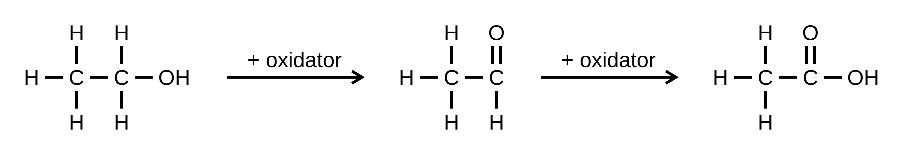
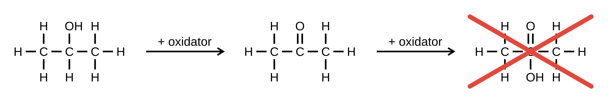
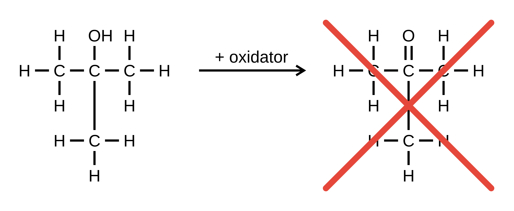
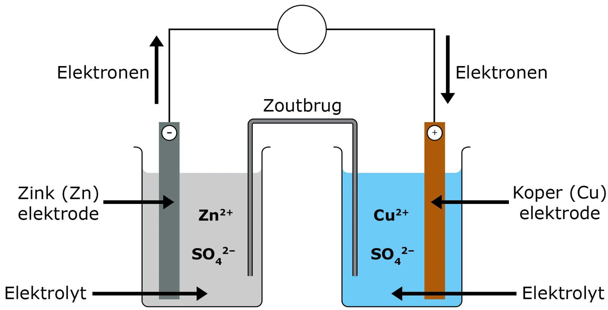
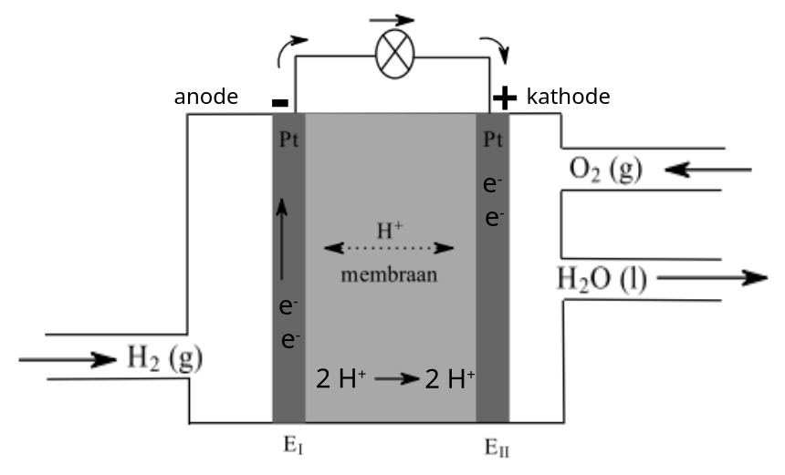
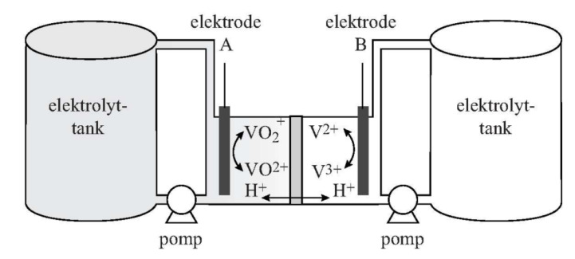

> Bekijk ook de [samenvatting zuur-base](/5VWO/TW3/schk_zuurbase2).

## Redoxreacties

Bij een **redoxreactie** worden **elektronen** overgedragen van de ene stof naar de andere.

Een natriumatoom heeft 1 elektron "te veel" voor een stabiele configuratie. Natrium kan dit elektron afstaan:

$$\ce{Na -> Na+ + e-}$$

Dit is een **halfreactie**. Natrium is hier een **reductor**: een stof die elektronen afstaat.

Een chlooratoom komt juist 1 elektron tekort. Chloor kan daarom elektronen opnemen:

$$\ce{Cl2 + 2 e- -> 2 Cl-}$$

Chloor is hier een **oxidator**: een stof die elektronen opneemt.

Een redoxreactie is dus een reactie tussen een **red**uctor en een **ox**idator. Tel je de halfreacties op (waarbij je de halfreactie met natrium keer 2 doet zodat de elektronen wegvallen), krijg je:

$$\ce{2 Na + Cl2 -> 2 NaCl}$$

### Metalen en metaalionen

Ongeladen metalen kunnen alleen reductor zijn: ze kunnen wel elektronen afstaan, maar geen elektronen opnemen, want metaalionen zijn altijd positief geladen. $\ce{Cr}$ kan dus nooit oxidator zijn, maar $\ce{Cr^{3+}}$ wel.

## Sterkte van oxidatoren en reductoren

In Binas 48 staan oxidatoren en reductoren gerangschikt op sterkte. Links staan de oxidatoren, van sterk (boven) naar zwak (onder). Rechts staan de reductoren, van zwak (boven) naar sterk (onder). De sterkste oxidator is dus $\ce{F2}$ (linksboven) en de sterkste reductor $\ce{Li}$ (rechtsonder).

In de derde kolom staat de **standaardelektrodepotentiaal** van elke halfreactie (in $\mathrm{V}$). Hoe hoger die is, hoe sterker de oxidator.

Een redoxreactie verloopt alleen als de oxidator **hoger** in de tabel staat dan de reductor, oftewel als $V_\mathrm{ox} > V_\mathrm{red}$. Hierin is $V_\mathrm{ox}$ de standaardelektrodepotentiaal van de oxidator en $V_\mathrm{red}$ die van de reductor.

## Redoxreacties opstellen

Een redoxreactie stel je zo op:

1. Zoek de sterkste oxidator en de sterkste reductor die aanwezig zijn (vergeet $\ce{H2O}$ niet als de reactie in water plaatsvindt), en controleer of $V_\mathrm{ox} > V_\mathrm{red}$.
2. Zoek de halfreacties op in Binas 48.
3. Vermenigvuldig de halfreacties zodat er in beide evenveel elektronen staan.
4. Tel de halfreacties op. De elektronen vallen dan links en rechts tegen elkaar weg.
5. Controleer of de ontstane deeltjes nog verder reageren, bijvoorbeeld in een neerslagreactie of een zuur-basereactie.

> Voorbeeld: $\ce{Al}$ met $\ce{Cu^{2+}}$
>
> $\ce{Cu^{2+}}$ is de oxidator en $\ce{Al}$ de reductor. $\ce{Cu^{2+}}$ staat in Binas 48 hoger dan $\ce{Al}$, dus de reactie verloopt. De halfreacties zijn:
>
> $$\ce{Cu^{2+} + 2 e- -> Cu} \qquad (\times 3)$$
> $$\ce{Al -> Al^{3+} + 3 e-} \qquad (\times 2)$$
>
> Opgeteld geeft dat:
>
> $$\ce{3 Cu^{2+} + 2 Al -> 3 Cu + 2 Al^{3+}}$$

### Halfreacties zelf opstellen

Kijk altijd eerst of de halfreactie in Binas 48 staat. Staat hij er niet in, dan stel je hem zo zelf op:

1. Schrijf op wat er reageert en wat er ontstaat, en maak alle atomen behalve O en H kloppend.
2. Bepaal aan welke kant de elektronen komen. Een reductor staat elektronen af, dus dan komen ze rechts. Een oxidator neemt elektronen op, dus dan komen ze links.
3. Maak de O- en H-atomen kloppend. Omdat de reactie in water plaatsvindt, mag je de volgende deeltjes toevoegen:
   - In een zuur of neutraal milieu gebruik je $\ce{H+}$.
   - In een basisch milieu gebruik je $\ce{OH-}$.
   - $\ce{H2O}$ mag je altijd gebruiken, maar nooit alleen: aan de andere kant van de pijl moet dan ook $\ce{H+}$ of $\ce{OH-}$.
4. Maak de lading kloppend met elektronen.

> Voorbeeld: $\ce{NH3}$ reageert tot $\ce{NO2}$ in een zuur milieu
>
> 1. $\ce{NH3 -> NO2}$. De N-atomen kloppen al.
> 2. $\ce{NH3}$ is de reductor, dus de elektronen komen rechts.
> 3. Rechts staan 2 O-atomen meer, dus links komen 2 $\ce{H2O}$. Links staan nu 7 H-atomen, dus rechts komen 7 $\ce{H+}$: $\ce{NH3 + 2 H2O -> NO2 + 7 H+}$
> 4. De lading is links 0 en rechts 7+, dus rechts komen 7 elektronen: $\ce{NH3 + 2 H2O -> NO2 + 7 H+ + 7 e-}$
>
> Voorbeeld: $\ce{NH3}$ reageert tot $\ce{NO2}$ in een basisch milieu
>
> 1. $\ce{NH3 -> NO2}$. De N-atomen kloppen al.
> 2. $\ce{NH3}$ is de reductor, dus de elektronen komen rechts.
> 3. Rechts staan 2 O-atomen meer. Per O-atoom dat links tekortkomt, zet je 2 $\ce{OH-}$ links en 1 $\ce{H2O}$ rechts: $\ce{NH3 + 4 OH- -> NO2 + 2 H2O}$. Links staan nu 7 H-atomen en rechts 4. Per H-atoom dat rechts tekortkomt, zet je 1 $\ce{OH-}$ links en 1 $\ce{H2O}$ rechts: $\ce{NH3 + 7 OH- -> NO2 + 5 H2O}$
> 4. De lading is links 7- en rechts 0, dus rechts komen 7 elektronen: $\ce{NH3 + 7 OH- -> NO2 + 5 H2O + 7 e-}$

## Oxidatie van alcoholen

Alcoholen kunnen als reductor reageren, en worden dan geoxideerd. Wat er ontstaat, hangt af van het C-atoom waar de OH-groep aan vastzit.

### Primaire alcoholen

Bij een **primaire alcohol** zit de OH-groep aan het uiteinde van de koolstofketen. Het C-atoom met de OH-groep is dan aan maar 1 ander C-atoom gebonden. Een voorbeeld is ethanol ($\ce{CH3-CH2-OH}$).

Een primaire alcohol oxideert eerst tot een **aldehyde**. Dat aldehyde kan daarna nog verder oxideren tot een **carbonzuur**:

$$\ce{CH3-CH2-OH -> CH3-CHO -> CH3-COOH}$$

Daarom moet je een geopende wijnfles snel opmaken: de zuurstof uit de lucht oxideert de ethanol in de wijn anders langzaam tot azijnzuur (ethaanzuur).

### Secundaire alcoholen

Bij een **secundaire alcohol** zit de OH-groep ergens in het midden van de koolstofketen. Het C-atoom met de OH-groep is dan aan 2 andere C-atomen gebonden. Een voorbeeld is propaan-2-ol ($\ce{CH3-CH(OH)-CH3}$).

Een secundaire alcohol oxideert tot een **keton**:

$$\ce{CH3-CH(OH)-CH3 -> CH3-CO-CH3}$$

Verder oxideren tot een carbonzuur kan niet, want dan zou het middelste C-atoom 5 bindingen moeten aangaan.

### Tertiaire alcoholen

Bij een **tertiaire alcohol** is het C-atoom met de OH-groep aan 3 andere C-atomen gebonden. Een voorbeeld is 2-methylpropaan-2-ol ($\ce{(CH3)3C-OH}$).

Een tertiaire alcohol kan niet oxideren, want dan zou je ook een C-atoom met meer dan 4 bindingen krijgen.

## De Daniell-cel

Bij een gewone redoxreactie reageren de oxidator en de reductor direct met elkaar. In een **Daniell-cel** komen ze niet met elkaar in contact, en gaan alleen de elektronen via een draad van de reductor naar de oxidator. De oxidator en de reductor reageren dus nog steeds met elkaar, maar dan op afstand. De chemische energie komt daardoor vrij als elektrische energie.

De Daniell-cel bestaat uit een zinkstaaf in een oplossing met $\ce{Zn^{2+}}$-ionen, een koperstaaf in een oplossing met $\ce{Cu^{2+}}$-ionen, een **zoutbrug** en een draad.

Bij de zinkstaaf reageert zink als reductor: $\ce{Zn -> Zn^{2+} + 2 e-}$. Bij de koperstaaf reageert $\ce{Cu^{2+}}$ als oxidator: $\ce{Cu^{2+} + 2 e- -> Cu}$. De zinkstaaf lost langzaam op, en op de koperstaaf zet zich koper af.

### Elektrodes

De elektrode waar de reductor reageert, heet de **anode**. De elektrode waar de oxidator reageert, heet de **kathode**. Bij een batterij die stroom levert, is de anode de **minpool** (daar ontstaan de elektronen) en de kathode de **pluspool**. In de Daniell-cel is de zinkstaaf dus de minpool en de koperstaaf de pluspool.

De elektronen stromen van de minpool naar de pluspool. Let op: de stroomrichting is precies andersom, want stroom loopt van plus naar min.

Elektrodes kunnen zelf ook meereageren, zoals de zinkstaaf. Elektrodes van koolstof ($\ce{C}$) of platina ($\ce{Pt}$) kunnen dat niet.

### Zoutbrug

Zonder zoutbrug zou de oplossing aan de zinkkant positief geladen worden, want daar ontstaan $\ce{Zn^{2+}}$-ionen. Aan de koperkant verdwijnen $\ce{Cu^{2+}}$-ionen, waardoor die oplossing negatief geladen zou worden. De zoutbrug voorkomt dit: positieve ionen uit de zoutbrug gaan naar de koperkant en negatieve ionen naar de zinkkant.

### Spanning

Voor de **spanning** die een batterij kan leveren, geldt:

$$V_\mathrm{bat} = V_\mathrm{ox} - V_\mathrm{red}$$

Hierin is $V_\mathrm{bat}$ de spanning van de batterij, $V_\mathrm{ox}$ de standaardelektrodepotentiaal van de oxidator en $V_\mathrm{red}$ die van de reductor (alle in $\mathrm{V}$).

## Batterijen

Batterijen, zoals een knoopcel, werken volgens hetzelfde principe als de Daniell-cel. Ze bestaan uit 3 onderdelen: een anode (minpool), een kathode (pluspool) en een **elektrolyt**.

Het elektrolyt heeft 3 functies:

- Het zorgt ervoor dat de anode en de kathode niet direct met elkaar in contact staan.
- Het werkt als **ionengeleider** (net als de zoutbrug).
- Het kan zelf meereageren in de redoxreactie.

> Let op: zeg niet dat het elektrolyt de anode en de kathode "scheidt". Het woord scheiden gebruik je alleen bij mengsels.

Een batterij is "leeg" als 1 van de beginstoffen op is.

### Opladen

Een **oplaadbare batterij** laad je op door er met een stroombron stroom in tegengestelde richting doorheen te sturen. De halfreacties lopen dan andersom, waardoor ook de rollen omdraaien: bij de elektrode die eerst de anode was, reageert nu de oxidator, dus die is tijdens het opladen de kathode (en andersom). De minpool blijft wel de minpool. Omdat $V_\mathrm{ox}$ nu kleiner is dan $V_\mathrm{red}$, verloopt de reactie niet vanzelf: het is een **gedwongen redoxreactie**.

Een batterij is alleen oplaadbaar als de reactieproducten in de batterij blijven (ze mogen bijvoorbeeld niet als gas ontsnappen) en als er tijdens het opladen geen nevenreacties plaatsvinden.

## Brandstofcellen

In een **brandstofcel** splits je de verbranding van waterstof ($\ce{2 H2 + O2 -> 2 H2O}$) op in 2 halfreacties, zodat je er elektrische energie uit kunt halen.

De brandstofcel heeft platina-elektrodes en een **protonenmembraan** als elektrolyt. Dit membraan laat alleen $\ce{H+}$-ionen door, dus geen elektronen. Aan de minpool reageert waterstof tot $\ce{H+}$-ionen en elektronen:

$$\ce{H2 -> 2 H+ + 2 e-}$$

De elektronen gaan via de draad naar de pluspool (dit is de stroom die je gebruikt), en de $\ce{H+}$-ionen gaan door het membraan om het ladingsverschil te compenseren. Aan de pluspool reageert zuurstof met de $\ce{H+}$-ionen en de elektronen tot water:

$$\ce{O2 + 4 H+ + 4 e- -> 2 H2O}$$

Waterstof en zuurstof komen zo nooit direct met elkaar in contact, en kunnen dus ook niet ontploffen.

In plaats van waterstof kun je ook andere brandstoffen gebruiken, zoals ammoniak. Het membraan bepaalt in welk milieu je de halfreacties opstelt: bij een membraan dat $\ce{H+}$ doorlaat in een zuur milieu (met $\ce{H+}$), bij een membraan dat $\ce{OH-}$ doorlaat in een basisch milieu (met $\ce{OH-}$).

## Redox-flowbatterijen

Bij een gewone batterij zitten de reagerende stoffen in de batterij zelf. Bij een **redox-flowbatterij** zitten ze in aparte tanks, en worden deze oplossingen langs de elektrodes gepompt.

Een voorbeeld is de **vanadium-redox-flowbatterij** (VRFB). Deze heeft 2 tanks: een met $\ce{V^{2+}}$-ionen en een met $\ce{VO2+}$-ionen. Tussen de 2 elektrodes zit een membraan dat alleen $\ce{H+}$-ionen doorlaat.

Aan de minpool staan de $\ce{V^{2+}}$-ionen elektronen af:

$$\ce{V^{2+} -> V^{3+} + e-}$$

Deze elektronen gaan via de draad naar de pluspool, waar de $\ce{VO2+}$-ionen ze opnemen:

$$\ce{VO2+ + 2 H+ + e- -> VO^{2+} + H2O}$$

De $\ce{H+}$-ionen gaan door het membraan van de minpoolkant naar de pluspoolkant om het ladingsverschil te compenseren.
